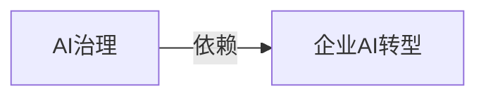

# AI治理

> **分类**：安全与治理 ｜ **英文**：AI governance ｜ **出现于 4 篇文章**

## 摘要
AI治理是为 AI 部署设定控制、审计与自主性边界的框架，它决定智能体可以做什么、做到什么程度、以及哪些产出必须经过人工确认。随着 Claude Code 等执行框架让 AI 能长时间自主运行多步骤工作流，治理从合规议题变成了能否放心把真实工作交给 AI 的前提。

## 关键做法
- 为智能体设定明确目标而非逐条提示词，同时预先划定它可自主推进的范围与必须停下来请示的节点。
- 在重要产出被依赖之前插入人工审查环节，让 AI 的高速产出与人的判断责任分离。
- 用可验证的证据支撑结论，例如安全场景中要求每个问题都附带可利用性证明与业务上下文，而非仅给出告警。
- 把治理作为转型的起点而非事后补丁：先完成利益相关方对齐与治理基础，再启动试点与推广。
- 关注模型之外的执行框架（harness），治理边界往往要在 Claude Code 这类承载自主运行的层面落地。

## 在 Claude 里的用法
在 Claude 平台上，治理体现为对自主性边界的配置：通过 Claude Code 等执行框架给智能体一个目标并让其持续工作，同时在关键产出前保留人工审查。Balyasny 的实践是智能体运行约 30 分钟后，任何重要产出在被依赖前都经过人工审查；Wiz 则把 Opus 嵌入其 Red Agent，用可利用性证明与安全图谱上下文验证每个发现。企业侧可参照零售业的做法，先做利益相关方对齐与治理，再推进试点与规模化。

## 常见误区
- 把治理等同于事后合规审查，而忽略它在设定自主性边界、决定哪些工作可交给智能体上的前置作用。
- 只评估模型本身，而不治理围绕模型的执行框架，导致长时自主运行缺乏约束。
- 追求全自动而省去人工审查，忽视高风险产出仍需人类判断兜底。

## 相关概念

- [企业AI转型](企业AI转型.md) —— AI治理是企业AI转型的前置基础，转型路径依赖先完成治理与利益相关方对齐。

## 知识图谱（Knowledge Graph）

## 来源（Sources）

| # | 文章 | 原文 |
| --- | --- | --- |
| 1 | [我们的合作伙伴如何将 Opus 用于网络安全](../docs/zh/articles/how-our-partners-are-putting-opus-to-work-for-cybersecurity.md) | [原文](https://claude.com/resources/articles/how-our-partners-are-putting-opus-to-work-for-cybersecurity) |
| 2 | [在前沿工作：Balyasny Asset Management 如何评估与治理 Claude Fable 5](../docs/zh/articles/working-at-the-frontier-how-balyasny-asset-management-evaluates-and-governs-claude-fable-5.md) | [原文](https://claude.com/resources/articles/working-at-the-frontier-how-balyasny-asset-management-evaluates-and-governs-claude-fable-5) |
| 3 | [生命科学企业 AI 转型指南](../docs/zh/guides/the-enterprise-ai-transformation-guide-for-life-sciences.md) | [原文](https://claude.com/resources/guides/the-enterprise-ai-transformation-guide-for-life-sciences) |
| 4 | [零售企业 AI 转型指南](../docs/zh/guides/the-enterprise-ai-transformation-guide-for-retail.md) | [原文](https://claude.com/resources/guides/the-enterprise-ai-transformation-guide-for-retail) |
