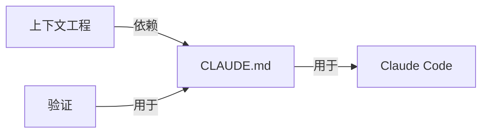

# CLAUDE.md

> **分类**：上下文工程 ｜ **英文**：CLAUDE.md ｜ **出现于 8 篇文章**

## 摘要

CLAUDE.md 是 Claude Code 在会话启动时自动加载的指令文件，用来记录项目约定、技术栈、常用命令与架构等上下文。它把原本散落在 wiki、代码注释和成员记忆中的知识固化为一个团队共享、随代码一起审查的文件，因此是上下文工程中最基础、最“始终开启”的一层。

## 关键做法

- 在仓库根目录运行 `/init` 生成起始 CLAUDE.md，然后裁剪到“新加入者第一天需要的内容”：构建、测试、lint 命令，重要约定，以及 Claude 反复搞错的事情。
- 把 CLAUDE.md 检入仓库根目录的 git，让全团队共享同一版本，改动像代码一样被审查；个人偏好可放在本地文件里。
- 遵循“第二次犯错”规则：当 Claude 第二次犯同一个错误时，把纠正写进 CLAUDE.md，让它随每次犯错迭代。
- 保持简短（一页以内），并从主文件指向其他文档；在大型代码库中尤其如此，因为每次会话开始都会加载全部内容，过时内容只会无益地占用上下文。
- 利用加载层级：根目录文件始终加载，压缩对话后会被重新读取；子目录中的 CLAUDE.md（如 `app/api/CLAUDE.md`）按需加载，只在读取该目录下文件时生效。
- 定期用 `/context` 检查 CLAUDE.md 与 MCP 工具定义在每轮中占用了多少启动上下文，删掉不属于那里的内容。

## 在 Claude 里的用法

在 Claude Code 中，CLAUDE.md 与系统提示词、消息一起组装成第一个请求，属于输入 token 的一部分，并参与提示词缓存。它常与 Skills、子智能体、钩子等其它指示方式配合：CLAUDE.md 负责始终开启的项目上下文，Skills 承载可复用流程，钩子做确定性自动化。代码审查场景中，团队还会配合 `REVIEW.md` 让审查器知道在各代码区域什么最重要，并在审查漏掉问题时把修复写回 CLAUDE.md。可用 `/doctor` 调整 skills 与 CLAUDE.md 的规模。

## 常见误区

- 把 CLAUDE.md 当成越长越好的知识库：它每次会话开始都被完整读取，过长或过时会挤占上下文。
- 只把它当作个人笔记：不检入仓库就失去了团队共享与像代码一样审查的价值。
- 指望它承担所有记忆与指导：现在还有记忆、Skills 等机制，CLAUDE.md 不应包揽一切。

## 相关概念

- [Claude Code](Claude-Code.md) —— CLAUDE.md 是 Claude Code 会话启动时加载的指令文件，二者是依赖关系。
- [上下文工程](上下文工程.md) —— CLAUDE.md 是上下文工程中“始终开启”的一层，属于其组装上下文的手段之一。
- [验证](验证.md) —— 审查器会标记违反 CLAUDE.md 约定的代码，也可在 CLAUDE.md 中列出智能体可运行的检查。

## 知识图谱（Knowledge Graph）

## 来源（Sources）

| # | 文章 | 原文 |
| --- | --- | --- |
| 1 | [Anthropic 各团队如何使用 Claude Code](../docs/zh/articles/how-anthropic-teams-use-claude-code.md) | [原文](https://claude.com/resources/articles/how-anthropic-teams-use-claude-code) |
| 2 | [最大化你的 Claude Code 会话价值](../docs/zh/articles/maximizing-the-value-of-your-claude-code-sessions.md) | [原文](https://claude.com/resources/articles/maximizing-the-value-of-your-claude-code-sessions) |
| 3 | [如何在工程组织中推广智能体式编程](../docs/zh/articles/scaling-agentic-coding.md) | [原文](https://claude.com/resources/articles/scaling-agentic-coding) |
| 4 | [Claude Code 团队如何进行代码审查](../docs/zh/articles/solving-code-review-at-anthropic.md) | [原文](https://claude.dev/blog/solving-code-review-at-anthropic/) |
| 5 | [引导 Claude Code：何时使用 CLAUDE.md、Skills、钩子（hooks）与子智能体](../docs/zh/articles/steering-claude-code-skills-hooks-rules-subagents-and-more.md) | [原文](https://claude.com/resources/articles/steering-claude-code-skills-hooks-rules-subagents-and-more) |
| 6 | [AI 原生 SDLC 实战手册](../docs/zh/articles/the-ai-native-sdlc-playbook.md) | [原文](https://claude.com/resources/articles/the-ai-native-sdlc-playbook) |
| 7 | [Claude 5 代模型的上下文工程新规则](../docs/zh/articles/the-new-rules-of-context-engineering-for-claude-5-generation-models.md) | [原文](https://claude.dev/blog/the-new-rules-of-context-engineering-for-claude-5-generation-models/) |
| 8 | [最大化 Claude Code 的价值](../docs/zh/webinars/claude-code-maximizing-value.md) | [原文](https://claude.com/resources/webinars/claude-code-maximizing-value) |
