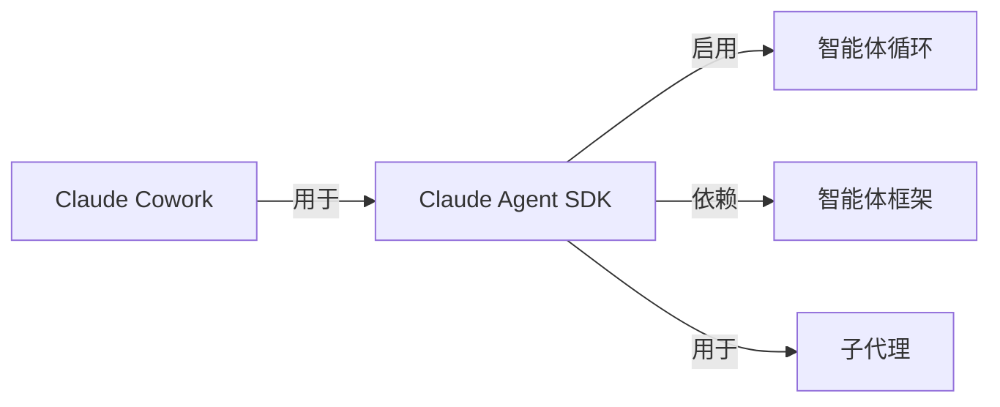

# Claude Agent SDK

> **分类**：Claude Code 与编程 ｜ **英文**：Claude Agent SDK ｜ **出现于 12 篇文章**

## 摘要

Claude Agent SDK 是 Anthropic 提供的开发工具包，让开发者能在驱动 Claude Code 的同一套执行框架（harness）之上构建自己的可编程智能体。它由 Claude Code SDK 更名而来，核心设计原则是"给智能体一台计算机"，使其能像人类一样运行命令、读写文件、搜索信息并完成各类数字化工作。它的重要性在于：团队无需自研智能体循环，就能直接复用为 Claude 调优好、并随 Claude Code 持续演进的基础设施。

## 关键做法

- 复用 Claude Code 的执行框架，而不是自己维护智能体循环：SDK 把收集上下文、调用工具、编写并运行代码、根据结果调整这一整套机制开箱提供出来。
- 遵循"给智能体一台计算机"的设计原则：赋予智能体运行 bash 命令、编辑文件、创建文件和搜索文件的能力，让它能处理 CSV、网页检索、可视化、指标解读等非编程任务。
- 用子智能体拆分复杂工作流：为不同数据类型或职责配备专门的子智能体，再由上层编排，例如 Ambral 的核心研究引擎即按数据类型配置专门子智能体。
- 以编程方式调用同一套智能体式开发框架：把 SDK 作为通用执行框架置于产品之下，在其上叠加自己的领域工作流、工具与上下文（如 Cresta Conductor 的做法）。
- 按需划分权限边界：不同智能体可运行在不同访问权限与合规环境上（如受 BAA 覆盖的组织），以隔离敏感数据的访问。

## 在 Claude 里的用法

Claude Agent SDK 是 Claude Code 执行框架的产品化开放形式，开发者可在 Claude Code 文档的 Agent SDK 章节了解接入方式，并在 Claude API、Amazon Bedrock、Microsoft Foundry 或 Google Cloud Vertex AI 等已有环境中部署。它支持无头智能体执行，适合构建生产级智能体；官方还提供商务智能体蓝图与 Claude Code 插件帮助快速上手。实践中它常与 [Claude Cowork](Claude-Cowork.md) 等产品形态配合，也支撑了 Thomson Reuters CoCounsel 等第三方工具的重建与集成。

## 常见误区

- 把它当成只面向编程任务的工具：SDK 驱动的 Claude 在非编程的数字化工作上同样高效，编程只是其能力之一。
- 以为需要自己从零搭建智能体循环：SDK 的价值恰恰在于执行框架已为 Claude 调优好并随 Claude Code 演进，无需自研维护。
- 把它与 Claude Code 割裂看待：二者共享同一套执行框架，SDK 只是把 Claude Code 的能力以编程方式开放出来。

## 相关概念

- [智能体循环](智能体循环.md) —— SDK 直接启用并封装了这一循环，开发者无需自行实现。
- [智能体框架](智能体框架.md) —— SDK 依赖并复用 Claude Code 的执行框架作为通用底座。
- [Claude Cowork](Claude-Cowork.md) —— 与 SDK 配合使用的产品形态之一。
- [子代理](子代理.md) —— 构建复杂智能体时的常用手段，SDK 支持按数据类型或职责配置专门子智能体。

## 知识图谱（Knowledge Graph）

## 来源（Sources）

| # | 文章 | 原文 |
| --- | --- | --- |
| 1 | [用 Skills 构建智能体：为智能体装备专业化工作能力](../docs/zh/articles/building-agents-with-skills-equipping-agents-for-specialized-work.md) | [原文](https://claude.com/resources/articles/building-agents-with-skills-equipping-agents-for-specialized-work) |
| 2 | [使用 Claude Agent SDK 构建智能体](../docs/zh/articles/building-agents-with-the-claude-agent-sdk.md) | [原文](https://claude.com/resources/articles/building-agents-with-the-claude-agent-sdk) |
| 3 | [三家 YC 初创公司如何用 Claude Code 打造自己的公司](../docs/zh/articles/building-companies-with-claude-code.md) | [原文](https://claude.com/resources/articles/building-companies-with-claude-code) |
| 4 | [智能体界面的演进：使用 Claude Managed Agents 构建](../docs/zh/articles/building-with-claude-managed-agents.md) | [原文](https://claude.com/resources/articles/building-with-claude-managed-agents) |
| 5 | [使用 Claude 构建商务智能体](../docs/zh/articles/claude-for-commerce-agents.md) | [原文](https://claude.com/resources/articles/claude-for-commerce-agents) |
| 6 | [面向法律行业的 Claude](../docs/zh/articles/claude-for-the-legal-industry.md) | [原文](https://claude.com/resources/articles/claude-for-the-legal-industry) |
| 7 | [Cresta 如何将 CX 专业知识转化为基于 Claude Agent SDK 的智能体构建器](../docs/zh/articles/how-cresta-turned-cx-expertise-into-an-agent-builder-on-the-claude-agent-sdk.md) | [原文](https://claude.com/resources/articles/how-cresta-turned-cx-expertise-into-an-agent-builder-on-the-claude-agent-sdk) |
| 8 | [医疗健康组织如何使用 Claude Tag](../docs/zh/articles/how-healthcare-organizations-use-claude-tag.md) | [原文](https://claude.com/resources/articles/how-healthcare-organizations-use-claude-tag) |
| 9 | [Outtake 如何在 Claude 上构建网络调查员](../docs/zh/articles/how-outtake-built-a-cyber-investigator-on-claude.md) | [原文](https://claude.com/resources/articles/how-outtake-built-a-cyber-investigator-on-claude) |
| 10 | [在前沿工作：Hebbia 如何为金融尽职调查构建不容错漏的 AI](../docs/zh/articles/working-at-the-frontier-how-hebbia-builds-ai-for-financial-diligence-that-cant-miss-a-detail.md) | [原文](https://claude.com/resources/articles/working-at-the-frontier-how-hebbia-builds-ai-for-financial-diligence-that-cant-miss-a-detail) |
