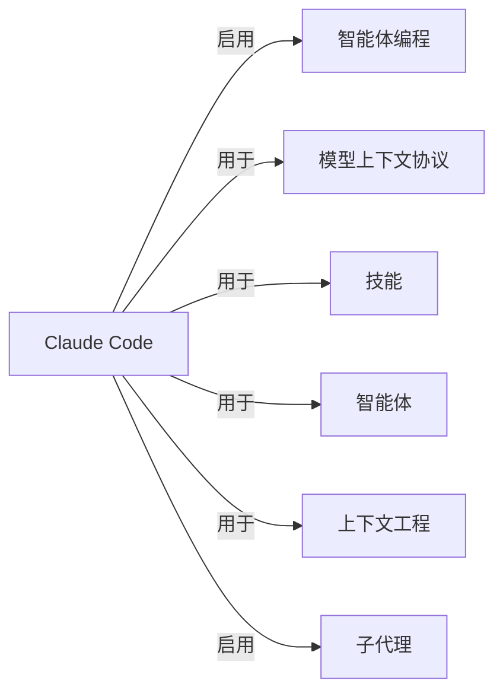

# Claude Code

> **分类**：Claude Code 与编程 ｜ **英文**：Claude Code ｜ **出现于 79 篇文章**

## 摘要

Claude Code 是 Anthropic 的智能体编程工具，面向构建和交付软件的开发者，支持多智能体并行与动态工作流。它把 Claude 模型放进一个能读写代码库、运行命令、调用工具的执行环境中，因此适合聊天无法胜任的长时间、多步骤任务。理解它的能力边界与配置方式，是让智能体编程真正落地的关键。

## 关键做法

- 在第一轮就把任务说清楚：给出意图、约束、验收标准和相关文件位置，比多轮逐步补充更省 token，质量也更稳定。把 Claude 当作可以委派任务的工程师，而不是逐行指导的结对程序员。
- 减少交互轮次：每个用户轮次都会增加推理开销，把问题批量提出，并一次性提供继续推进所需的上下文。
- 对可信任务使用自动模式：在你已提供完整上下文、且信任模型能安全执行的长时程任务中，自动模式能缩短周期时间（Claude Code Max 用户可用 Shift+Tab 开启）。
- 为长任务设置完成通知：让 Claude 在任务结束时播放声音，可通过基于钩子（hooks）的方式自行创建。
- 按任务选择执行框架：默认执行框架在同一个上下文窗口中同时规划和执行，适合多数编码任务；长时间运行、大规模并行、高度结构化或对抗性的任务，应改用动态工作流等自定义框架。
- 用 Skills 封装可复用流程：例如 `/deep-research` 会扇出网络搜索、获取来源、对抗性验证论断并综合出带引用的报告。

## 在 Claude 里的用法

Claude Code 是命令行工具，需要 npm 安装和 API 访问，专为大型代码库中的重构与修复而构建——它会探索项目文件结构、识别跨文件的视口特定问题并提出维护现有架构的修复方案。它与 Chat、Claude Cowork 运行同样的 Claude 模型，但定位不同：Chat 用于获取答案和头脑风暴，Claude Cowork 把 Claude 带到你电脑上的文件夹里完成非技术工作，而 Claude Code 面向代码中的工作。在 Claude Code 中可通过 Skills 调用引导式工作流，例如 `/claude-api build-eval` 会在特定节点暂停等待批准，`/claude-api hillclimb` 则针对给定评估迭代改进。Opus 4.7 在 Claude Code 中的默认 effort 级别为 `xhigh`，适合设计 API 和 schema、迁移遗留代码、审查大型代码库等对智能敏感的任务。

## 常见误区

- 以为默认执行框架适用于所有任务：它在长时间运行、大规模并行、高度结构化和对抗性任务中可能失效，需要动态工作流等自定义框架。
- 把提示词和上下文当成工作本身：地图（提示词、Skills、上下文）与疆域（代码库与真实约束）之间的差异就是“未知”，完成的工作越多，Claude 遇到的未知越多。
- 用逐步微调的对话方式驱动它：模糊的多轮提示词往往降低 token 效率，有时也降低整体质量。

## 相关概念

- [智能体编程](智能体编程.md) —— Claude Code 是启用智能体编程的通用编程智能体。
- [模型上下文协议](模型上下文协议.md) —— Claude Code 通过 MCP 连接外部工具与数据，MCP 已成为智能体连接的标准。
- [技能](技能.md) —— Claude Code 借助 Skills 封装并复用深度研究、评估设计等工作流。
- [子代理](子代理.md) —— Claude Code 可部署子代理并行处理任务。
- [CLAUDE.md](CLAUDE-md.md) —— Claude Code 依赖 CLAUDE.md 承载项目级上下文与约定。

## 知识图谱（Knowledge Graph）

## 来源（Sources）

| # | 文章 | 原文 |
| --- | --- | --- |
| 1 | [Claude Fable 5 实战指南：发现你的未知](../docs/zh/articles/a-field-guide-to-claude-fable-finding-your-unknowns.md) | [原文](https://claude.com/resources/articles/a-field-guide-to-claude-fable-finding-your-unknowns) |
| 2 | [为每个任务打造执行框架：Claude Code 中的动态工作流](../docs/zh/articles/a-harness-for-every-task-dynamic-workflows-in-claude-code.md) | [原文](https://claude.dev/blog/a-harness-for-every-task-dynamic-workflows-in-claude-code/) |
| 3 | [Anthropic 如何用 Claude Code 运行大规模代码迁移](../docs/zh/articles/ai-code-migration.md) | [原文](https://claude.com/resources/articles/ai-code-migration) |
| 4 | [用 Claude 自动化评估设计与爬山优化](../docs/zh/articles/automating-eval-design-and-hillclimbing.md) | [原文](https://claude.dev/blog/automating-eval-design-and-hillclimbing/) |
| 5 | [Claude Cowork 入门最佳实践](../docs/zh/articles/best-practices-for-getting-started-with-claude-cowork.md) | [原文](https://claude.com/resources/articles/best-practices-for-getting-started-with-claude-cowork) |
| 6 | [在 Claude Code 中使用 Claude Opus 4.7 的最佳实践](../docs/zh/articles/best-practices-for-using-claude-opus-4-7-with-claude-code.md) | [原文](https://claude.com/resources/articles/best-practices-for-using-claude-opus-4-7-with-claude-code) |
| 7 | [构建响应式网页布局](../docs/zh/articles/build-responsive-web-layouts.md) | [原文](https://claude.com/resources/articles/build-responsive-web-layouts) |
| 8 | [用 Skills 构建智能体：为智能体装备专业化工作能力](../docs/zh/articles/building-agents-with-skills-equipping-agents-for-specialized-work.md) | [原文](https://claude.com/resources/articles/building-agents-with-skills-equipping-agents-for-specialized-work) |
| 9 | [为医疗健康与生命科学构建 AI 智能体](../docs/zh/articles/building-ai-agents-in-healthcare-and-life-sciences.md) | [原文](https://claude.com/resources/articles/building-ai-agents-in-healthcare-and-life-sciences) |
| 10 | [三家 YC 初创公司如何用 Claude Code 打造自己的公司](../docs/zh/articles/building-companies-with-claude-code.md) | [原文](https://claude.com/resources/articles/building-companies-with-claude-code) |

## 反向链接（Backlinks）

- [Claude Fable 5](Claude-Fable-5.md)
- [Claude-Opus-5.5](Claude-Opus-5.5.md)
- [Claude 平台](Claude-平台.md)
- [上下文工程](上下文工程.md)
- [事故分诊](事故分诊.md)
- [令牌成本](令牌成本.md)
- [动态工作流](动态工作流.md)
- [努力等级](努力等级.md)
- [工作流自动化](工作流自动化.md)
- [工具搜索](工具搜索.md)
- [快速模式](快速模式.md)
- [技术债务](技术债务.md)
- [提示缓存](提示缓存.md)
- [智能体](智能体.md)
- [智能体蓝图](智能体蓝图.md)
- [模型路由](模型路由.md)
- [现场演示](现场演示.md)
- [生产部署](生产部署.md)
- [自助式数据分析](自助式数据分析.md)
- [调试](调试.md)
- [遗留系统迁移](遗留系统迁移.md)
- [金融服务](金融服务.md)
- [钩子](钩子.md)
- [长时运行智能体](长时运行智能体.md)
- [验证](验证.md)
