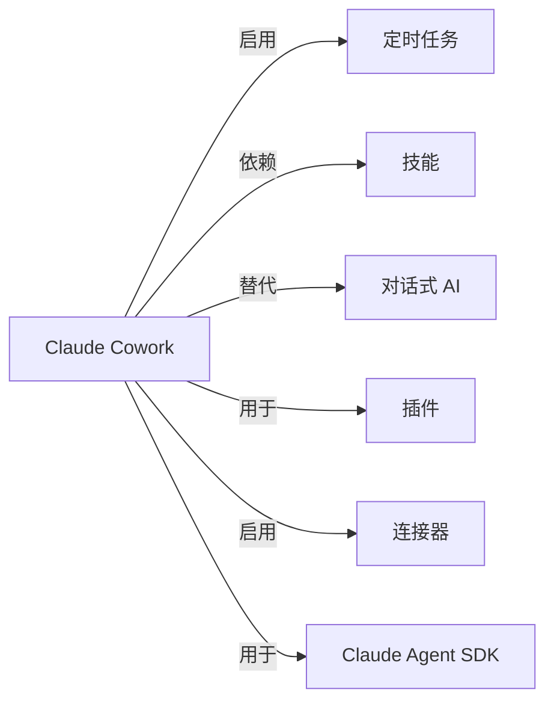

# Claude Cowork

> **分类**：产品线与功能 ｜ **英文**：Claude Cowork ｜ **出现于 23 篇文章**

## 摘要

Claude Cowork 是面向非技术知识工作者的企业级 AI 协作工作空间，让员工在不需要写代码、也不需要理解“智能体”的情况下，把邮件、演示文稿、电子表格、文档、会议等长流程工作交给 Claude 完成。它的重要性在于把原本需要 Claude Code 才能胜任的多步骤任务，带给组织中的每一个团队，而无需为每个团队单独定制开发。

## 关键做法

- 先判断任务类型：如果你的工作是非技术性的知识工作，例如整理总结、处理文档、准备会议材料，就适合放进 Claude Cowork；需要终端与代码的场景仍归 Claude Code。
- 用插件定义“工作该如何完成”：在插件中一次性写明希望 Claude 如何做事、从哪些工具和数据获取信息、开放哪些斜杠命令，团队即可获得更一致的成果。
- 通过连接器打通系统：让 Claude 能读写 CRM、知识库等业务系统，它才能在案件级、项目级工作中真正发挥作用。
- 用定时任务承接重复性工作：例如每周的监管更新扫描或收件分诊，交给定时任务自动执行。
- 以共享插件积累跨职能专长：团队构建并共享插件后，丰富上下文会融入每一次相关交互，管理者可以把时间从执行流程转向改进流程。
- 企业推广按阶段推进：可参考面向组织的六个月部署框架，把能力带给每个团队而不是逐团队定制开发。

## 在 Claude 里的用法

在 Claude 产品矩阵中，Claude Cowork 承担“跨文件与应用的案件级/项目级工作”，与用于对话和研究的 Chat、用于 Word/Excel/PowerPoint/Outlook 的 Claude for Microsoft 365、面向工程的 Claude Code 以及用于构建自定义应用的 Claude Platform 并列使用。在法律等行业，Cowork 中可直接使用连接器与插件对一批合同进行分诊、为产品发布做清关、为董事会起草监管说明。它依赖 MCP 完成编排与外部调用，桌面应用则负责本地文件访问、浏览器使用和计算机使用。从安全视角看，Cowork 处于“人类凭证”一端：键盘前的员工对结果负责，智能体代表其在授权系统中行动。

## 常见误区

- 误以为需要懂技术才能用：Cowork 面向非技术知识工作者，不需要会写代码，也不需要知道什么是“智能体”。
- 误以为它替代 Claude Code：两者分工不同，Cowork 承接非技术知识工作，Claude Code 面向量化、工程等需要代码与终端的场景。
- 误以为装上就能见效：价值取决于在 Claude 周围搭建了什么——能读写哪些系统、是否有承担复杂工作所需的访问权限与控制手段。

## 相关概念

- [定时任务](定时任务.md) —— 定时任务在 Cowork 中自动化周度扫描、收件分诊等重复工作。
- [技能](技能.md) —— Cowork 可启用技能，把最佳实践固化为可复用的工作方式。
- [对话式 AI](对话式-AI.md) —— 替代「对话式 AI」
- [插件](插件.md) —— 插件用于在 Cowork 中定义工作流程、数据来源与斜杠命令。
- [连接器](连接器.md) —— 连接器让 Cowork 接入 CRM、知识库等系统，是跨文件工作的前提。
- [Claude Agent SDK](Claude-Agent-SDK.md) —— 用于「Claude Agent SDK」
- [内部试用](内部试用.md) —— 被「内部试用」使用

## 知识图谱（Knowledge Graph）

## 来源（Sources）

| # | 文章 | 原文 |
| --- | --- | --- |
| 1 | [Claude Cowork 入门最佳实践](../docs/zh/articles/best-practices-for-getting-started-with-claude-cowork.md) | [原文](https://claude.com/resources/articles/best-practices-for-getting-started-with-claude-cowork) |
| 2 | [为企业构建 AI 智能体](../docs/zh/articles/building-ai-agents-for-the-enterprise.md) | [原文](https://claude.com/resources/articles/building-ai-agents-for-the-enterprise) |
| 3 | [构建 AI 原生收入组织](../docs/zh/articles/building-an-ai-native-revenue-organization.md) | [原文](https://claude.com/resources/articles/building-an-ai-native-revenue-organization) |
| 4 | [零风险不是目标：CISO 的智能体式 AI 指南](../docs/zh/articles/ciso-guide-to-agentic-ai.md) | [原文](https://claude.com/resources/articles/ciso-guide-to-agentic-ai) |
| 5 | [面向法律行业的 Claude](../docs/zh/articles/claude-for-the-legal-industry.md) | [原文](https://claude.com/resources/articles/claude-for-the-legal-industry) |
| 6 | [用插件定制 Cowork](../docs/zh/articles/cowork-plugins.md) | [原文](https://claude.com/resources/articles/cowork-plugins) |
| 7 | [在金融服务领域部署 Claude](../docs/zh/articles/deploying-claude-across-financial-services.md) | [原文](https://claude.com/resources/articles/deploying-claude-across-financial-services) |
| 8 | [在法律行业部署 Claude](../docs/zh/articles/deploying-claude-across-the-legal-industry.md) | [原文](https://claude.com/resources/articles/deploying-claude-across-the-legal-industry) |
| 9 | [Anthropic 的一位销售负责人如何用 Claude Cowork 管理 4,000 个客户账户](../docs/zh/articles/how-an-anthropic-sales-leader-uses-claude-cowork-to-run-a-4-000-account-book.md) | [原文](https://claude.com/resources/articles/how-an-anthropic-sales-leader-uses-claude-cowork-to-run-a-4-000-account-book) |
| 10 | [一位 Anthropic 销售人员如何用 Claude Code 重建团队工作流](../docs/zh/articles/how-anthropic-uses-claude-gtm-engineering.md) | [原文](https://claude.com/resources/articles/how-anthropic-uses-claude-gtm-engineering) |

## 反向链接（Backlinks）

- [Claude Agent SDK](Claude-Agent-SDK.md)
- [Claude Fable 5](Claude-Fable-5.md)
- [内部试用](内部试用.md)
- [对话式 AI](对话式-AI.md)
- [智能体](智能体.md)
- [智能体工作流](智能体工作流.md)
- [最佳实践](最佳实践.md)
- [研究预览](研究预览.md)
- [长时运行智能体](长时运行智能体.md)
