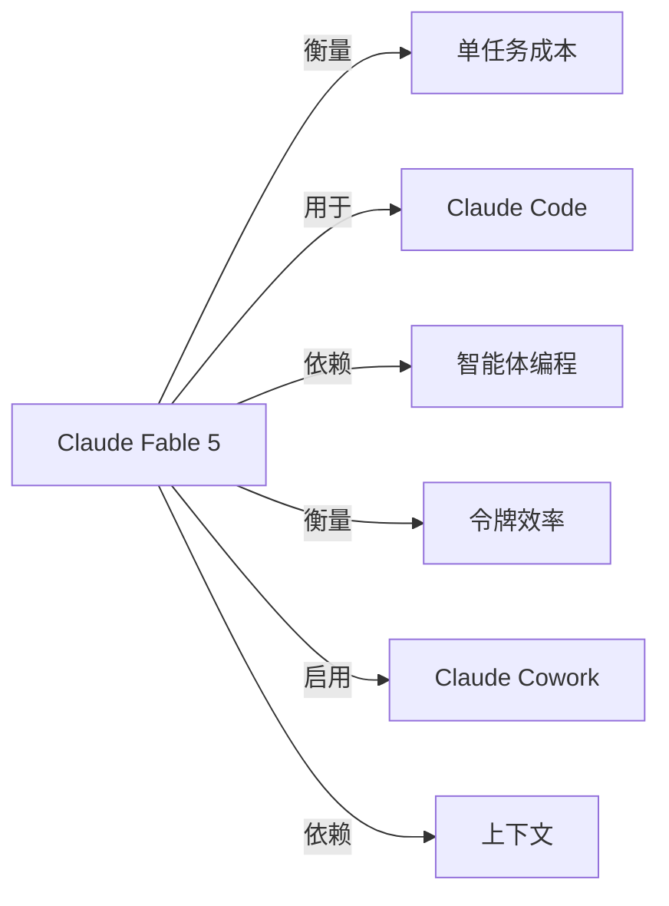

# Claude Fable 5

> **分类**：模型与能力 ｜ **英文**：Claude Fable 5 ｜ **出现于 7 篇文章**

## 摘要

Claude Fable 5 是面向高难度推理与长程任务的前沿模型，其核心价值在于能在无人监督的情况下长时间自主运行，并在运行过程中自我反思、纠正早期的错误假设。它之所以重要，是因为它把智能体从"需要逐步照看"推进到"可以委派决策"：用户可以把一个复杂问题交出去，而不是反复重申目标、审查每一步。

## 关键做法

- 把工作单元从"任务"升级为"决策"：明确说明情况与"什么样的最终结果算得上出色"，然后让模型自主执行，减少对每一步的检查。
- 提供充分的上下文、偏好与 Skills，让模型在整个任务周期内贯穿应用，即便任务需要数天完成。
- 在长程任务中允许模型在每一步进行反思并自我纠正，而不是在第一次选错方向后烧掉整个运行轮次。
- 用私有代码库与真实任务做评估，而非只看公开基准分数；同时关注单任务成本，而不只是每 token 价格。
- 让智能体在运行轮次之间携带记忆，记住过去会话中出过什么问题并避免重复。
- 对高难度工作（如重建系统提示词、复杂重构）直接委派给模型，并借助已有的 A/B 测试等基础设施快速衡量与上线结果。

## 在 Claude 里的用法

在 Claude Cowork 中，Claude Fable 5 会把你的上下文、偏好和 Skills 贯穿应用于整个任务，协作方式更像与一位能力极强的同事共事：你说明情况、就成功标准达成一致，然后让它去干活。配合 Claude Code 与智能体编程场景，它可承担长时间的重构与调试；官方还提供了 Claude Fable 5 提示指南，列出能力改进清单与推荐的行为、提示方式调整。要最大化发挥其能力，提示词最佳实践、提供上下文与构建 Skills 依然重要，而且有了这些做法模型表现会更好。

## 常见误区

- 只看每 token 价格就判断成本高低：Claude Fable 5 单价更高，但对复杂、长时程工作，其单任务成本可能更低。
- 认为基准测试高分等于真实可用：有些模型针对公开基准调优，得分高却在真实任务上表现不佳，需用私有代码库核验。
- 以为长程自主运行仍需全程盯守：它的价值恰恰在于中途自我纠正，使签核（sign-off）第一次变得可行。

## 相关概念

- [单任务成本](单任务成本.md) —— 衡量 Claude Fable 5 经济性的关键指标，复杂长时程工作中可能低于前代模型。
- [Claude Code](Claude-Code.md) —— Claude Fable 5 用于智能体编程与工程任务的载体之一。
- [智能体编程](智能体编程.md) —— 依赖 Claude Fable 5 的长程自主与自我纠错能力。
- [令牌效率](令牌效率.md) —— 衡量其效率的维度，达到解决方案所需步骤更少。
- [Claude Cowork](Claude-Cowork.md) —— 启用 Claude Fable 5 的知识工作智能体式系统，贯穿应用上下文与 Skills。

## 知识图谱（Knowledge Graph）

## 来源（Sources）

| # | 文章 | 原文 |
| --- | --- | --- |
| 1 | [Claude Fable 5 实战指南：发现你的未知](../docs/zh/articles/a-field-guide-to-claude-fable-finding-your-unknowns.md) | [原文](https://claude.com/resources/articles/a-field-guide-to-claude-fable-finding-your-unknowns) |
| 2 | [守护前沿：JetBrains 如何评估与部署 Claude Fable 5](../docs/zh/articles/how-jetbrains-evaluates-and-deploys-claude-fable-5.md) | [原文](https://claude.com/resources/articles/how-jetbrains-evaluates-and-deploys-claude-fable-5) |
| 3 | [在前沿工作：Cursor 如何判断 Claude Fable 5 已准备好应对最难的 1% 问题](../docs/zh/articles/working-at-the-frontier-cursor.md) | [原文](https://claude.com/resources/articles/working-at-the-frontier-cursor) |
| 4 | [在前沿工作：Cognition 如何信任 Claude Fable 5 通宵工作](../docs/zh/articles/working-at-the-frontier-how-cognition-trusts-claude-fable-5-to-work-through-the-night.md) | [原文](https://claude.com/resources/articles/working-at-the-frontier-how-cognition-trusts-claude-fable-5-to-work-through-the-night) |
| 5 | [在前沿工作：Rakuten 如何借助 Claude Fable 5 在一夜之间构建智能体](../docs/zh/articles/working-at-the-frontier-rakuten.md) | [原文](https://claude.com/resources/articles/working-at-the-frontier-rakuten) |
| 6 | [在前沿工作：Base44 为何将最具挑战性的工程工作托付给 Claude Fable 5](../docs/zh/articles/working-at-the-frontier-why-base44-trusts-claude-fable-5-with-their-most-challenging-engineering-work.md) | [原文](https://claude.com/resources/articles/working-at-the-frontier-why-base44-trusts-claude-fable-5-with-their-most-challenging-engineering-work) |
| 7 | [在 Claude Cowork 中使用 Claude Fable 5](../docs/zh/articles/working-with-claude-fable-5-in-claude-cowork.md) | [原文](https://claude.com/resources/articles/working-with-claude-fable-5-in-claude-cowork) |

## 反向链接（Backlinks）

- [上下文](上下文.md)
- [任务委派](任务委派.md)
- [分类器](分类器.md)
