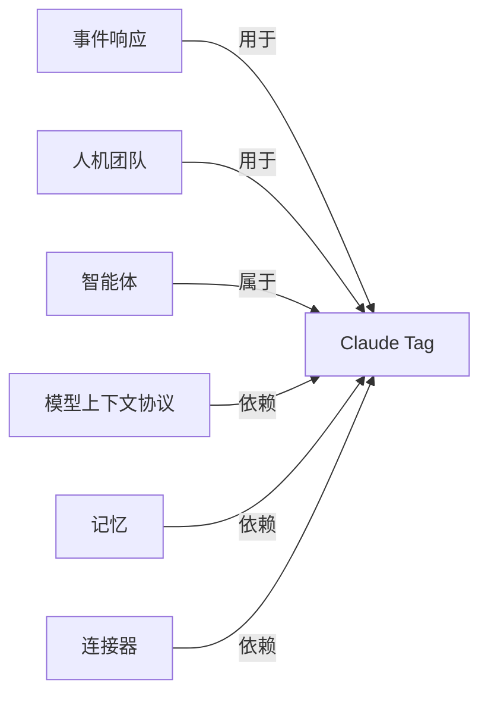

# Claude Tag

> **分类**：产品线与功能 ｜ **英文**：Claude Tag ｜ **出现于 10 篇文章**

## 摘要

Claude Tag 是 Claude 面向多人协作场景的常驻智能体形态：它以独立身份加入 Slack 等共享频道，拥有自己的记忆与工具访问权限，团队成员像 @ 同事一样 @ 它即可派活。它之所以重要，是因为它把 AI 从"一个人对一个助手"的私人体验，变成"一个智能体与整个团队同处一个工作空间"的协作模式，并由此引出全新的智能体身份与权限模型。

## 关键做法

- 先把 Claude 加入承载上下文的共享频道（如值班频道、项目频道），再在频道内 @Claude 提出请求，它会在该话题串中处理并发布进度清单。
- 由管理员一次性为该频道配置工具与连接器（如 Datadog、Grafana、GitHub、数据仓库），并采用按频道限定的连接器范围与访问捆绑包，避免敏感系统被触及。
- 用自然语言在频道里设定例程，例如"每周一美国东部时间上午 9:00 运行 CI 交接"，让 Claude 定期自主执行。
- 让 Claude 使用自己的工作区服务账号与独立应用身份行事（以 Claude 应用身份发帖、以 Claude GitHub App 身份发起 PR），而不是借用某个人的权限。
- 把超出常规流程的事项交给 Claude Tag 兜底：智能体或人把请求转给它，由它在后台完成并回报结果。
- 保留人工审查关卡：变更在落地前由人审批，人类注意力转向指导意图与查看仪表板。

## 在 Claude 里的用法

在 Claude Tag（beta）中，Claude 作为 Slack 工作区成员存在，可被加入频道、被 @ 提及，并在频道内保存记忆、调用已授权的连接器与工具。管理员通过管理端设置决定它在哪些频道可用、能连接哪些工具，并可默认关闭、仅在获批频道启用、禁用私信。它与 Claude Code、Managed Agents 等配合：后者处理常规自动化流程，Claude Tag 接手例外事项与事件响应。

## 常见误区

- 误以为 Claude Tag 代表某个具体用户行事。实际上它在每个系统中都有自己的账户与身份，权限由管理员独立于参与的人类来定义。
- 误以为它能读取整个 Slack。它只能看到工作区成员可见的内容，无法访问未被邀请加入的私有频道。
- 误以为可以无条件用于所有场景。例如它目前尚未纳入商业伙伴协议（BAA）覆盖范围，涉及受保护健康信息的频道需谨慎规避。

## 相关概念

- [事件响应](事件响应.md) —— 它是 Anthropic 值班场景的第一响应者，常用于 CI/CD 故障等事件处理。
- [人机团队](人机团队.md) —— 它是把 Claude 作为队友引入共享空间、供人机共同协作的载体。
- [智能体](智能体.md) —— Claude Tag 属于常驻型智能体，具备自主安排后续任务与响应事件的能力。
- [模型上下文协议](模型上下文协议.md) —— 被「模型上下文协议」依赖
- [记忆](记忆.md) —— 它在频道中保存记忆，从而持续掌握团队上下文。
- [连接器](连接器.md) —— 它依赖管理员配置的连接器访问外部系统，且连接器范围可按频道限定。

## 知识图谱（Knowledge Graph）

## 来源（Sources）

| # | 文章 | 原文 |
| --- | --- | --- |
| 1 | [Claude Tag 中的智能体身份：面向自主、团队级 AI 的全新访问模型](../docs/zh/articles/agent-identity-access-model.md) | [原文](https://claude.com/resources/articles/agent-identity-access-model) |
| 2 | [Claude 值班：Claude Tag 如何成为 Anthropic 应对 CI/CD 故障的第一响应者](../docs/zh/articles/ai-ci-cd-on-call.md) | [原文](https://claude.com/resources/articles/ai-ci-cd-on-call) |
| 3 | [零风险不是目标：CISO 的智能体式 AI 指南](../docs/zh/articles/ciso-guide-to-agentic-ai.md) | [原文](https://claude.com/resources/articles/ciso-guide-to-agentic-ai) |
| 4 | [面向初创企业的 Claude Tag 指南](../docs/zh/articles/claude-tag-guide-for-startups.md) | [原文](https://claude.com/resources/articles/claude-tag-guide-for-startups) |
| 5 | [Anthropic 日本的一位 BDR 如何用 Claude Managed Agents 度过一天](../docs/zh/articles/how-an-anthropic-japan-business-development-representative-runs-his-day.md) | [原文](https://claude.com/resources/articles/how-an-anthropic-japan-business-development-representative-runs-his-day) |
| 6 | [Anthropic 员工如何使用 Claude Tag](../docs/zh/articles/how-anthropic-employees-use-claude-tag.md) | [原文](https://claude.com/resources/articles/how-anthropic-employees-use-claude-tag) |
| 7 | [Anthropic 如何保障其 AI 原生软件开发生命周期的安全](../docs/zh/articles/how-anthropic-secures-its-ai-native-software-development-lifecycle.md) | [原文](https://claude.com/resources/articles/how-anthropic-secures-its-ai-native-software-development-lifecycle) |
| 8 | [医疗健康组织如何使用 Claude Tag](../docs/zh/articles/how-healthcare-organizations-use-claude-tag.md) | [原文](https://claude.com/resources/articles/how-healthcare-organizations-use-claude-tag) |
| 9 | [我们如何在两周内让 claude.ai 提速 3 倍](../docs/zh/articles/how-we-made-claude-ai-faster.md) | [原文](https://claude.dev/blog/how-we-made-claude-ai-faster/) |
| 10 | [Slack 中的自助式数据分析：Anthropic 如何部署 Claude Tag 应对临时性问题](../docs/zh/articles/self-service-data-analytics-in-slack-how-anthropic-deploys-claude-tag-for-ad-hoc-questions.md) | [原文](https://claude.com/resources/articles/self-service-data-analytics-in-slack-how-anthropic-deploys-claude-tag-for-ad-hoc-questions) |

## 反向链接（Backlinks）

- [受保护健康信息](受保护健康信息.md)
- [爬山优化](爬山优化.md)
- [自助式数据分析](自助式数据分析.md)
