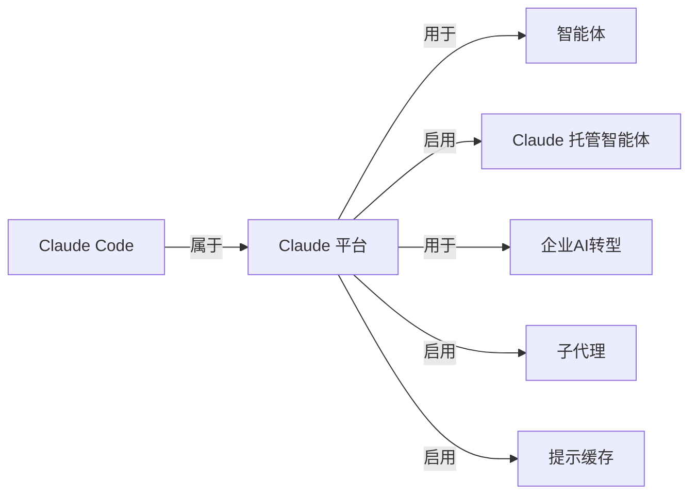

# Claude 平台

> **分类**：产品线与功能 ｜ **英文**：Claude Platform ｜ **出现于 26 篇文章**

## 摘要

Claude 平台（Claude Platform）是 Anthropic 提供的开发平台，用于构建和部署自定义应用与智能体。它区别于面向终端用户的对话产品，是企业在 Claude 之上做定制化开发的入口，因此在多产品并行的部署策略中承担"构建层"的角色。

## 关键做法

- 把平台定位为"构建与部署"层：当现成产品（对话、文档协作、代码）无法覆盖业务场景时，才在 Claude Platform 上构建定制应用与智能体。
- 与现成产品组合使用：金融服务与法律行业的部署实践显示，多数团队同时运行多款 Claude 产品，平台负责定制应用，其余产品负责日常对话、跨文件工作与办公套件内的工作。
- 从预构建参考架构起步：官方已发布面向行业的预构建智能体模板与参考架构，可先复用再改造，减少从零设计的工作量。
- 按阶段推进落地：采用"基础—试点—规模化"的三阶段实战手册，先把基础能力打通，再选小范围场景试点，最后规模化推广。
- 用智能体承接长时、上下文繁重的任务：平台上的智能体可自主处理业务流程，人类在环监督，从而释放重复性工作占用的时间。

## 在 Claude 里的用法

在 Claude 产品矩阵中，Claude Platform 与 Claude Managed Agents 一起，用于构建和部署自定义应用与智能体；前者提供开发能力，后者提供托管运行。与之并列的是用于对话与研究的 Claude、用于跨文件与应用项目级工作的 Claude Cowork、面向工程团队的 Claude Code，以及 Claude for Microsoft 365。团队通常按任务类型在这些产品之间分工，把定制化需求收敛到平台上实现。

## 常见误区

- 把 Claude 平台等同于对话产品：它面向构建与部署自定义应用和智能体，而不是日常问答入口。
- 认为一个产品就能覆盖全部场景：行业部署资料反复指出，多数公司同时运行不止一个 Claude 产品。
- 跳过试点直接规模化：官方给出的路径是先打基础、再试点、最后规模化，省略中间环节会放大落地风险。

## 相关概念

- [智能体](智能体.md) —— 平台的核心构建对象，用于承载自主业务流程。
- [Claude Code](Claude-Code.md) —— 同属 Claude 产品线，面向工程与量化团队。
- [Claude 托管智能体](Claude-托管智能体.md) —— 与平台配套，负责智能体的托管运行。
- [企业AI转型](企业AI转型.md) —— 用于「企业AI转型」
- [子代理](子代理.md) —— 启用「子代理」
- [提示缓存](提示缓存.md) —— 启用「提示缓存」
- [商务智能体](商务智能体.md) —— 用于「商务智能体」

## 知识图谱（Knowledge Graph）

## 来源（Sources）

| # | 文章 | 原文 |
| --- | --- | --- |
| 1 | [构建响应式网页布局](../docs/zh/articles/build-responsive-web-layouts.md) | [原文](https://claude.com/resources/articles/build-responsive-web-layouts) |
| 2 | [为初创公司构建 AI 智能体](../docs/zh/articles/building-ai-agents-for-startups.md) | [原文](https://claude.com/resources/articles/building-ai-agents-for-startups) |
| 3 | [为金融服务构建 AI 智能体](../docs/zh/articles/building-ai-agents-in-financial-services.md) | [原文](https://claude.com/resources/articles/building-ai-agents-in-financial-services) |
| 4 | [Carta Healthcare 如何让 AI 像临床数据提取员一样推理](../docs/zh/articles/carta-healthcare-clinical-abstractor.md) | [原文](https://claude.com/resources/articles/carta-healthcare-clinical-abstractor) |
| 5 | [在金融服务领域部署 Claude](../docs/zh/articles/deploying-claude-across-financial-services.md) | [原文](https://claude.com/resources/articles/deploying-claude-across-financial-services) |
| 6 | [在法律行业部署 Claude](../docs/zh/articles/deploying-claude-across-the-legal-industry.md) | [原文](https://claude.com/resources/articles/deploying-claude-across-the-legal-industry) |
| 7 | [用 Claude 更快修复软件缺陷](../docs/zh/articles/fix-software-bugs-faster-with-claude.md) | [原文](https://claude.com/resources/articles/fix-software-bugs-faster-with-claude) |
| 8 | [Anthropic 法务团队如何借助 Claude 将审查时间从数天缩短至数小时](../docs/zh/articles/how-anthropic-uses-claude-legal.md) | [原文](https://claude.com/resources/articles/how-anthropic-uses-claude-legal) |
| 9 | [Curative 如何借助 Claude 上的智能体构建全国医疗服务提供方网络](../docs/zh/articles/how-curative-is-building-a-national-provider-network-with-agents-on-claude.md) | [原文](https://claude.com/resources/articles/how-curative-is-building-a-national-provider-network-with-agents-on-claude) |
| 10 | [Kepler 如何借助 Claude 为金融服务构建可验证的 AI](../docs/zh/articles/how-kepler-built-verifiable-ai-for-financial-services-with-claude.md) | [原文](https://claude.com/resources/articles/how-kepler-built-verifiable-ai-for-financial-services-with-claude) |

## 反向链接（Backlinks）

- [企业AI转型](企业AI转型.md)
- [商务智能体](商务智能体.md)
- [工作流自动化](工作流自动化.md)
- [提示缓存](提示缓存.md)
