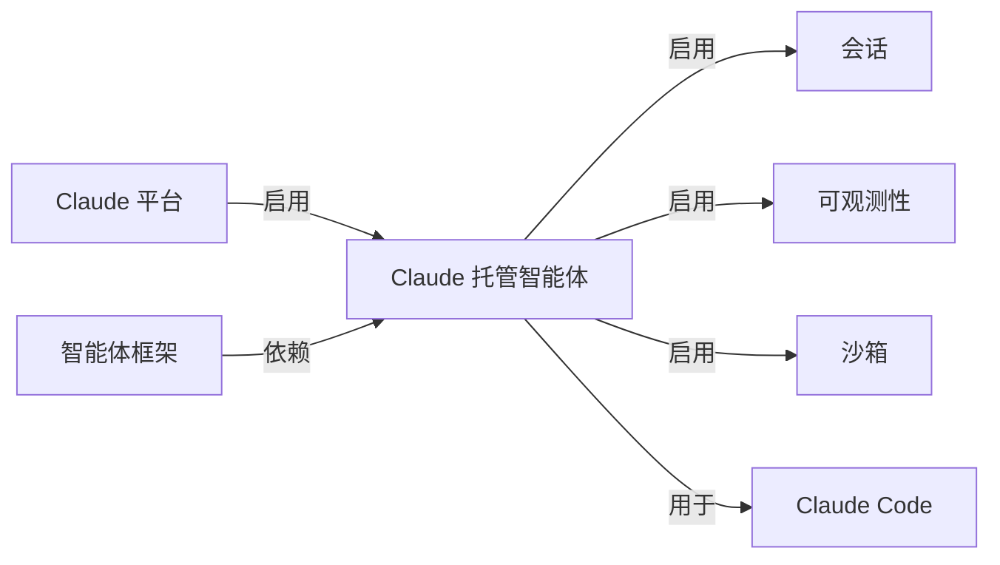

# Claude 托管智能体

> **分类**：产品线与功能 ｜ **英文**：Claude Managed Agents ｜ **出现于 7 篇文章**

## 摘要

Claude 托管智能体（Claude Managed Agents）是 Claude 平台提供的一套可组合 API，把为性能调优的智能体执行框架与生产基础设施配对，提供运行时、会话与记忆管理等托管能力。它解决的是智能体从原型走向生产时最耗时的部分——安全、状态管理、权限控制与执行框架调优，让团队能在几天而非几个月内上线。对任何要把智能体真正投入生产的企业来说，它是原型与生产级智能体之间的分水岭。

## 关键做法

- 把基础设施交给托管层：智能体需要有地方运行它写出的代码、需要凭据访问数据、需要可观测的会话和可随用量扩展的基础设施，这些由 Claude Managed Agents 统一提供，团队不必自建执行框架。
- 用可组合 API 按需拼装能力：按业务需要组合运行时、会话与记忆管理等组件，而不是从零搭建整套智能体系统。
- 从原型阶段就按生产标准设计：在开发早期就考虑权限控制、状态管理与安全边界，避免开发周期被这些工程问题消耗。
- 让智能体常驻并版本管理：把智能体当作可版本管理、可观测、常驻运行的服务来运营，而不是一次性脚本。
- 面向全员推广构建能力：在统一平台上让各业务部门自行构建自动化流程，再由工程团队将其升级为可观测的常驻智能体集群。

## 在 Claude 里的用法

在 Claude 平台（Claude Platform）上，团队通过 Claude Managed Agents 的 API 构建和部署自定义智能体，并与 Claude Code 等产品配合使用：工程团队用 Claude Code 交付软件，再把面向各业务职能的定制智能体跑在托管智能体上。实际案例中，Anthropic 销售团队在 Claude Managed Agents（beta）上构建了购买智能体，每天进行数千次对话并引导客户完成结账；Rakuten 也在 Claude Code 之外，为公司各团队构建定制的 Claude Managed Agents。金融服务等行业的部署指南把 Claude Platform 与 Claude Managed Agents 列为构建和部署自定义应用与智能体的产品线。

## 常见误区

- 以为有好提示词就能上生产：投入生产还需要运行环境、数据凭据、可观测会话与可扩展基础设施，提示词只是其中一环。
- 把托管智能体当成一次性脚本：它面向的是可版本管理、可观测、常驻运行的智能体，而非临时任务。
- 在自建执行框架上重复消耗开发周期：安全、状态管理与权限控制等通用问题可交由托管层处理，团队应聚焦业务逻辑。

## 相关概念

- [Claude 平台](Claude-平台.md) —— 托管智能体是 Claude 平台上构建与部署自定义智能体的产品线之一。
- [会话](会话.md) —— 托管服务提供可观测的会话管理，是智能体上生产的关键能力之一。
- [可观测性](可观测性.md) —— 常驻智能体需要可观测的会话与运行状态，才能被运营和排障。
- [沙箱](沙箱.md) —— 智能体需要有安全的地方运行它写出的代码，沙箱由此被启用。
- [Claude Code](Claude-Code.md) —— 用于「Claude Code」
- [智能体框架](智能体框架.md) —— 托管智能体依赖为性能调优的智能体执行框架，并将其与生产基础设施配对。

## 知识图谱（Knowledge Graph）

## 来源（Sources）

| # | 文章 | 原文 |
| --- | --- | --- |
| 1 | [智能体界面的演进：使用 Claude Managed Agents 构建](../docs/zh/articles/building-with-claude-managed-agents.md) | [原文](https://claude.com/resources/articles/building-with-claude-managed-agents) |
| 2 | [在金融服务领域部署 Claude](../docs/zh/articles/deploying-claude-across-financial-services.md) | [原文](https://claude.com/resources/articles/deploying-claude-across-financial-services) |
| 3 | [ABC Legal 如何借助 Claude Managed Agents 让每位员工都成为构建者](../docs/zh/articles/how-abc-legal-turned-every-employee-into-a-builder-with-claude-managed-agents.md) | [原文](https://claude.com/resources/articles/how-abc-legal-turned-every-employee-into-a-builder-with-claude-managed-agents) |
| 4 | [Anthropic 的销售团队如何用 Claude Managed Agents 重建入站流程](../docs/zh/articles/how-anthropics-sales-team-rebuilt-inbound-with-claude-managed-agents.md) | [原文](https://claude.com/resources/articles/how-anthropics-sales-team-rebuilt-inbound-with-claude-managed-agents) |
| 5 | [Datadog 如何为 Claude Code 打造“通用机床”](../docs/zh/articles/how-datadog-built-a-universal-machine-tool-for-claude-code.md) | [原文](https://claude.com/resources/articles/how-datadog-built-a-universal-machine-tool-for-claude-code) |
| 6 | [monday.com 如何将其平台转型为人类与智能体协作的智能体优先产品](../docs/zh/articles/how-monday-com-transformed-its-platform-into-an-agent-first-product-where-humans-and-agents-collaborate.md) | [原文](https://claude.com/resources/articles/how-monday-com-transformed-its-platform-into-an-agent-first-product-where-humans-and-agents-collaborate) |
| 7 | [在前沿工作：Rakuten 如何借助 Claude Fable 5 在一夜之间构建智能体](../docs/zh/articles/working-at-the-frontier-rakuten.md) | [原文](https://claude.com/resources/articles/working-at-the-frontier-rakuten) |
