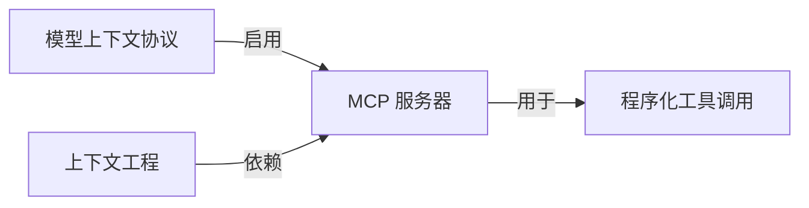

# MCP 服务器

> **分类**：工具与扩展 ｜ **英文**：MCP Server ｜ **出现于 7 篇文章**

## 摘要

MCP 服务器是实现模型上下文协议（MCP）的服务端，负责把外部系统、工具和数据以标准化方式暴露给 Claude 等 AI 助手。它解决的是“连接性”问题：在 MCP 之前，每个应用和数据库都需要单独写集成代码，而 MCP 服务器提供统一的接入格式，让智能体能够可靠地触达生产系统。Anthropic 的连接器目录中已有 200 多个 MCP 服务器，每天有数百万人使用。

## 关键做法

- 围绕意图组织工具，而不是一对一镜像 API。一个 `create_issue_from_thread` 工具胜过 `get_thread` + `parse_messages` + `create_issue` + `link_attachment` 这样的原语拼接。
- 宁可少而描述良好，也不要穷举式暴露。更少但描述清晰的工具，始终优于对 API 的完整镜像，能让智能体用几次调用完成任务。
- 面对数百种操作的大型服务（如 Cloudflare、AWS、Kubernetes），改为暴露一个接受代码的薄工具面：智能体写一段简短脚本，服务器在沙箱中针对 API 运行并只返回结果。Cloudflare 的 MCP 服务器用 search 和 execute 两个工具、约 1K token 覆盖约 2,500 个端点。
- 把结构化搜索等能力封装成 Claude 可直接调用的工具，而不是让模型自行拼接底层调用。
- 控制启动上下文成本：用 `/context` 查看 CLAUDE.md 和 MCP 服务器在每一轮中增加了什么，删掉不属于那里的内容。

## 在 Claude 里的用法

在 Claude Code 中，MCP 服务器是五个扩展点之一（与 CLAUDE.md、钩子、Skills、插件并列），用于连接原本无法触及的内部工具、数据源和 API，成熟团队常把结构化搜索作为 MCP 工具暴露出来。在 Claude 应用侧，MCP 服务器通过连接器目录接入，例如 Asana 的 MCP 服务器让 Claude 能读取其数据并直接回答项目进展问题。MCP 与 Skills 分工明确：MCP 负责安全、标准化的连接性，Skills 提供“连上之后该做什么”的上下文，二者可组合——单个 Skill 可编排多个 MCP 服务器，单个服务器也可支撑数十个 Skill。

## 常见误区

- 把 MCP 服务器当成 API 的逐条包装。一对一镜像 API 会让智能体被迫拼接大量原语，降低可靠性。
- 认为接入即完成。连接只提供访问权限，若缺少 Skill 层面的指导，Claude 未必知道获得访问后该做什么。
- 忽视上下文开销。MCP 服务器会持续占用每一轮的启动上下文，不清理会为用不到的内容付费。

## 相关概念

- [模型上下文协议](模型上下文协议.md) —— MCP 服务器是该协议的服务端实现，属于其生态的一部分。
- [上下文工程](上下文工程.md) —— MCP 服务器注入的工具定义构成上下文的一部分，需要按上下文工程原则管理。
- [程序化工具调用](程序化工具调用.md) —— 大型服务可通过暴露接受代码的薄工具面，让智能体以程序化方式调用。

## 知识图谱（Knowledge Graph）

## 来源（Sources）

| # | 文章 | 原文 |
| --- | --- | --- |
| 1 | [你可以指导的智能体：Asana 如何用 Claude 构建人机团队](../docs/zh/articles/agents-you-can-coach-how-asana-builds-human-agent-teams-with-claude.md) | [原文](https://claude.com/resources/articles/agents-you-can-coach-how-asana-builds-human-agent-teams-with-claude) |
| 2 | [用 MCP 构建触达生产系统的智能体](../docs/zh/articles/building-agents-that-reach-production-systems-with-mcp.md) | [原文](https://claude.com/resources/articles/building-agents-that-reach-production-systems-with-mcp) |
| 3 | [通过 Skills 和 MCP 服务器扩展 Claude 的能力](../docs/zh/articles/extending-claude-capabilities-with-skills-mcp-servers.md) | [原文](https://claude.com/resources/articles/extending-claude-capabilities-with-skills-mcp-servers) |
| 4 | [Claude Code 在大型代码库中如何运作：最佳实践与入门指南](../docs/zh/articles/how-claude-code-works-in-large-codebases-best-practices-and-where-to-start.md) | [原文](https://claude.com/resources/articles/how-claude-code-works-in-large-codebases-best-practices-and-where-to-start) |
| 5 | [什么是 Model Context Protocol？将 AI 连接到你的世界](../docs/zh/articles/what-is-model-context-protocol.md) | [原文](https://claude.com/resources/articles/what-is-model-context-protocol) |
| 6 | [最大化 Claude Code 的价值](../docs/zh/webinars/claude-code-maximizing-value.md) | [原文](https://claude.com/resources/webinars/claude-code-maximizing-value) |
| 7 | [在 VS Code 和 Claude 中用 MCP 构建 AI 编程的未来](../docs/zh/webinars/future-of-ai-coding-mcp-vs-code.md) | [原文](https://claude.com/resources/webinars/future-of-ai-coding-mcp-vs-code) |
