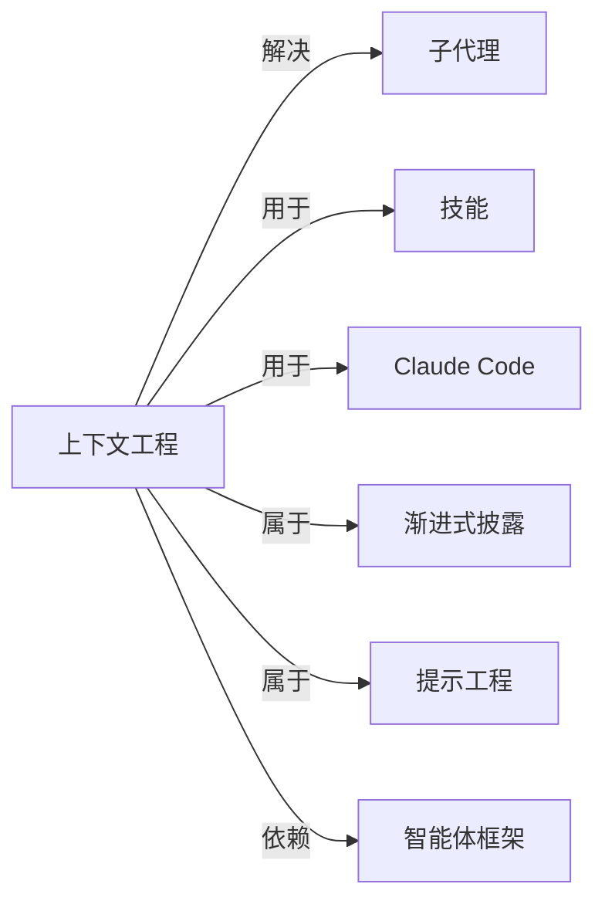

# 上下文工程

> **分类**：上下文工程 ｜ **英文**：Context Engineering ｜ **出现于 24 篇文章**

## 摘要

上下文工程（Context Engineering）是系统化设计与管理模型上下文以提升输出质量的实践：决定向模型提供什么信息、排除什么信息、以什么顺序呈现。它之所以重要，是因为智能体的表现并不完全由模型决定，而是由提供给模型的信息决定——世界上最好的提示词，如果被喂入不完整、无序或范围界定不当的信息，也会表现不佳。随着 Claude 5 代模型的发展，提示工程正与上下文工程趋于融合：更少的脚手架，更多的内容策展。

## 关键做法

- 把上下文当作需要策展的内容而非堆砌的输入：明确包含什么、排除什么、以什么顺序呈现，这是区分原型与生产系统的工程工作。
- 将跨会话通用的指令从单条提示词中移出，放入 CLAUDE.md 文件、Skills 或其他引导方法，让每条提示词只承载当次任务特有的信息。
- 利用文件与文件夹结构本身作为上下文工程手段：当 Claude 遇到大文件（如日志或用户上传的文件）时，让它通过 `grep`、`tail` 等 bash 脚本决定如何将内容加载进上下文。
- 在长会话中主动管理上下文规模：随着会话运行时间更长、每个请求的上下文显著增长，需要配合上下文压缩等策略控制输入与输出的比例。
- 用子代理做上下文隔离：把独立的子任务交给子代理处理，避免无关信息污染主任务的上下文。
- 采用渐进式披露：按需逐步展开信息，而不是一次性把所有资料塞进上下文。

## 在 Claude 里的用法

在 Claude Code 中，上下文工程体现为 CLAUDE.md 文件、Skills、子代理与工具调用的组合：常驻指令写入 CLAUDE.md，可复用流程封装为 Skills，独立子任务交给子代理，大文件则由 Claude 自行用 bash 工具按需读取。在 Claude Agent SDK 构建智能体时，智能体的文件夹和文件结构本身就成为一种上下文工程形式。在 Claude Managed Agents 等场景中，可以把 Skills 与知识库中的 Markdown 文件组织成可复用的配置，供团队共享。Anthropic 关于有效上下文工程的工程博客提供了系统性指导，可与提示工程技巧配合使用。

## 常见误区

- 认为上下文工程会取代提示工程：向上下文工程的转变并不会削弱提示词工程的重要性，二者是融合关系，在合理的时候仍应使用提示词技巧并证明其合理性。
- 只优化提示词措辞而忽视信息质量：提示词再好在面对不完整、无序或范围界定不当的信息时也会表现不佳。
- 把所有内容都塞进上下文：上下文并非越多越好，包含什么与排除什么同样重要。

## 相关概念

- [子代理](子代理.md) —— 通过隔离上下文来解决单一线程上下文被污染的问题。
- [技能](技能.md) —— 承载跨会话复用指令与流程的上下文工程载体。
- [Claude Code](Claude-Code.md) —— 上下文工程实践落地的主要产品环境。
- [渐进式披露](渐进式披露.md) —— 按需展开信息的上下文组织策略，属于上下文工程的一部分。
- [上下文压缩](上下文压缩.md) —— 在长会话中控制上下文规模的手段。

## 知识图谱（Knowledge Graph）

## 来源（Sources）

| # | 文章 | 原文 |
| --- | --- | --- |
| 1 | [2026 年提示词工程最佳实践](../docs/zh/articles/best-practices-for-prompt-engineering.md) | [原文](https://claude.com/resources/articles/best-practices-for-prompt-engineering) |
| 2 | [使用 Claude Agent SDK 构建智能体](../docs/zh/articles/building-agents-with-the-claude-agent-sdk.md) | [原文](https://claude.com/resources/articles/building-agents-with-the-claude-agent-sdk) |
| 3 | [三家 YC 初创公司如何用 Claude Code 打造自己的公司](../docs/zh/articles/building-companies-with-claude-code.md) | [原文](https://claude.com/resources/articles/building-companies-with-claude-code) |
| 4 | [构建多智能体系统：何时使用以及如何使用](../docs/zh/articles/building-multi-agent-systems-when-and-how-to-use-them.md) | [原文](https://claude.com/resources/articles/building-multi-agent-systems-when-and-how-to-use-them) |
| 5 | [Carta Healthcare 如何让 AI 像临床数据提取员一样推理](../docs/zh/articles/carta-healthcare-clinical-abstractor.md) | [原文](https://claude.com/resources/articles/carta-healthcare-clinical-abstractor) |
| 6 | [编码会话变得更长、使用更多上下文。Claude Opus 5.5 正是为此而生。](../docs/zh/articles/claude-opus-5-5-built-for-coding-sessions-that-use-more-context.md) | [原文](https://claude.com/resources/articles/claude-opus-5-5-built-for-coding-sessions-that-use-more-context) |
| 7 | [智能体执行框架设计：驾驭 Claude 智能的 3 种模式](../docs/zh/articles/harnessing-claudes-intelligence.md) | [原文](https://claude.com/resources/articles/harnessing-claudes-intelligence) |
| 8 | [Anthropic 日本的一位 BDR 如何用 Claude Managed Agents 度过一天](../docs/zh/articles/how-an-anthropic-japan-business-development-representative-runs-his-day.md) | [原文](https://claude.com/resources/articles/how-an-anthropic-japan-business-development-representative-runs-his-day) |
| 9 | [Anthropic 如何借助 Claude 实现自助式数据分析](../docs/zh/articles/how-anthropic-enables-self-service-data-analytics-with-claude.md) | [原文](https://claude.com/resources/articles/how-anthropic-enables-self-service-data-analytics-with-claude) |
| 10 | [Anthropic 的业务拓展团队如何用 Claude 大规模处理入站与出站业务](../docs/zh/articles/how-anthropics-business-development-team-uses-claude-to-run-inbound-and-outbound-at-scale.md) | [原文](https://claude.com/resources/articles/how-anthropics-business-development-team-uses-claude-to-run-inbound-and-outbound-at-scale) |

## 反向链接（Backlinks）

- [CLAUDE.md](CLAUDE-md.md)
- [MCP 服务器](MCP-服务器.md)
- [令牌成本](令牌成本.md)
- [技术债务](技术债务.md)
- [提示工程](提示工程.md)
- [智能体循环](智能体循环.md)
- [智能体框架](智能体框架.md)
- [缓存命中率](缓存命中率.md)
- [评估框架](评估框架.md)
