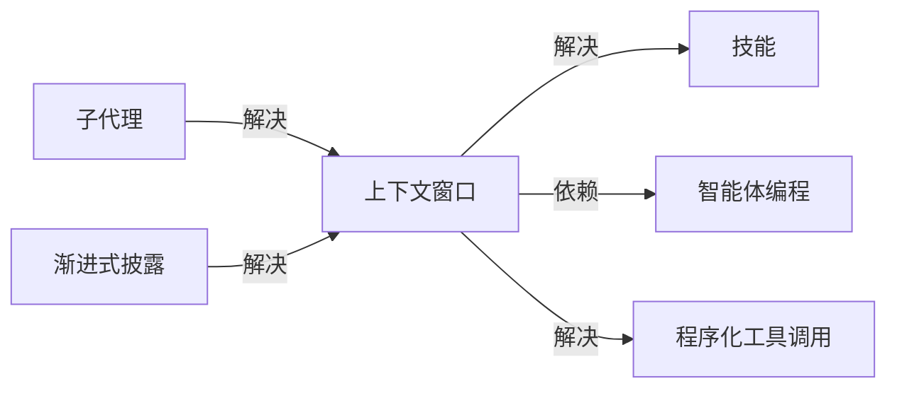

# 上下文窗口

> **分类**：上下文工程 ｜ **英文**：Context Window ｜ **出现于 13 篇文章**

## 摘要

上下文窗口（Context Window）是模型单次请求可处理的令牌总量上限，它决定了 Claude 在一次会话中"看得见"多少信息。随着 Claude Code 会话变长、每个请求的上下文显著增长，如何管理这一有限资源已成为上下文工程的核心问题。理解上下文窗口的边界，是设计 Skills、子代理与工具调用策略的前提。

## 关键做法

- 把不必进入上下文的内容移出主会话：让子代理在独立上下文中运行，只把最终答案返回主会话，其余过程在完成后丢弃。
- 用渐进式披露控制加载量：Skills 在运行时只向模型展示 YAML frontmatter 中的名称与描述，完整内容按需读取，从而在有限窗口内装备大量能力。
- 避免让每个工具结果都以 token 形式回流上下文：给 Claude 代码执行工具，由它自行决定哪些结果传递、过滤或管道到下一次调用。
- 优先使用自文档化、可修改的代码而非冗长工具说明，减少常驻上下文的体积。
- 关注会话的上下文增长趋势：长会话中每个请求的上下文与输入输出 token 比例都会上升，按 token 计费时成本差异最明显。
- 在 Claude Code 中可用 mod（如 Token Weather）实时观察上下文窗口的填充程度，据此判断何时压缩或切换策略。

## 在 Claude 里的用法

在 Claude Code 与 Claude Agent SDK 中，子代理拥有自己的上下文窗口、系统提示词与工具权限，适合承接会污染主会话的离散任务。Skills 通过三层结构（约 50 token 的元数据、约 500 token 的 SKILL.md、按需加载的 2,000+ token 参考文件）保护上下文窗口。Claude Sonnet 5.5 原生支持 1M 上下文窗口，可用 `/model sonnet` 为范围明确的任务切换模型。Claude 付费套餐中的 Projects 则各自提供一个 200K 上下文窗口，用于承载项目级文档与指令。

## 常见误区

- 认为每个工具结果都必须流回上下文窗口才能指导下一步——实际上若结果只需传给下一个工具，以 token 处理既慢又贵且不必要。
- 认为装备更多 Skills 就必然挤占上下文——渐进式披露使元数据先行，完整内容仅在需要时加载。
- 把上下文窗口等同于会话记忆的全部——子代理的上下文与主会话相互隔离，其过程内容不会保留。

## 相关概念

- [子代理](子代理.md) —— 通过独立上下文窗口承接离散任务，是避免主会话上下文膨胀的主要手段。
- [渐进式披露](渐进式披露.md) —— 按需分批加载信息，直接服务于在有限上下文窗口内扩展能力。
- [技能](技能.md) —— 借助元数据先行加载的方式，使大量 Skills 共存而不压垮上下文窗口。
- [智能体编程](智能体编程.md) —— 依赖「智能体编程」
- [程序化工具调用](程序化工具调用.md) —— 让工具结果在上下文窗口之外流转，只把必要输出送回模型。

## 知识图谱（Knowledge Graph）

## 来源（Sources）

| # | 文章 | 原文 |
| --- | --- | --- |
| 1 | [用 Skills 构建智能体：为智能体装备专业化工作能力](../docs/zh/articles/building-agents-with-skills-equipping-agents-for-specialized-work.md) | [原文](https://claude.com/resources/articles/building-agents-with-skills-equipping-agents-for-specialized-work) |
| 2 | [使用 Claude Sonnet 5.5 构建](../docs/zh/articles/building-with-claude-sonnet-5-5.md) | [原文](https://claude.dev/blog/building-with-claude-sonnet-5-5/) |
| 3 | [编码会话变得更长、使用更多上下文。Claude Opus 5.5 正是为此而生。](../docs/zh/articles/claude-opus-5-5-built-for-coding-sessions-that-use-more-context.md) | [原文](https://claude.com/resources/articles/claude-opus-5-5-built-for-coding-sessions-that-use-more-context) |
| 4 | [Claude Code mods 入门](../docs/zh/articles/getting-started-with-claude-code-mods.md) | [原文](https://claude.dev/blog/getting-started-with-claude-code-mods/) |
| 5 | [智能体执行框架设计：驾驭 Claude 智能的 3 种模式](../docs/zh/articles/harnessing-claudes-intelligence.md) | [原文](https://claude.com/resources/articles/harnessing-claudes-intelligence) |
| 6 | [如何创建 Skills：关键步骤、限制与示例](../docs/zh/articles/how-to-create-skills-key-steps-limitations-and-examples.md) | [原文](https://claude.com/resources/articles/how-to-create-skills-key-steps-limitations-and-examples) |
| 7 | [最大化你的 Claude Code 会话价值](../docs/zh/articles/maximizing-the-value-of-your-claude-code-sessions.md) | [原文](https://claude.com/resources/articles/maximizing-the-value-of-your-claude-code-sessions) |
| 8 | [Skills 详解：Skills 与提示词、Projects、MCP 和子智能体的对比](../docs/zh/articles/skills-explained.md) | [原文](https://claude.com/resources/articles/skills-explained) |
| 9 | [如何在 Claude Code 中使用子智能体，以及何时使用](../docs/zh/articles/subagents-in-claude-code.md) | [原文](https://claude.com/resources/articles/subagents-in-claude-code) |
| 10 | [使用 Claude Code：会话管理与 1M 上下文](../docs/zh/articles/using-claude-code-session-management-and-1m-context.md) | [原文](https://claude.com/resources/articles/using-claude-code-session-management-and-1m-context) |

## 反向链接（Backlinks）

- [CLAUDE.md](CLAUDE-md.md)
- [智能体编程](智能体编程.md)
