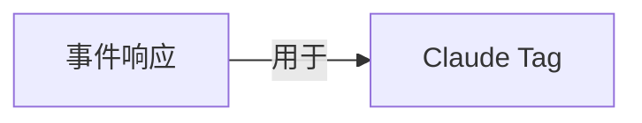

# 事件响应

> **分类**：安全与治理 ｜ **英文**：incident response ｜ **出现于 2 篇文章**

## 摘要

事件响应（incident response）是检测、响应和恢复安全事件的过程，属于安全与治理范畴。在 AI 加速攻击手段扩散的背景下，事件响应的速度与自动化程度直接决定组织能否在漏洞被串联利用之前完成处置。它也是把 Claude 引入安全运营（如告警分诊、频道内协作）时需要事先规划的核心环节。

## 关键做法

- 把 AI 纳入防御侧：攻击者可用 AI 加速发现与利用漏洞，防御方同样可以用前沿模型审查代码库、提前发现长期潜伏的缺陷。
- 提前假设漏洞会被串联利用：应预期未来一段时间内，大量长期未被传统审查发现的问题会被 AI 模型发现并组合成可用漏洞利用，据此调整响应预案的优先级。
- 让 AI 参与一线分诊：在协作频道中由 Claude 读取话题串、调用已连接工具完成初步排查并回报结果，缩短从告警到判断的时间。
- 用访问捆绑包限定数据边界：在一个频道内只连接代码库、问题跟踪器等必要数据源，让 EHR、临床系统和患者沟通内容保持不可访问。
- 默认关闭、按频道启用：将相关能力默认关闭，仅在获批频道中启用，禁用私信，并按频道限定连接器范围。

## 在 Claude 里的用法

在 Slack 中通过 Claude Tag（beta）把 Claude 作为队友引入频道：在频道里 @Claude，它会读取该话题串、使用已连接的工具有完成工作并回报结果，还能记住频道内发生的事，长时程工作无需反复说明；经允许后它可监视频道并在需要时自行介入。医疗健康组织正是用它分诊生产环境告警、维护内部工具。需要注意 Claude Tag 目前尚未纳入 Anthropic 的商业伙伴协议（BAA）覆盖范围，因此应只在完全不接触受保护健康信息（PHI）的场景中使用。面向更上游的防御准备，可参考 Project Glasswing 及配套技术文章中的安全建议。

## 常见误区

- 认为事件响应只是事后补救：资料强调防御方应借助 AI 提前发现代码中的潜伏缺陷，把工作前移到检测之前。
- 认为接入 Claude 就能读取整个 Slack：Claude Tag 只能看到工作区成员能看到的内容，无法访问未被邀请加入的私有频道。
- 在受监管数据场景中默认可用于事件响应：Claude Tag 尚未纳入 BAA 覆盖，涉 PHI 的频道不应依赖它处理。

## 相关概念

- [Claude Tag](Claude-Tag.md) —— 在 Slack 频道中承担告警分诊与工具调用的协作入口，是事件响应落地的主要载体。

## 知识图谱（Knowledge Graph）

## 来源（Sources）

| # | 文章 | 原文 |
| --- | --- | --- |
| 1 | [医疗健康组织如何使用 Claude Tag](../docs/zh/articles/how-healthcare-organizations-use-claude-tag.md) | [原文](https://claude.com/resources/articles/how-healthcare-organizations-use-claude-tag) |
| 2 | [为 AI 加速的攻击做好安全项目准备](../docs/zh/articles/preparing-your-security-program-for-ai-accelerated-offense.md) | [原文](https://claude.com/resources/articles/preparing-your-security-program-for-ai-accelerated-offense) |
