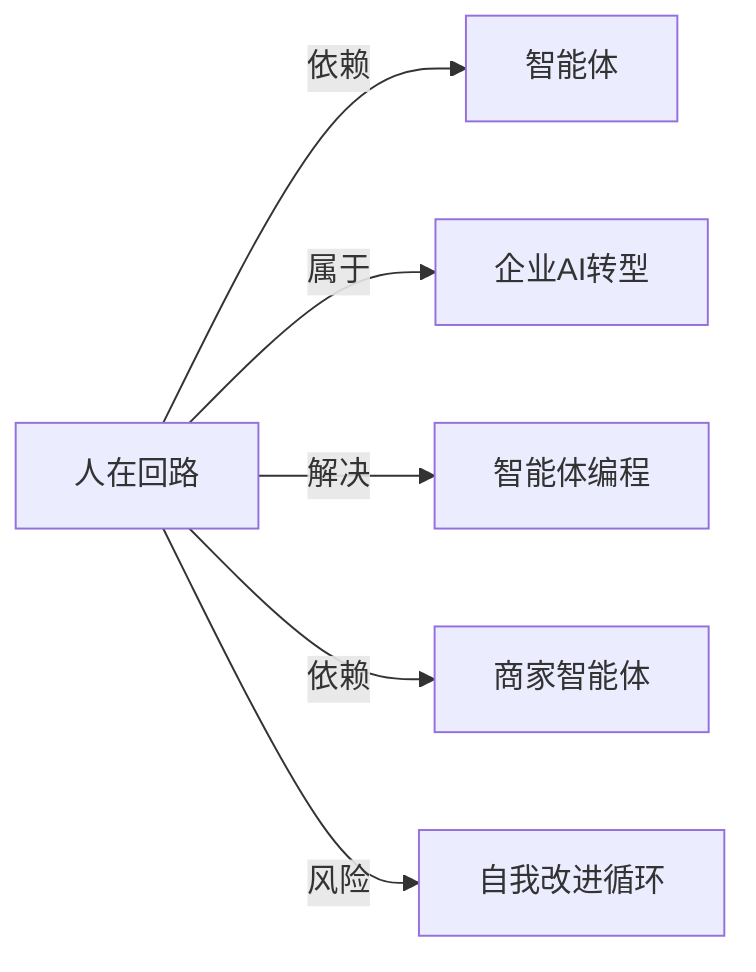

# 人在回路

> **分类**：安全与治理 ｜ **英文**：Human-in-the-Loop ｜ **出现于 10 篇文章**

## 摘要
人在回路（Human-in-the-Loop）是一种在关键决策点保留人类审核与最终决定权的机制，让 AI 智能体在自主执行任务的同时仍受人类监督。它之所以重要，是因为智能体越自主，越需要在不牺牲判断与专业能力的前提下控制风险，这也是企业级 AI 部署能否持续累积成效的关键。

## 关键做法
- 把人类角色定位为“指导、设定意图并负责最终审批”，而不是逐步输入指令；智能体负责执行，人负责把关。
- 在敏感或不可逆操作（如删除数据库表等）前设置人工确认点，避免 AI 在无人监督下触碰高风险动作。
- 在压缩信息密集型流程时，明确划定哪些判断与专业能力必须由人保留，不让效率优化侵蚀审核环节。
- 让审查、监控等安全流程随智能体产出速度同步扩展，否则它们会从保障变成瓶颈。
- 在受监管行业（如医疗、金融）中，把监管要求与临床/业务安全标准直接设计进系统，由人承担合规终审。

## 在 Claude 里的用法
在 Claude Code 的智能体式编程流程中，人类工程师负责指导方向与最终审批，Claude 承担大量代码创建与审查工作。企业可借助 Claude Cowork 的部署框架与 Claude Enterprise，把人工审核点嵌入各部门自建的自动化流程。构建商务智能体时，可直接使用官方蓝图中的护栏（guardrails）模式来落实人工把关。

## 常见误区
- 误以为人在回路等于持续人工输入：智能体的价值恰恰在于取代持续指导，人类只在关键节点介入。
- 误以为引入人工审核必然拖慢速度：若审核流程不与智能体节奏同步扩展，才会成为瓶颈；设计得当则可兼顾质量与速度。
- 误以为自主性越高越好：在敏感操作与受监管场景中，保留人类最终决定权是落地的前提而非障碍。

## 相关概念
- [智能体](智能体.md) —— 人在回路是智能体自主运行时的监督机制，智能体的落地依赖它来管控风险。
- [智能体编程](智能体编程.md) —— 在 Claude Code 驱动的编程流程中，人类审批是解决自主生成代码可信性问题的关键环节。
- [企业AI转型](企业AI转型.md) —— 人在回路属于企业 AI 转型中的治理要素，决定部署能否持续累积成效。
- [商家智能体](商家智能体.md) —— 商务智能体蓝图中的护栏依赖人在回路来约束购买与交易类操作。
- [自我改进循环](自我改进循环.md) —— 当 AI 越来越多地创建与审查自身产出时，人类审批是抑制该循环风险的重要防线。

## 知识图谱（Knowledge Graph）

## 来源（Sources）

| # | 文章 | 原文 |
| --- | --- | --- |
| 1 | [为初创公司构建 AI 智能体](../docs/zh/articles/building-ai-agents-for-startups.md) | [原文](https://claude.com/resources/articles/building-ai-agents-for-startups) |
| 2 | [为企业构建 AI 智能体](../docs/zh/articles/building-ai-agents-for-the-enterprise.md) | [原文](https://claude.com/resources/articles/building-ai-agents-for-the-enterprise) |
| 3 | [为金融服务构建 AI 智能体](../docs/zh/articles/building-ai-agents-in-financial-services.md) | [原文](https://claude.com/resources/articles/building-ai-agents-in-financial-services) |
| 4 | [为医疗健康与生命科学构建 AI 智能体](../docs/zh/articles/building-ai-agents-in-healthcare-and-life-sciences.md) | [原文](https://claude.com/resources/articles/building-ai-agents-in-healthcare-and-life-sciences) |
| 5 | [三家 YC 初创公司如何用 Claude Code 打造自己的公司](../docs/zh/articles/building-companies-with-claude-code.md) | [原文](https://claude.com/resources/articles/building-companies-with-claude-code) |
| 6 | [使用 Claude 构建商务智能体](../docs/zh/articles/claude-for-commerce-agents.md) | [原文](https://claude.com/resources/articles/claude-for-commerce-agents) |
| 7 | [ABC Legal 如何借助 Claude Managed Agents 让每位员工都成为构建者](../docs/zh/articles/how-abc-legal-turned-every-employee-into-a-builder-with-claude-managed-agents.md) | [原文](https://claude.com/resources/articles/how-abc-legal-turned-every-employee-into-a-builder-with-claude-managed-agents) |
| 8 | [Anthropic 如何保障其 AI 原生软件开发生命周期的安全](../docs/zh/articles/how-anthropic-secures-its-ai-native-software-development-lifecycle.md) | [原文](https://claude.com/resources/articles/how-anthropic-secures-its-ai-native-software-development-lifecycle) |
| 9 | [Cresta 如何将 CX 专业知识转化为基于 Claude Agent SDK 的智能体构建器](../docs/zh/articles/how-cresta-turned-cx-expertise-into-an-agent-builder-on-the-claude-agent-sdk.md) | [原文](https://claude.com/resources/articles/how-cresta-turned-cx-expertise-into-an-agent-builder-on-the-claude-agent-sdk) |
| 10 | [Warp 如何在 Claude 上构建自我改进的智能体](../docs/zh/articles/how-warp-builds-self-improving-agents-on-claude.md) | [原文](https://claude.com/resources/articles/how-warp-builds-self-improving-agents-on-claude) |
