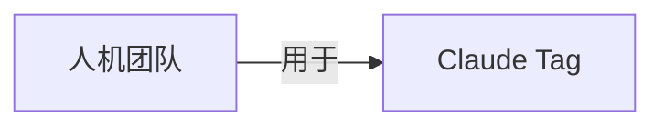

# 人机团队

> **分类**：企业落地与组织 ｜ **英文**：Human-Agent Team ｜ **出现于 2 篇文章**

## 摘要
人机团队（Human-Agent Team）是指人类成员与 AI 智能体在同一平台上分工协作的团队模式。它把智能体当作可被指派角色、被训练、被追踪的“队友”，而不是一次性工具，因而成为企业把 Claude 从个人助手推进到组织级生产力的关键形态。

## 关键做法
- 为每个智能体明确角色与访问权限，界定它能接触哪些数据、能执行哪些操作。
- 指定专人对智能体进行训练与调教，让它的行为随团队反馈持续改进。
- 保持工作对所有人可见：智能体的任务、进度与产出都在共享平台中可查。
- 先把非结构化信息（想法、Slack 对话、会议录音、报表、文档）整理进项目与任务等结构化载体，再让智能体基于结构行动。
- 让智能体具备三项基础能力：持久记忆、自己的凭证、共享上下文。

## 在 Claude 里的用法
在 Claude 平台上，人类成员与智能体在同一个工作空间中协作：人负责梳理与结构化信息，智能体基于结构执行复杂任务。Asana 的实践是让团队与 Claude 讨论零散信息，再注入 Asana 的项目与任务结构，由 Claude 模型驱动智能体行动。医疗领域的 Insight Health、Tennr、Medallion 等组织则通过 Claude Tag 构建自己的人机团队。

## 常见误区
- 把智能体当成一次性问答工具，而不给它角色、权限与持续训练，团队协作就无从谈起。
- 只关注智能体的能力，忽视工作可见性与共享上下文，人机之间容易脱节。

## 相关概念
- [Claude Tag](Claude-Tag.md) —— 医疗等组织借助 Claude Tag 构建人机团队的落地载体。

## 知识图谱（Knowledge Graph）

## 来源（Sources）

| # | 文章 | 原文 |
| --- | --- | --- |
| 1 | [你可以指导的智能体：Asana 如何用 Claude 构建人机团队](../docs/zh/articles/agents-you-can-coach-how-asana-builds-human-agent-teams-with-claude.md) | [原文](https://claude.com/resources/articles/agents-you-can-coach-how-asana-builds-human-agent-teams-with-claude) |
| 2 | [医疗健康组织如何使用 Claude Tag](../docs/zh/articles/how-healthcare-organizations-use-claude-tag.md) | [原文](https://claude.com/resources/articles/how-healthcare-organizations-use-claude-tag) |
