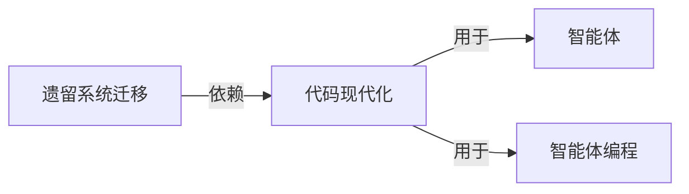

# 代码现代化

> **分类**：Claude Code 与编程 ｜ **英文**：Code Modernization ｜ **出现于 3 篇文章**

## 摘要

代码现代化（Code Modernization）指将遗留系统升级、重构为现代语言与架构的实践。它之所以重要，是因为借助 AI 与智能体，原本需要数年、全员投入的现代化工作可以压缩到几个月甚至几周，同时不必牺牲新功能的交付。

## 关键做法

- 先做发现工作：让 Claude 梳理依赖关系，并记录那些“无人记得构建过”的工作流，把隐性的业务逻辑显性化。
- 使用代码现代化插件的 _assess_、_map_ 和 _extract-rules_ 命令挖掘业务规则，输出附带源引用，便于工程师逐条审查。
- 建立项目的中央知识库：把目标、证书、推广策略、代码库、文档以及所需的数据源与工具放在文件系统上或通过 MCP 提供给 Claude。
- 把现代化与业务目标对齐，优先识别高投资回报（ROI）的机会，而不是为现代化而现代化。
- 把现代化视为持续交付的一部分，不必在现代化与交付下一个重要功能之间二选一。

## 在 Claude 里的用法

在 Claude Code 中，可以从官方代码现代化插件起步，用其 assess、map、extract-rules 命令完成评估与规则抽取；再通过 MCP 或文件系统把代码库、文档与相关数据源接入，形成项目知识库。相关文章本身也可以作为上下文提供给 Claude，帮助它理解项目背景与推广策略。

## 常见误区

- 以为现代化必须先停下手上的功能交付——实际上两者可以并行推进。
- 只关注代码改写，而忽略依赖梳理与业务规则挖掘这类前置发现工作。
- 把资料散落在各处而不集中到 Claude 可访问的知识库中，导致上下文缺失。

## 相关概念

- [智能体](智能体.md) —— 代码现代化借助智能体完成依赖梳理与规则抽取等发现工作。
- [智能体编程](智能体编程.md) —— 智能体编程是实施现代化改造的编程方式。
- [遗留系统迁移](遗留系统迁移.md) —— 代码现代化依赖遗留系统迁移的具体路径落地。

## 知识图谱（Knowledge Graph）

## 来源（Sources）

| # | 文章 | 原文 |
| --- | --- | --- |
| 1 | [如何为 AI 驱动的代码现代化项目做好准备](../docs/zh/articles/how-to-prepare-for-ai-driven-code-modernization-projects.md) | [原文](https://claude.com/resources/articles/how-to-prepare-for-ai-driven-code-modernization-projects) |
| 2 | [代码现代化实战手册](../docs/zh/guides/the-code-modernization-playbook.md) | [原文](https://claude.com/resources/guides/the-code-modernization-playbook) |
| 3 | [将遗留系统转化为战略资产：借助 AI 实现代码现代化](../docs/zh/webinars/deloitte-code-modernization.md) | [原文](https://claude.com/resources/webinars/deloitte-code-modernization) |
