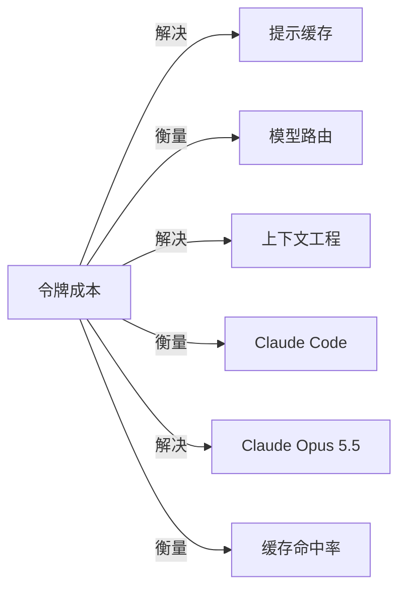

# 令牌成本

> **分类**：成本与性能 ｜ **英文**：Token Cost ｜ **出现于 5 篇文章**

## 摘要

令牌成本（Token Cost）指一次会话中发送给模型的输入令牌与模型生成的输出令牌所产生的费用，是衡量 Claude 使用效率的核心指标。它之所以重要，是因为长会话、高上下文与多轮智能体循环会显著放大输入令牌量，而输入令牌往往占据成本的绝大部分。

## 关键做法

- 先弄清 token 花在哪里：区分"决定 token 价格的因素"与"决定你发送多少 token 的因素"，后者通常是可控的。
- 定期运行 `/context` 检查启动上下文，查看 CLAUDE.md 与 MCP 服务器在每一轮中额外增加了什么，并删除不属于那里的内容，避免为用不到的上下文付费。
- 编写具体、明确的提示词，并用 Skills 强化验证步骤，减少往返轮次，从而降低总令牌消耗。
- 对支线探索任务使用子智能体：它在独立上下文窗口中工作，只把结果返回主对话，避免把噪音带进主线程。
- 按任务复杂度选择最简工作流，不必为简单任务套用复杂循环；顺序式工作流以延迟换准确性，需权衡其令牌开销。
- 关注输入与输出令牌之比：随着会话变长、上下文变高，按 token 付费的用户会看到最大的成本差异。

## 在 Claude 里的用法

在 Claude Code 中，可用 `/context` 审视每轮的上下文构成，并通过精简 CLAUDE.md、按需启用 MCP 服务器来控制启动开销。借助 Skills 把验证步骤固化下来，可减少智能体循环的轮次；借助子智能体把支线任务隔离到独立上下文窗口。在按 token 计费的长会话场景下，Claude Opus 5.5 等模型的设计也针对更高上下文与更长运行时间做了优化。

## 常见误区

- 只关注输出令牌而忽略输入令牌：实际会话中上下文持续累积，输入令牌往往是成本主体。
- 认为所有任务都需要复杂循环：资料明确建议从最简单的方案开始，有选择地使用循环模式。
- 忽视启动上下文的长期成本：CLAUDE.md 与 MCP 服务器在每一轮都会重复计入，一次清理可让之后每个会话受益。

## 相关概念

- [提示缓存](提示缓存.md) —— 降低重复上下文令牌开销、直接缓解令牌成本的手段。
- [上下文工程](上下文工程.md) —— 通过管理进入上下文的内容来控制令牌成本的实践。
- [缓存命中率](缓存命中率.md) —— 衡量缓存对令牌成本削减效果的指标。
- [智能体循环](智能体循环.md) —— 轮次越多令牌消耗越大，是令牌成本的主要来源之一。
- [Claude Code](Claude-Code.md) —— 令牌成本主要被观测和优化的产品场景。

## 知识图谱（Knowledge Graph）

## 来源（Sources）

| # | 文章 | 原文 |
| --- | --- | --- |
| 1 | [编码会话变得更长、使用更多上下文。Claude Opus 5.5 正是为此而生。](../docs/zh/articles/claude-opus-5-5-built-for-coding-sessions-that-use-more-context.md) | [原文](https://claude.com/resources/articles/claude-opus-5-5-built-for-coding-sessions-that-use-more-context) |
| 2 | [AI 智能体的常见工作流模式——以及何时使用它们](../docs/zh/articles/common-workflow-patterns-for-ai-agents-and-when-to-use-them.md) | [原文](https://claude.com/resources/articles/common-workflow-patterns-for-ai-agents-and-when-to-use-them) |
| 3 | [循环工程：循环入门](../docs/zh/articles/getting-started-with-loops.md) | [原文](https://claude.com/resources/articles/getting-started-with-loops) |
| 4 | [如何在 Claude Code 中使用子智能体，以及何时使用](../docs/zh/articles/subagents-in-claude-code.md) | [原文](https://claude.com/resources/articles/subagents-in-claude-code) |
| 5 | [最大化 Claude Code 的价值](../docs/zh/webinars/claude-code-maximizing-value.md) | [原文](https://claude.com/resources/webinars/claude-code-maximizing-value) |

## 反向链接（Backlinks）

- [Claude-Opus-5.5](Claude-Opus-5.5.md)
- [模型路由](模型路由.md)
