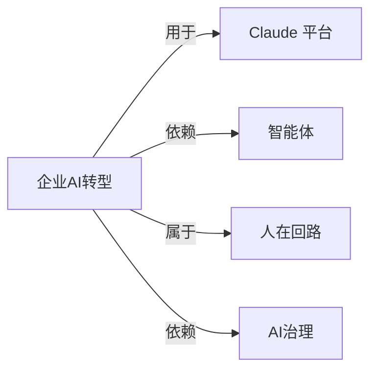

# 企业AI转型

> **分类**：企业落地与组织 ｜ **英文**：Enterprise AI Transformation ｜ **出现于 3 篇文章**

## 摘要

企业 AI 转型指企业系统性地引入 AI，并借此重塑工作方式、流程与产品能力的整体变革。它的重要性在于：单点试用带来的收益往往在一个季度内就趋于停滞，只有把智能体式 AI 嵌入员工的工作方式、流程的运行方式和产品的可能性之中，才能形成竞争对手难以复制的持久优势。

## 关键做法

- 先把基础打牢：通过利益相关方对齐与治理奠定转型基础，再启动后续工作。
- 启动战略性试点，以快速取得显著成效为目标，用早期成果建立组织信心。
- 在推广阶段同步构建组织能力，把试点中行之有效的做法规模化复制。
- 把机构知识编码进能够随时间不断累积的系统，让能力随使用而增长，而不是每次从零开始。
- 将智能体式 AI 嵌入员工的工作方式、流程的运行方式与产品的可能性，而不只是做增量式的工具叠加。
- 借助统一平台把能力带给组织中的每一个团队，避免为每个团队单独定制开发。

## 在 Claude 里的用法

Anthropic 将企业 AI 转型总结为经过验证的三步法，并在零售等行业指南中给出结构化路径。实践中可以借助 Claude Cowork 把相关能力带给组织内的各个团队，而无需逐团队定制开发；Claude 平台则承载智能体式 AI 的落地。转型过程依赖智能体能力与 AI 治理机制，并把人在回路纳入流程设计。

## 常见误区

- 把转型等同于零散的 AI 试用：这类增量收益可能在一个季度内就趋于停滞，无法形成持久优势。
- 跳过治理与利益相关方对齐直接铺开试点，容易在推广阶段失去组织支撑。
- 为每个团队单独定制开发，而不是用统一平台承载能力，导致难以规模化。

## 相关概念

- [Claude 平台](Claude-平台.md) —— 企业 AI 转型落地所依托的产品与平台基础。
- [智能体](智能体.md) —— 转型依赖智能体式 AI 嵌入工作方式与流程。
- [人在回路](人在回路.md) —— 属于转型中流程与治理设计的一部分。
- [AI治理](AI治理.md) —— 转型依赖治理机制来打好基础、支撑规模化推广。

## 知识图谱（Knowledge Graph）

## 来源（Sources）

| # | 文章 | 原文 |
| --- | --- | --- |
| 1 | [为企业构建 AI 智能体](../docs/zh/articles/building-ai-agents-for-the-enterprise.md) | [原文](https://claude.com/resources/articles/building-ai-agents-for-the-enterprise) |
| 2 | [零售企业 AI 转型指南](../docs/zh/guides/the-enterprise-ai-transformation-guide-for-retail.md) | [原文](https://claude.com/resources/guides/the-enterprise-ai-transformation-guide-for-retail) |
| 3 | [企业 AI 转型指南](../docs/zh/guides/the-enterprise-ai-transformation-guide.md) | [原文](https://claude.com/resources/guides/the-enterprise-ai-transformation-guide) |
