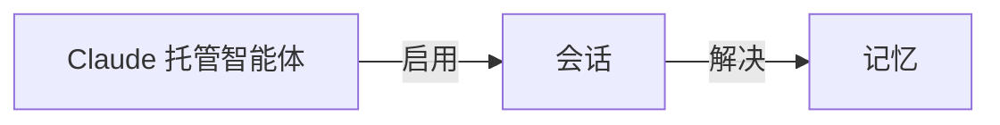

# 会话

> **分类**：智能体架构 ｜ **英文**：Session ｜ **出现于 2 篇文章**

## 摘要
会话（Session）是记录消息与工具调用的对话实例，是智能体保存和延续上下文的载体。它让智能体在多次运行轮次之间保留进度，从而支撑常驻、有状态的智能体行为，也是把智能体从原型推向生产时必须解决的基础设施问题之一。

## 关键做法
- 把每一段工作组织为运行轮次（run）：智能体接收事件、完成任务、保存本次发生的信息，然后回到休眠。
- 让运行轮次在会话内进行，会话负责记录消息与工具调用，作为后续恢复的依据。
- 区分事件类型：延续先前工作的事件（例如用户的回复）恢复已有会话，其他事件则启动新会话。
- 为会话状态选择持久化位置（本地或外部存储），使一次运行在中断后能够恢复。
- 保留可回溯的会话记录，以便事后检查之前会话中发生了什么。

## 在 Claude 里的用法
在常驻智能体架构中，会话是核心循环外围原语之一，决定运行轮次之间保留什么。借助 Agent SDK，生产基础设施的许多要素通过 Claude Code 的机制提供，会话状态可持久化在本地或外部存储上。使用 Claude 托管智能体时，会话管理属于平台替你承担的基础设施职责，并可与可观测性能力配合，重建智能体走过的每一步。

## 常见误区
- 把会话等同于单次运行：运行轮次在会话内进行，一次会话可以跨越多个运行轮次。
- 认为所有新事件都应恢复旧会话：只有延续先前工作的事件才恢复已有会话，其余事件启动新会话。
- 忽视会话的可观测性：智能体自主工作较长时间后，若无法回溯会话，就难以重建其行为过程。

## 相关概念

- [Claude 托管智能体](Claude-托管智能体.md) —— 托管智能体把会话管理纳入平台提供的基础设施，从而启用生产级常驻智能体。
- [记忆](记忆.md) —— 会话通过记录消息与工具调用，解决智能体跨运行轮次的记忆问题。

## 知识图谱（Knowledge Graph）

## 来源（Sources）

| # | 文章 | 原文 |
| --- | --- | --- |
| 1 | [构建常驻智能体](../docs/zh/articles/building-always-on-agents.md) | [原文](https://claude.com/resources/articles/building-always-on-agents) |
| 2 | [智能体界面的演进：使用 Claude Managed Agents 构建](../docs/zh/articles/building-with-claude-managed-agents.md) | [原文](https://claude.com/resources/articles/building-with-claude-managed-agents) |
