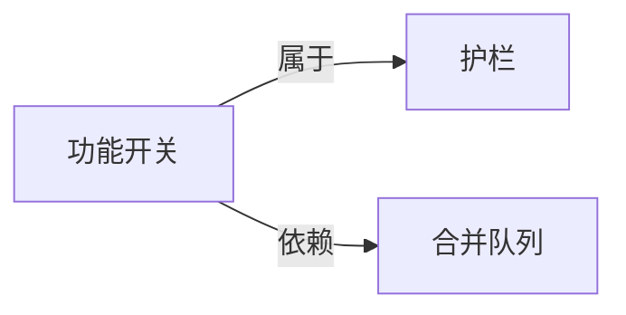

# 功能开关

> **分类**：企业落地与组织 ｜ **英文**：Feature Flag ｜ **出现于 3 篇文章**

## 摘要

功能开关（Feature Flag）是一种运行时开关，用于控制新功能的灰度放量与快速回滚，无需重新部署即可改变线上行为。它之所以重要，是因为它把"发布"与"上线"解耦：出问题时可以立即关闭开关止损，而不是走漫长的回滚流程。

## 关键做法

- 把功能开关与合并队列、先内部使用、分阶段发布、一键回滚组合成一套发布流程，而不是单独依赖某一种手段。
- 灰度放量时按阶段推进：先内部使用，再逐步扩大流量，每一步都观察错误率等指标。
- 保留一键回滚能力，确保开关关闭后系统能迅速回到基线状态。
- 把回滚和事故转化为评估集，在提示词、工具或模型变更时重新打分，让开关相关的决策有可验证的依据。
- 用回滚率和事故率作为护栏指标，同时衡量人力的时间投入，避免为了速度牺牲稳定性。

## 在 Claude 里的用法

在 Claude Tag 的 on-call 场景中，Claude 能定位到"某功能开关被打开后测试消失"这类根因，并判断回滚是否安全，再由人执行回滚，随后在 Slack 上确认错误率回到基线。在推广流程的第一阶段，可以让 Claude 管理金丝雀流量、监视问题，并自动调高或调低某个功能开关。在 Claude Code 团队的代码审查实践中，功能开关与合并队列、分阶段发布、一键回滚一起构成发布安全循环。

## 常见误区

- 把功能开关当成纯粹的发布工具，而忽略它与护栏指标（回滚率、事故率）的配套关系。
- 认为打开开关后无需持续监控；实际上灰度阶段需要有人或 Claude 持续观察并决定调高还是调低。

## 相关概念

- [护栏](护栏.md) —— 功能开关的放量与回滚决策需要以回滚率、事故率等护栏指标为依据。
- [合并队列](合并队列.md) —— 功能开关与合并队列配合使用，共同构成安全的发布流程。

## 知识图谱（Knowledge Graph）

## 来源（Sources）

| # | 文章 | 原文 |
| --- | --- | --- |
| 1 | [Claude 值班：Claude Tag 如何成为 Anthropic 应对 CI/CD 故障的第一响应者](../docs/zh/articles/ai-ci-cd-on-call.md) | [原文](https://claude.com/resources/articles/ai-ci-cd-on-call) |
| 2 | [我们如何在两周内让 claude.ai 提速 3 倍](../docs/zh/articles/how-we-made-claude-ai-faster.md) | [原文](https://claude.dev/blog/how-we-made-claude-ai-faster/) |
| 3 | [Claude Code 团队如何进行代码审查](../docs/zh/articles/solving-code-review-at-anthropic.md) | [原文](https://claude.dev/blog/solving-code-review-at-anthropic/) |
