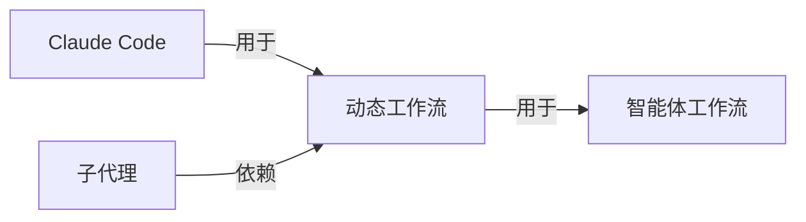

# 动态工作流

> **分类**：智能体架构 ｜ **英文**：Dynamic Workflows ｜ **出现于 7 篇文章**

## 摘要

动态工作流（Dynamic Workflows）是一种按任务即时编写并编排多智能体框架的机制：它不再依赖预先写死、需覆盖所有边缘情况的静态工作流，而是针对当前任务生成专属的执行框架。它之所以重要，是因为 Claude 现在足够智能，可以为具体任务量身定制执行框架，从而在深度研究、事件响应、大规模代码迁移等复杂场景中协调大量子智能体并行工作。

## 关键做法

- 以 JavaScript 文件承载工作流：动态工作流执行一个 JavaScript 文件，其中包含若干特殊函数，用于生成和协调子智能体。
- 按任务定制而非追求通用：静态工作流为覆盖所有边缘情况而趋于通用，动态工作流则针对当前任务生成专属框架，把通用性换成针对性。
- 用编排器 + 执行器分工：由编排器智能体启动执行器子智能体，让每个子智能体调查一个依赖项或事实来源。
- 先试点再放量：动态工作流可以生成数百个智能体，应先在较小的工作切片上评估用量，再扩大规模。
- 为任务选择合适原语：较小的任务不需要多个智能体或循环，确定性工作交给脚本比推理步骤更便宜。
- 审查用量：用 `/workflows` 查看每个智能体的 token 用量，并可随时停止某个智能体。

## 在 Claude 里的用法

在 Claude Code 中，动态工作流用于大规模编排子智能体，例如官方发布的深度研究 Skill（`/deep-research`）会扇出网络搜索、获取来源、对抗性验证论断并综合出带引用的报告。在循环工程中，它可以编排智能体对每份报告进行分诊、修复并审查修复，与 `/schedule`、`/goal`、自动模式配合使用。在代码现代化与大规模迁移中，团队围绕目标、证书和推广策略构建定制的动态工作流，把工作分配到许多更小的并行子智能体工作流。Claude Tag 在事件响应中也会启动动态工作流，由编排器智能体派发执行器子智能体调查各依赖项。

## 常见误区

- 认为所有任务都需要动态工作流：较小的任务不需要多个智能体或循环，过度编排只会增加成本。
- 未经试点就直接大规模运行：动态工作流可生成数百个智能体，跳过小规模验证容易造成用量失控。
- 把确定性工作也交给推理：能用脚本完成的步骤应交给脚本，反复推导代码更昂贵。

## 相关概念

- [Claude Code](Claude-Code.md) —— 动态工作流在 Claude Code 中落地，用于大规模编排子智能体。
- [子代理](子代理.md) —— 动态工作流通过特殊函数生成并协调子智能体，二者是依赖关系。
- [智能体工作流](智能体工作流.md) —— 动态工作流属于智能体工作流的一种实现形态。

## 知识图谱（Knowledge Graph）

## 来源（Sources）

| # | 文章 | 原文 |
| --- | --- | --- |
| 1 | [为每个任务打造执行框架：Claude Code 中的动态工作流](../docs/zh/articles/a-harness-for-every-task-dynamic-workflows-in-claude-code.md) | [原文](https://claude.dev/blog/a-harness-for-every-task-dynamic-workflows-in-claude-code/) |
| 2 | [Claude 值班：Claude Tag 如何成为 Anthropic 应对 CI/CD 故障的第一响应者](../docs/zh/articles/ai-ci-cd-on-call.md) | [原文](https://claude.com/resources/articles/ai-ci-cd-on-call) |
| 3 | [Anthropic 如何用 Claude Code 运行大规模代码迁移](../docs/zh/articles/ai-code-migration.md) | [原文](https://claude.com/resources/articles/ai-code-migration) |
| 4 | [云端 Claude Code：云会话实战指南](../docs/zh/articles/claude-code-in-the-cloud.md) | [原文](https://claude.dev/blog/claude-code-in-the-cloud/) |
| 5 | [AI 智能体的常见工作流模式——以及何时使用它们](../docs/zh/articles/common-workflow-patterns-for-ai-agents-and-when-to-use-them.md) | [原文](https://claude.com/resources/articles/common-workflow-patterns-for-ai-agents-and-when-to-use-them) |
| 6 | [循环工程：循环入门](../docs/zh/articles/getting-started-with-loops.md) | [原文](https://claude.com/resources/articles/getting-started-with-loops) |
| 7 | [如何为 AI 驱动的代码现代化项目做好准备](../docs/zh/articles/how-to-prepare-for-ai-driven-code-modernization-projects.md) | [原文](https://claude.com/resources/articles/how-to-prepare-for-ai-driven-code-modernization-projects) |
