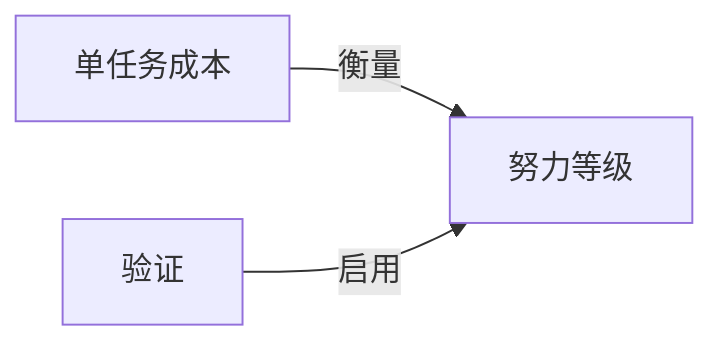

# 努力等级

> **分类**：模型与能力 ｜ **英文**：Effort Level ｜ **出现于 8 篇文章**

## 摘要

努力等级（Effort Level）是 Claude 中控制模型为一次请求「做多少工作」的档位设置，它不只影响思考时间，还决定读取的文件数量、调用的工具数量，以及在反馈前执行的步骤数。它与模型选择共同构成「让答案更好」的两个正交旋钮，直接影响任务质量、延迟与单任务成本，因此是调优 Claude Code 会话与 API 调用的核心参数。

## 关键做法

- 把模型与 effort 分开考虑：模型决定能力上限，effort 决定模型愿意投入多少行动；出错原因是「漏读文件、没跑测试、中途放弃」时提高 effort，而非换模型。
- 从各模型的默认 effort 起步，按工作类型调出一个通用偏好，而不是逐任务反复调整。
- 在会话开始前就设定好模型与 effort：对话中途更改任一项都可能破坏提示词缓存，抬高 token 成本。
- 在验证与边界情况测试价值高的领域（硬件、代码审查、安全）提高 effort，能获得更好的结果。
- 降低 effort 确实省 token，但要计入「任务没做完」的风险——一次重试的花费往往超过这些节省。

## 在 Claude 里的用法

在 Claude Code 中，effort 与模型设置并列，可在会话开始时选定；更高的 effort 让 Claude 在回到你面前之前读更多文件、跑更多测试、反复核对，较低的 effort 则更倾向于向你索取上下文而不是自己花 token 弄清。通过 Claude Platform 调用时，可在请求的 `output_config` 中指定 effort 档位（如 `"effort": "medium"`）。在 Opus 4.7 等较新模型上，更高 effort 级别下模型倾向于思考更多，替换旧模型时可能需要重新调优提示词与执行框架。

## 常见误区

- 以为 effort 只等于「思考更久」：它实际控制整体工作量，包括工具调用与步骤数。
- 以为换更大的模型总能解决质量问题：若失败源于投入不足，应提高 effort；只有 Claude 已掌握上下文、明确尝试过仍出错时，才是换更强模型的信号。
- 在对话中途调整 effort 或模型：这会破坏提示词缓存，反而增加成本。

## 相关概念

- [单任务成本](单任务成本.md) —— effort 通过影响轮次与 token 用量直接决定单任务成本。
- [验证](验证.md) —— effort 是调节 Claude 做多少验证与边界情况测试的主要手段。

## 知识图谱（Knowledge Graph）

## 来源（Sources）

| # | 文章 | 原文 |
| --- | --- | --- |
| 1 | [在 Claude Code 中使用 Claude Opus 4.7 的最佳实践](../docs/zh/articles/best-practices-for-using-claude-opus-4-7-with-claude-code.md) | [原文](https://claude.com/resources/articles/best-practices-for-using-claude-opus-4-7-with-claude-code) |
| 2 | [使用 Claude Sonnet 5.5 构建](../docs/zh/articles/building-with-claude-sonnet-5-5.md) | [原文](https://claude.dev/blog/building-with-claude-sonnet-5-5/) |
| 3 | [在 Claude Code 中选择 Claude 模型与 effort 级别](../docs/zh/articles/claude-model-and-effort-level-in-claude-code.md) | [原文](https://claude.com/resources/articles/claude-model-and-effort-level-in-claude-code) |
| 4 | [Claude 模型详解：为你的用例选择最佳模型](../docs/zh/articles/claude-models-explained-choosing-the-best-model-for-your-use-case.md) | [原文](https://claude.com/resources/articles/claude-models-explained-choosing-the-best-model-for-your-use-case) |
| 5 | [最大化你的 Claude Code 会话价值](../docs/zh/articles/maximizing-the-value-of-your-claude-code-sessions.md) | [原文](https://claude.com/resources/articles/maximizing-the-value-of-your-claude-code-sessions) |
| 6 | [使用 Claude Code：花好你的 effort](../docs/zh/articles/spending-your-effort.md) | [原文](https://claude.dev/blog/spending-your-effort/) |
| 7 | [Opus 5.5 上完成一项任务的成本](../docs/zh/articles/what-a-task-costs-on-opus-5-5.md) | [原文](https://claude.dev/blog/what-a-task-costs-on-opus-5-5/) |
| 8 | [该用哪个 Claude 模型来构建？](../docs/zh/articles/which-claude-model-should-you-build-with.md) | [原文](https://claude.dev/blog/which-claude-model-should-you-build-with/) |
