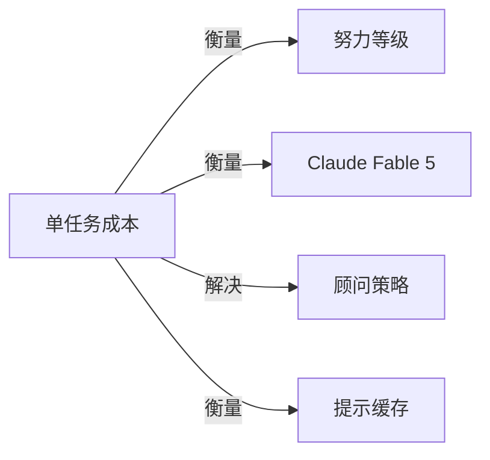

# 单任务成本

> **分类**：成本与性能 ｜ **英文**：Cost per Task ｜ **出现于 5 篇文章**

## 摘要

单任务成本（Cost per Task）指完成一个实际任务的总花费，而不是单个 token 的价格。它之所以重要，是因为更强的模型虽然每 token 更贵，却常常用更少的轮次和思考时间完成任务，从而使单任务成本反而更低。只看单价容易做出错误的经济性判断。

## 关键做法

- 以任务为单位核算成本，把 token 消耗、轮次数量和模型单价合在一起看，而不是只比较每 token 价格。
- 在评估模型时同时记录任务完成率与单任务成本，用两者的组合判断某个模型是否值得用在某类工作上。
- 对更复杂、长时程的工作优先测试更强模型的单任务成本，这类场景中最强模型往往能靠更少的往返抵消单价劣势。
- 对高产量、评估显示能满意完成的简单任务，考虑交给较低层级的模型以改善单位经济性。
- 把模型与任务匹配、以及 effort level 的选择，当作控制单任务成本的主要手段。

## 在 Claude 里的用法

在 Claude Code 这类智能体式工具中，每个任务要读取文件、运行工具并多步推理，token 消耗随任务复杂度和对话长度增长，因此账单由 token 数量与所用模型共同决定。实践中可以按任务类型在 Claude Haiku、Sonnet、Opus、Fable 等模型之间分配，并结合 effort level 调整，让复杂工作走强模型、其余工作走小模型。在 Claude Platform 上构建时，也可用私有评估集维护"最佳质量、最佳单任务成本、最快"这类排行榜来指导选型。

## 常见误区

- 只比较每 token 价格就下结论：单价更高的模型可能因为轮次更少而单任务成本更低。
- 从小模型起步做验证：这会让你更难区分是模型失败还是配置失败。
- 认为强模型一定更贵：在复杂、长时程任务上，强模型的单任务成本可能反而更低。

## 相关概念

- [努力等级](努力等级.md) —— 努力等级直接影响同一模型完成任务的轮次与思考量，是衡量单任务成本时的关键变量。
- [Claude Fable 5](Claude-Fable-5.md) —— 该模型每 token 价格更高，但在复杂长时程工作中单任务成本可能更低。
- [顾问策略](顾问策略.md) —— 用于解决成本与能力的平衡问题，把难任务交给强模型、其余交给小模型。
- [提示缓存](提示缓存.md) —— 影响实际 token 消耗，从而参与单任务成本的衡量。

## 知识图谱（Knowledge Graph）

## 来源（Sources）

| # | 文章 | 原文 |
| --- | --- | --- |
| 1 | [Claude 模型详解：为你的用例选择最佳模型](../docs/zh/articles/claude-models-explained-choosing-the-best-model-for-your-use-case.md) | [原文](https://claude.com/resources/articles/claude-models-explained-choosing-the-best-model-for-your-use-case) |
| 2 | [守护前沿：JetBrains 如何评估与部署 Claude Fable 5](../docs/zh/articles/how-jetbrains-evaluates-and-deploys-claude-fable-5.md) | [原文](https://claude.com/resources/articles/how-jetbrains-evaluates-and-deploys-claude-fable-5) |
| 3 | [在 Google Cloud 上管理 Claude Code 的成本并展示投资回报](../docs/zh/articles/how-to-manage-costs-and-demonstrate-roi-for-claude-code-on-google-cloud.md) | [原文](https://claude.com/resources/articles/how-to-manage-costs-and-demonstrate-roi-for-claude-code-on-google-cloud) |
| 4 | [该用哪个 Claude 模型来构建？](../docs/zh/articles/which-claude-model-should-you-build-with.md) | [原文](https://claude.dev/blog/which-claude-model-should-you-build-with/) |
| 5 | [在前沿工作：Rakuten 如何借助 Claude Fable 5 在一夜之间构建智能体](../docs/zh/articles/working-at-the-frontier-rakuten.md) | [原文](https://claude.com/resources/articles/working-at-the-frontier-rakuten) |
