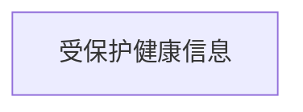

# 受保护健康信息

> **分类**：安全与治理 ｜ **英文**：PHI ｜ **出现于 2 篇文章**

## 摘要

受保护健康信息（PHI）是 HIPAA 监管下需要严格保护的患者健康数据。在医疗健康场景中使用 AI 产品时，是否接触 PHI 直接决定了合规边界与可用范围，因此它是评估 Claude 等工具能否落地的前提条件。

## 关键做法

- 先判断工作流是否触及 PHI：把任务拆到具体环节，确认输入、输出与中间存储中是否包含患者健康数据。
- 对不接触 PHI 的场景优先落地：例如分诊生产环境告警、维护内部工具、回答付款方规则等，可在不涉及患者数据的前提下使用 AI。
- 需要处理 PHI 时先确认合同覆盖：检查所用产品是否纳入商业伙伴协议（BAA）范围，未覆盖则不用于 PHI 相关工作。
- 用运行隔离限制数据暴露面：让单次运行只看到一条记录、不跨交易保留记忆，避免错误记忆长期累积。
- 在既有渠道上完成数据流转时保持谨慎：传真等传统渠道仍是医疗机构的实际工作方式，但需明确其中是否携带 PHI。

## 在 Claude 里的用法

在医疗健康组织中，Claude Tag（beta）被用于在 Slack 中分诊生产环境告警、维护内部工具和回答付款方规则问题。需要注意，Claude Tag 目前尚未纳入 Anthropic 面向商业客户的商业伙伴协议（BAA）覆盖范围，因此相关实践都限定在完全不接触 PHI 的频段内。涉及 PHI 的流程应改用已纳入 BAA 覆盖的产品与配置。

## 常见误区

- 认为只要不主动输入患者姓名就不算 PHI：告警内容、工单文本等间接信息同样可能构成 PHI，需要按数据内容判断。
- 默认所有 Claude 产品都可处理 PHI：Claude Tag 目前不在 BAA 覆盖范围内，不能用于接触 PHI 的场景。
- 让智能体跨交易保留记忆以提升连续性：在敏感数据场景下，错误记忆难以清除，隔离运行更安全。

## 相关概念

## 知识图谱（Knowledge Graph）

## 来源（Sources）

| # | 文章 | 原文 |
| --- | --- | --- |
| 1 | [Curative 如何借助 Claude 上的智能体构建全国医疗服务提供方网络](../docs/zh/articles/how-curative-is-building-a-national-provider-network-with-agents-on-claude.md) | [原文](https://claude.com/resources/articles/how-curative-is-building-a-national-provider-network-with-agents-on-claude) |
| 2 | [医疗健康组织如何使用 Claude Tag](../docs/zh/articles/how-healthcare-organizations-use-claude-tag.md) | [原文](https://claude.com/resources/articles/how-healthcare-organizations-use-claude-tag) |
