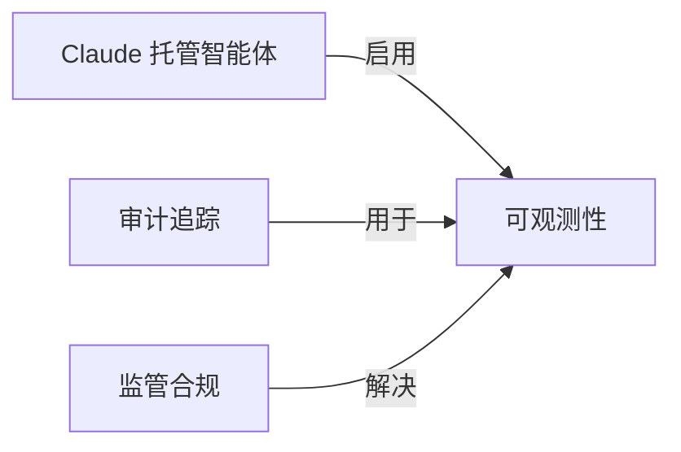

# 可观测性

> **分类**：安全与治理 ｜ **英文**：Observability ｜ **出现于 4 篇文章**

## 摘要

可观测性是追踪与审查智能体决策过程与数据来源的能力，让团队能够重建自主智能体在长时间运行中走过的每一步。在安全与治理语境下，它既是监管合规（如 HIPAA 对 PHI 处理系统的可问责性要求）的前提，也是把智能体投入生产时判断"能否信任其边界"的核心依据。

## 关键做法

- 把会话设计为持续的事件流：每次模型调用、工具调用和结果都追加到运行进程之外的日志中，使整个运行本身成为一份可回溯的事件记录。
- 保证会话可恢复与可检查：历史在交互之间保留，空闲时对容器做检查点保存，从而能从中断处干净继续，也能回溯此前会话中发生了什么。
- 将可观测性接入既有监控栈：通过 OpenTelemetry 把智能体的运行数据导出到你已经在使用的监控体系中，而不是另建一套孤立的观测设施。
- 用可视化时间线与调试视图审查单次会话，深入检查任意对话记录，定位智能体做出意外之举的具体环节。
- 在受监管场景中把可观测性与可问责性一并设计，配合风险管理系统、数据治理与技术文档，避免"打勾式合规"。

## 在 Claude 里的用法

在 Claude 平台上，Claude Managed Agents 以事件为单位组织会话，会话日志位于运行智能体的进程之外，因此可观测性随会话持久性自然获得。Claude Developer Console 提供智能体会话的原生可视化时间线视图和可深入检查对话记录的调试体验。借助 Agent SDK，可观测性可通过 OpenTelemetry 导出到现有监控栈；Managed Agents 附带的 Memory 与 Dreaming 等功能同样利用这种会话持久性。在 Slack 中部署的 Claude Tag 则依托同一套受治理定义来支撑数据分析问答。

## 常见误区

- 把可观测性等同于事后看日志：它要求会话本身即为事件记录，能在运行中实时流入更新，而非仅在出问题后翻查。
- 认为智能体跑得久就自然可信：自主工作一小时并做出意外之举时，若无法重建每一步，就无法界定生产中真正愿意信任的边界。
- 把合规当作文档工作：HIPAA 与 EU AI Act 等要求的是对 AI 系统的全面可观测性与可问责性，而非"打勾式合规"。

## 相关概念

- [Claude 托管智能体](Claude-托管智能体.md) —— 其事件流架构与 Developer Console 时间线视图使可观测性得以落地。
- [审计追踪](审计追踪.md) —— 事件流式的会话日志为审计追踪提供可回溯的原始记录。
- [监管合规](监管合规.md) —— 可观测性是满足 HIPAA、EU AI Act 等监管对可问责性要求的手段。

## 知识图谱（Knowledge Graph）

## 来源（Sources）

| # | 文章 | 原文 |
| --- | --- | --- |
| 1 | [为金融服务构建 AI 智能体](../docs/zh/articles/building-ai-agents-in-financial-services.md) | [原文](https://claude.com/resources/articles/building-ai-agents-in-financial-services) |
| 2 | [为医疗健康与生命科学构建 AI 智能体](../docs/zh/articles/building-ai-agents-in-healthcare-and-life-sciences.md) | [原文](https://claude.com/resources/articles/building-ai-agents-in-healthcare-and-life-sciences) |
| 3 | [智能体界面的演进：使用 Claude Managed Agents 构建](../docs/zh/articles/building-with-claude-managed-agents.md) | [原文](https://claude.com/resources/articles/building-with-claude-managed-agents) |
| 4 | [Slack 中的自助式数据分析：Anthropic 如何部署 Claude Tag 应对临时性问题](../docs/zh/articles/self-service-data-analytics-in-slack-how-anthropic-deploys-claude-tag-for-ad-hoc-questions.md) | [原文](https://claude.com/resources/articles/self-service-data-analytics-in-slack-how-anthropic-deploys-claude-tag-for-ad-hoc-questions) |
