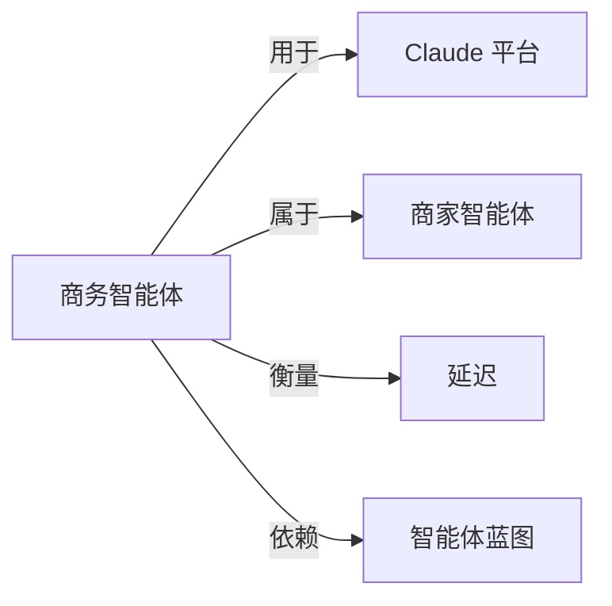

# 商务智能体

> **分类**：行业与场景 ｜ **英文**：Commerce Agent ｜ **出现于 2 篇文章**

## 摘要

商务智能体（Commerce Agent）是在电商或旅行等场景中辅助用户搜索、比较与购买的智能体，与面向商家的商家智能体同属一套商务智能体蓝图。它重要是因为消费品牌与平台正积极用前沿 AI 改造购物体验，而蓝图把让这类智能体在几天内跑起来所需的执行框架、模式与护栏打包提供，降低了落地门槛。

## 关键做法

- 从官方蓝图起步：使用 Claude 上构建商务智能体的蓝图，直接获得执行框架（harness）、模式与护栏，而不是从零搭建。
- 参考已有实现：蓝图提供面向零售、旅游、电信和票务平台的购物智能体与商家智能体参考实现，可对照自身场景选用。
- 用 Claude Code 插件加速上手：蓝图附带一个 Claude Code 插件，帮助团队快速进入开发。
- 提前处理工程难点：把构建、认证、延迟等问题纳入设计考量，其中延迟是衡量这类智能体表现的关键指标之一。
- 区分两类角色：面向消费者的购物智能体与面向商家的商家智能体职责不同，需分别设计。

## 在 Claude 里的用法

在 Claude 平台上，团队依托商务智能体蓝图构建购物智能体与商家智能体，覆盖零售、旅游、电信、票务等场景。工程团队可通过蓝图附带的 Claude Code 插件快速上手，并参考蓝图中的执行框架、模式与护栏完成实现。官方还通过网络研讨会讲解这些参考实现并现场解答构建、认证、延迟方面的问题。

## 常见误区

- 误以为要从零自建：蓝图已提供执行框架、模式与护栏及多行业参考实现，可直接复用。
- 只关注功能而忽略延迟与认证：这两者是实际落地中的典型棘手问题，应在设计初期就纳入。

## 相关概念

- [Claude 平台](Claude-平台.md) —— 商务智能体蓝图构建于其上，是其运行与开发的基础。
- [商家智能体](商家智能体.md) —— 与购物智能体并列，同属商务智能体蓝图提供的参考实现。
- [延迟](延迟.md) —— 衡量商务智能体表现的关键指标，也是构建中的常见难题。
- [智能体蓝图](智能体蓝图.md) —— 商务智能体依赖该蓝图获得执行框架、模式与护栏。

## 知识图谱（Knowledge Graph）

## 来源（Sources）

| # | 文章 | 原文 |
| --- | --- | --- |
| 1 | [使用 Claude 构建商务智能体](../docs/zh/articles/claude-for-commerce-agents.md) | [原文](https://claude.com/resources/articles/claude-for-commerce-agents) |
| 2 | [构建 Claude 商业智能体](../docs/zh/webinars/building-claude-commerce-agents.md) | [原文](https://claude.com/resources/webinars/building-claude-commerce-agents) |
