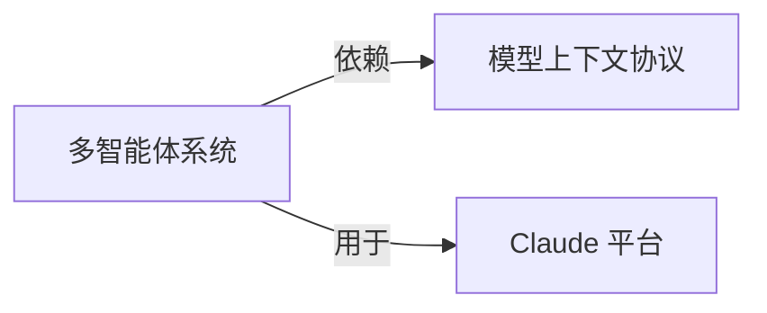

# 多智能体系统

> **分类**：智能体架构 ｜ **英文**：Multi-Agent System ｜ **出现于 3 篇文章**

## 摘要
多智能体系统（Multi-Agent System）是一种架构，其中多个 LLM 实例在各自独立的对话上下文中运行，并通过代码进行协调，每个智能体负责任务中一个独立的切片。它的价值在于保护上下文、支持并行工作，并实现单个智能体难以维持的专业化分工。不过它并非默认选择——许多场景下改进单个智能体的提示词就能达到同等效果。

## 关键做法
- 先判断是否真的需要多智能体：多智能体系统常被用在单个智能体会表现更好的场景，投入前应先尝试优化单智能体的提示词。
- 从编排器-子智能体模式起步：由主导智能体派生并管理针对特定子任务的专用子智能体，这种分层模型协调方式直接，适合刚接触多智能体系统的团队。
- 按任务切片划分职责：例如一个子智能体负责研究、一个编排器负责规划，让每个智能体只承担独立的一块工作。
- 让每个智能体运行在独立上下文中，通过代码而非共享对话历史来协调，以保护上下文并支持并行。
- 了解其他协调模式的取舍：除编排器-子智能体之外，还存在智能体集群、基于能力的系统以及消息总线架构等模式。

## 在 Claude 里的用法
在 Claude 平台上，多智能体系统可以借助 Model Context Protocol（MCP）与 Agent-to-Agent 协议（A2A）落地，实现智能体之间的工具集成、上下文共享与任务委派；Anthropic 与 Google Cloud 联合的网络研讨会演示了在 Vertex AI 上使用 Claude 构建这类系统的方式。企业级案例中，L'Oréal 构建了以 Claude 为核心的多智能体系统，编排 15 个以上专用智能体协同工作，将用户问题转化为洞察和可视化，服务于遍布 150 个国家的 44,000 名员工。

## 常见误区
- 默认认为多智能体优于单智能体：Anthropic 看到一些团队投入数月构建精心设计的多智能体架构，最终发现改进单个智能体的提示词就能达到同等效果。
- 把多智能体当作起点而非演进结果：更稳妥的路径是先压榨单智能体能力，确认确有上下文隔离、并行或专业化需求后再拆分。

## 相关概念
- [模型上下文协议](模型上下文协议.md) —— 多智能体系统依赖 MCP 实现智能体之间的工具集成与上下文共享。
- [Claude 平台](Claude-平台.md) —— 多智能体系统在 Claude 平台上借助 Claude 模型与相关协议构建和部署。

## 知识图谱（Knowledge Graph）

## 来源（Sources）

| # | 文章 | 原文 |
| --- | --- | --- |
| 1 | [构建多智能体系统：何时使用以及如何使用](../docs/zh/articles/building-multi-agent-systems-when-and-how-to-use-them.md) | [原文](https://claude.com/resources/articles/building-multi-agent-systems-when-and-how-to-use-them) |
| 2 | [领先零售商如何将 AI 试点转化为企业级转型](../docs/zh/articles/how-leading-retailers-are-turning-ai-pilots-into-enterprise-wide-transformation.md) | [原文](https://claude.com/resources/articles/how-leading-retailers-are-turning-ai-pilots-into-enterprise-wide-transformation) |
| 3 | [在 Vertex AI 上使用 Claude，通过 MCP 与 A2A 部署多智能体系统](../docs/zh/webinars/deploying-multi-agent-systems-using-mcp-and-a2a-with-claude-on-vertex-ai.md) | [原文](https://claude.com/resources/webinars/deploying-multi-agent-systems-using-mcp-and-a2a-with-claude-on-vertex-ai) |
