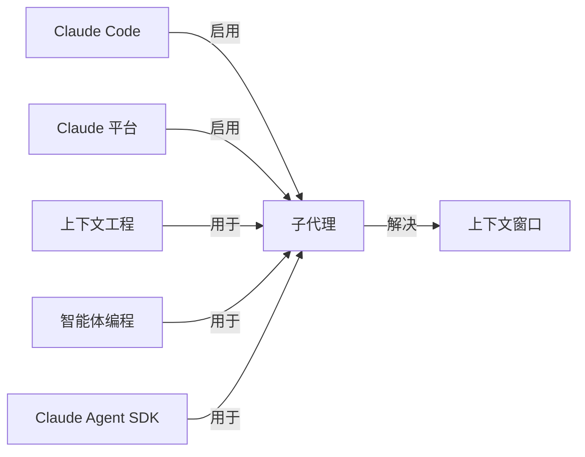

# 子代理

> **分类**：智能体架构 ｜ **英文**：Subagents ｜ **出现于 30 篇文章**

## 摘要

子代理（Subagents）是拥有独立上下文窗口、工具与指令，并由主代理（协调器）编排的专注执行单元。它把"规划"与"执行"从同一个上下文窗口中拆开，因此在长时间运行、大规模并行、高度结构化或对抗性任务中，能避免单上下文膨胀导致的性能下降。子代理是智能体架构的核心组成部分，在验证、并行工作和模块化权限控制方面尤其有效。

## 关键做法

- 把子任务交给拥有全新上下文的子代理执行，任务完成后即丢弃其上下文，避免主循环的上下文膨胀。
- 用协调器（主代理）负责规划与调度，子代理只负责专注执行，形成"规划—执行"分离的结构。
- 在需要并行处理多个任务时使用子代理，让每个任务各自使用独立的上下文窗口。
- 当单一智能体难以选择合适的工具，或系统提示词中存在相互冲突的指令时，考虑拆分为子代理。
- 反过来也要评估折叠：当子代理带来的收益不足以抵消成本时，把路由器、规划器和领域子代理折叠进主智能体循环，往往能获得更低的任务成本与延迟。
- 借助动态工作流中的特殊函数来生成和协调子智能体，把编排逻辑写成可执行的流程。

## 在 Claude 里的用法

在 Claude Code 中，子代理由动态工作流的 JavaScript 文件通过专门的函数生成与协调，用于长时间运行、大规模并行或对抗性任务；Anthropic 内部的代码迁移实践就使用了数百个智能体、阶段门禁与多轮对抗性审查。Claude Agent SDK（原 Claude Code SDK）作为驱动 Claude Code 的执行框架，也可用于构建带子代理的智能体。在 Claude Cowork 与基于 Claude Platform 构建的多智能体研究系统中，子代理同样承担并行与验证类工作。需要注意的是，带 Skills 的单一智能体在企业部署对比中经常在质量上优于子代理设计，且单任务成本与延迟通常更低，因此是否引入子代理应视任务特征而定。

## 常见误区

- 认为子代理总是优于单一智能体：在企业部署对比中，带 Skills 的单一智能体在质量上经常优于子代理设计，且成本与延迟通常更低。
- 忽视上下文膨胀的信号：当单一智能体循环已出现可测量的性能下降时仍不拆分，或反之在无并行、无上下文隔离需求时强行拆分，都会得不偿失。
- 把子代理当成单纯的"多开"：子代理的价值在于独立上下文与模块化权限控制，而非数量本身。

## 相关概念

- [Claude Code](Claude-Code.md) —— 通过动态工作流生成与协调子智能体来启用子代理能力。
- [Claude 平台](Claude-平台.md) —— 由「Claude 平台」启用
- [上下文工程](上下文工程.md) —— 子代理是上下文工程中隔离与分配上下文的手段之一。
- [上下文窗口](上下文窗口.md) —— 子代理拥有独立上下文窗口，正是为解决主上下文膨胀问题而设计。
- [智能体编程](智能体编程.md) —— 子代理属于智能体编程架构中的编排单元。
- [Claude Agent SDK](Claude-Agent-SDK.md) —— 被「Claude Agent SDK」使用
- [Claude Cowork](Claude-Cowork.md) —— 启用「Claude Cowork」

## 知识图谱（Knowledge Graph）

## 来源（Sources）

| # | 文章 | 原文 |
| --- | --- | --- |
| 1 | [为每个任务打造执行框架：Claude Code 中的动态工作流](../docs/zh/articles/a-harness-for-every-task-dynamic-workflows-in-claude-code.md) | [原文](https://claude.dev/blog/a-harness-for-every-task-dynamic-workflows-in-claude-code/) |
| 2 | [Anthropic 如何用 Claude Code 运行大规模代码迁移](../docs/zh/articles/ai-code-migration.md) | [原文](https://claude.com/resources/articles/ai-code-migration) |
| 3 | [在 Claude Code 中使用 Claude Opus 4.7 的最佳实践](../docs/zh/articles/best-practices-for-using-claude-opus-4-7-with-claude-code.md) | [原文](https://claude.com/resources/articles/best-practices-for-using-claude-opus-4-7-with-claude-code) |
| 4 | [构建智能体：何时将子智能体折叠进主智能体循环](../docs/zh/articles/building-agents-when-to-fold-subagents-into-your-main-agent-loop.md) | [原文](https://claude.com/resources/articles/building-agents-when-to-fold-subagents-into-your-main-agent-loop) |
| 5 | [使用 Claude Agent SDK 构建智能体](../docs/zh/articles/building-agents-with-the-claude-agent-sdk.md) | [原文](https://claude.com/resources/articles/building-agents-with-the-claude-agent-sdk) |
| 6 | [三家 YC 初创公司如何用 Claude Code 打造自己的公司](../docs/zh/articles/building-companies-with-claude-code.md) | [原文](https://claude.com/resources/articles/building-companies-with-claude-code) |
| 7 | [面向初创企业的 Claude Code 指南](../docs/zh/articles/claude-code-guide-for-startups.md) | [原文](https://claude.com/resources/articles/claude-code-guide-for-startups) |
| 8 | [编码会话变得更长、使用更多上下文。Claude Opus 5.5 正是为此而生。](../docs/zh/articles/claude-opus-5-5-built-for-coding-sessions-that-use-more-context.md) | [原文](https://claude.com/resources/articles/claude-opus-5-5-built-for-coding-sessions-that-use-more-context) |
| 9 | [用插件定制 Cowork](../docs/zh/articles/cowork-plugins.md) | [原文](https://claude.com/resources/articles/cowork-plugins) |
| 10 | [在法律行业部署 Claude](../docs/zh/articles/deploying-claude-across-the-legal-industry.md) | [原文](https://claude.com/resources/articles/deploying-claude-across-the-legal-industry) |

## 反向链接（Backlinks）

- [Claude Agent SDK](Claude-Agent-SDK.md)
- [动态工作流](动态工作流.md)
- [插件](插件.md)
- [智能体工作流](智能体工作流.md)
- [钩子](钩子.md)
