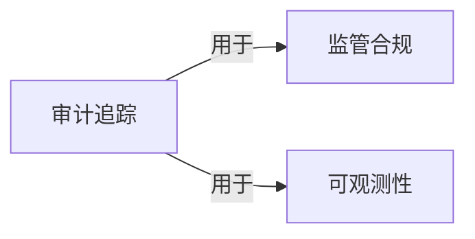

# 审计追踪

> **分类**：安全与治理 ｜ **英文**：Audit Trail ｜ **出现于 2 篇文章**

## 摘要

审计追踪（Audit Trail）是记录智能体所有操作与决策来源的完整日志，用于回答"谁在什么身份下做了什么、依据什么"。在智能体从单人助手走向多人共享工作区的场景中，它既是安全治理的基础设施，也是满足行业监管要求的前提。

## 关键做法

- 为智能体建立独立身份：在多人共享场景中，让 Claude 使用绑定到工作区的专属账户，而非某个人的个人账户，使每条操作都能归属到明确的执行主体。
- 记录决策来源而非仅记录结果：日志应覆盖智能体推理、规划与执行的全过程，便于事后追溯某一步为何被执行。
- 将审计追踪纳入系统设计阶段：在构建智能体系统时同步考虑日志与追溯能力，而不是上线后再补。
- 面向监管场景对齐要求：在医疗等受监管行业，审计追踪需服务于行业特有的监管要求与临床安全标准。
- 与可观测性能力打通：把审计日志作为可观测性数据的一部分统一采集与分析，支撑持续审查。

## 在 Claude 里的用法

在 Claude Tag 这类多人共享频道的体验中，Claude 通过**智能体身份（agent identity）**使用属于工作区的工具与上下文，管理员负责设置并绑定该身份，从而使操作可归属、可审计。在医疗与生命科学等受监管行业的智能体落地中，审计追踪与监管合规要求一同被纳入系统设计。结合可观测性实践，团队可以持续审查智能体的行为与决策链路。

## 常见误区

- 只记录最终输出而不记录决策来源，导致无法解释智能体为何采取某一步。
- 让智能体沿用个人账户行事，使多人协作场景下的操作归属模糊，审计失去意义。
- 把审计追踪当作上线后的附加项，而非系统设计的一部分。

## 相关概念

- [监管合规](监管合规.md) —— 审计追踪是满足行业监管要求、证明智能体行为可追溯的手段。
- [可观测性](可观测性.md) —— 审计追踪提供的行为日志是可观测性的重要数据来源。

## 知识图谱（Knowledge Graph）

## 来源（Sources）

| # | 文章 | 原文 |
| --- | --- | --- |
| 1 | [Claude Tag 中的智能体身份：面向自主、团队级 AI 的全新访问模型](../docs/zh/articles/agent-identity-access-model.md) | [原文](https://claude.com/resources/articles/agent-identity-access-model) |
| 2 | [为医疗健康与生命科学构建 AI 智能体](../docs/zh/articles/building-ai-agents-in-healthcare-and-life-sciences.md) | [原文](https://claude.com/resources/articles/building-ai-agents-in-healthcare-and-life-sciences) |
