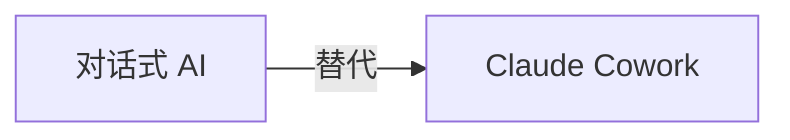

# 对话式 AI

> **分类**：行业与场景 ｜ **英文**：conversational AI ｜ **出现于 2 篇文章**

## 摘要

对话式 AI 指以问答交互为主、不直接产出交付物的 AI 形态：用户在聊天窗口提出问题、得到回答，而把回答转化为演示文稿、文档、电子表格或已发送邮件等实际成果的工作仍由用户自己完成。它之所以重要，是因为它构成了大多数 AI 工具的默认形态，也是理解 Claude Cowork 等"为工作本身而构建"的产品定位的参照系。

## 关键做法

- 明确区分"给答案"与"交付成果"：对话式 AI 的产出止于回答，后续的落地加工需要由人承担。
- 把对话式 AI 用在起草类任务上，例如对话式起草，而不是期待它端到端完成多步骤工作。
- 按任务类型选择工具：对话式起草用 chat，编码用 Claude Code，跨应用知识工作用 Claude Cowork。
- 当任务需要读写本地文件、调用已连接的工作应用或长时间运行时，不要停留在对话式交互，改用具备这些能力的产品形态。

## 在 Claude 里的用法

在 Claude 的产品矩阵中，chat 承担对话式起草的角色，适合快速问答与文本草拟。当工作需要跨应用流转信息、访问本地文件或运行多步骤任务时，则切换到 Claude Cowork；编码类工作交给 Claude Code。理解这一分工，可以帮助用户在对话式 AI 与面向交付的产品之间做出选择。

## 常见误区

- 误以为对话式 AI 会直接产出可交付成果：实际上把回答变成演示文稿、文档、表格或已发送邮件的工作仍由用户完成。
- 把所有 AI 工具都当作对话式工具使用，从而在需要文件访问、子智能体、长时间运行工作和定时任务的场景中选错产品。

## 相关概念

- [Claude Cowork](Claude-Cowork.md) —— 作为对话式 AI 的替代形态出现，为工作本身而构建，可直接读写文件、使用已连接应用并代为运行多步骤任务。

## 知识图谱（Knowledge Graph）

## 来源（Sources）

| # | 文章 | 原文 |
| --- | --- | --- |
| 1 | [Claude Cowork 产品指南](../docs/zh/articles/the-claude-cowork-product-guide.md) | [原文](https://claude.com/resources/articles/the-claude-cowork-product-guide) |
| 2 | [Claude Cowork 产品指南](../docs/zh/guides/claude-cowork-product-guide.md) | [原文](https://claude.com/resources/guides/claude-cowork-product-guide) |
