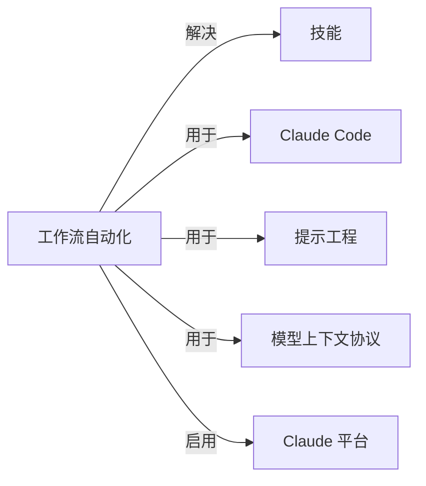

# 工作流自动化

> **分类**：企业落地与组织 ｜ **英文**：Workflow Automation ｜ **出现于 6 篇文章**

## 摘要

工作流自动化指用智能体（尤其是 Claude）自动完成原本耗时、重复的业务流程，让团队把精力从机械操作转向判断与创造。它的价值在于把“教一次、始终如一”的能力沉淀为可复用的资产，从而在个人、团队乃至整个组织层面统一工作方式。

## 关键做法

- 先识别高频、重复、规则相对稳定的流程（如文档创建、调研、客户沟通、跟进邮件），这些是最适合自动化的起点。
- 用 Skills 把工作流“教”给 Claude 一次，之后即可一致地复用，而不是每次重新写提示。
- 从个人小工具起步：先解决自己每天最痛的环节，验证有效后再向团队扩散。
- 把成熟工具打包为可分发形态（如 Cowork 插件），让整个团队以相同方式使用。
- 当流程需要连接外部系统时，将集成能力与可靠工作流搭配使用，而不是只依赖单次调用。

## 在 Claude 里的用法

在 Claude 中，工作流自动化主要通过 Skills 实现：你可以构建、测试并分发 Skills，用于独立工作流或 MCP 增强的集成。Claude Code 可用于构建自动化工具本身，即使没有编程经验也能迭代出可用应用；成熟方案还能打包成 Cowork 插件供团队使用。对于需要对接外部系统的场景，可将 MCP 连接器与 Skills 搭配，形成端到端的自动化流程。

## 常见误区

- 误以为自动化必须从写代码开始：实际可以先从 Skills 和现成工具入手，把编程交给 Claude 完成。
- 误以为一次构建即可长期不变：有效的工作流往往经历多次迭代才稳定。
- 只做个人效率工具而不考虑分发，导致团队无法以一致方式复用同一套工作流。

## 相关概念

- [技能](技能.md) —— Skills 是承载并复用工作流的核心机制，教一次即可一致应用。
- [Claude Code](Claude-Code.md) —— 用于构建自动化工具本身，可把流程固化为可运行的应用。
- [提示工程](提示工程.md) —— 用于设计与调优自动化流程中给 Claude 的指令。
- [模型上下文协议](模型上下文协议.md) —— 用于把工作流与外部系统和数据连接起来。
- [Claude 平台](Claude-平台.md) —— 提供启用工作流自动化的产品与分发能力（如 Cowork 插件）。

## 知识图谱（Knowledge Graph）

## 来源（Sources）

| # | 文章 | 原文 |
| --- | --- | --- |
| 1 | [构建 Claude Skills 的完整指南](../docs/zh/articles/complete-guide-to-building-skills-for-claude.md) | [原文](https://claude.com/resources/articles/complete-guide-to-building-skills-for-claude) |
| 2 | [一位 Anthropic 销售人员如何用 Claude Code 重建团队工作流](../docs/zh/articles/how-anthropic-uses-claude-gtm-engineering.md) | [原文](https://claude.com/resources/articles/how-anthropic-uses-claude-gtm-engineering) |
| 3 | [Anthropic 法务团队如何借助 Claude 将审查时间从数天缩短至数小时](../docs/zh/articles/how-anthropic-uses-claude-legal.md) | [原文](https://claude.com/resources/articles/how-anthropic-uses-claude-legal) |
| 4 | [Agent Skills：将 Claude 从助手转变为专用智能体](../docs/zh/webinars/agent-skills-transform-claude-from-assistant-to-specialized-agent.md) | [原文](https://claude.com/resources/webinars/agent-skills-transform-claude-from-assistant-to-specialized-agent) |
| 5 | [面向金融服务业的 Claude Code：向 Claude Code 负责人 Boris Cherny 学习](../docs/zh/webinars/claude-code-for-financial-services-boris-cherny.md) | [原文](https://claude.com/resources/webinars/claude-code-for-financial-services-boris-cherny) |
| 6 | [面向服务交付的 Claude Code：向 Claude Code 负责人 Boris Cherny 学习](../docs/zh/webinars/claude-code-service-delivery.md) | [原文](https://claude.com/resources/webinars/claude-code-service-delivery) |
