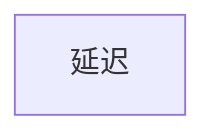

# 延迟

> **分类**：成本与性能 ｜ **英文**：latency ｜ **出现于 2 篇文章**

## 摘要

延迟（latency）指任务从开始到完成所需的时间开销，是评估 AI 智能体与工作流设计时与成本并列的核心约束之一。它之所以重要，是因为许多提升质量的模式（如多阶段顺序处理、评估—迭代）本质上都是用额外延迟换取更高准确性，团队必须判断这笔交换是否值得。

## 关键做法

- 在设计工作流前先明确延迟与成本约束，它们直接决定你能运行多少智能体、能负担多少次迭代。
- 采用顺序式工作流时，接受"以一定延迟换取更高准确性"的取舍：每个智能体只专注特定子任务，而非一次处理全部。
- 只有当首次尝试与最终质量之间的差距足够显著、值得额外的 token 和延迟时，才引入评估—迭代模式。
- 先用单个智能体建立基线，再对比多智能体工作流的产出，以判断增加的延迟是否真的带来了改进。
- 为每一步定义失败回退与重试逻辑，避免重试放大延迟而不提升成功率。

## 在 Claude 里的用法

在 Claude 上构建智能体工作流时，延迟是选型的关键判据：简单的单智能体方案延迟最低，适合作为基线；而顺序式多阶段流程或带评估器的工作流会引入额外延迟，应仅在质量收益明显时采用。构建面向消费者的商务智能体等场景时，延迟也常与构建、认证等问题一并成为需要提前规划的实际约束。

## 常见误区

- 认为更复杂的工作流一定更好：若质量提升有限，额外延迟与 token 开销并不划算。
- 只关注单次调用速度，忽略重试与多轮迭代对端到端延迟的累积影响。

## 相关概念

## 知识图谱（Knowledge Graph）

## 来源（Sources）

| # | 文章 | 原文 |
| --- | --- | --- |
| 1 | [AI 智能体的常见工作流模式——以及何时使用它们](../docs/zh/articles/common-workflow-patterns-for-ai-agents-and-when-to-use-them.md) | [原文](https://claude.com/resources/articles/common-workflow-patterns-for-ai-agents-and-when-to-use-them) |
| 2 | [构建 Claude 商业智能体](../docs/zh/webinars/building-claude-commerce-agents.md) | [原文](https://claude.com/resources/webinars/building-claude-commerce-agents) |
