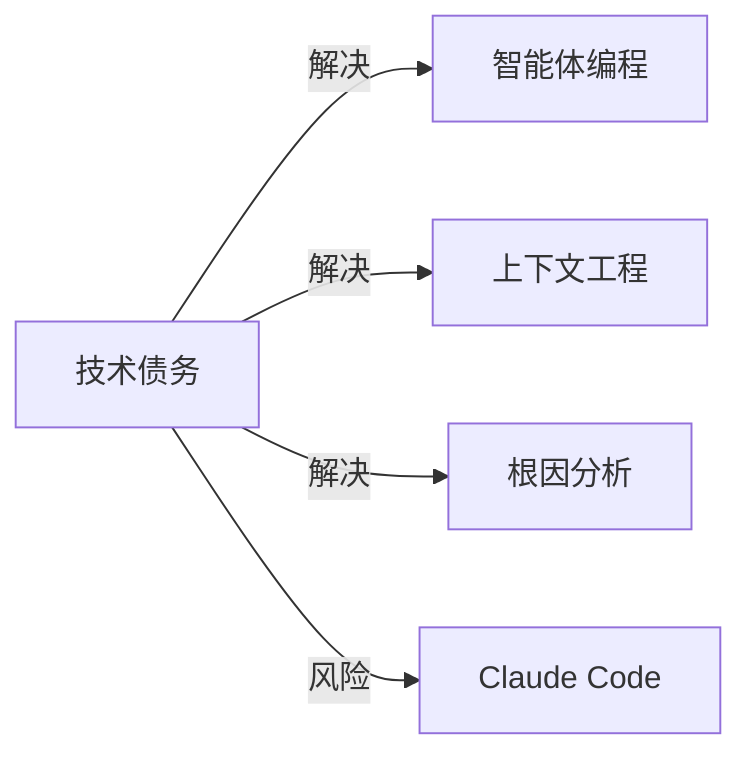

# 技术债务

> **分类**：Claude Code 与编程 ｜ **英文**：Technical Debt ｜ **出现于 3 篇文章**

## 摘要

技术债务指为换取短期交付速度而积累、需要在后续维护中偿还的负担。它之所以重要，是因为智能体编程的复合效应能把原本需要数月才能解决的技术债务逐步消化，而放任不管则会让代码库越来越难以维护。在 AI 原生开发中，技术债务既是需要主动防范的风险，也是可以借助智能体持续偿还的对象。

## 关键做法

- 在 MVP 阶段就考虑架构、范围与安全实践，防止 AI 生成的代码库累积技术债，而不是等到规模化阶段再补救。
- 把技术债务的偿还交给智能体持续进行：智能体编程的复合效应让原本看似过于昂贵的清理任务变得可行，数月才能解决的技术债可以逐步解决。
- 让智能体充当质量守门人，使代码标准不因截止日期压力或个人经验水平而松动，从而减少技术债务的积累。
- 把范围限制在可独立描述的封闭问题上，避免在缺乏项目上下文时引入难以维护的改动。
- 关注结果指标：更少的生产事故、更少的技术债务积累、问题发生时更快的调试，以及更易维护的代码库。

## 在 Claude 里的用法

在 Claude Code 中，可以把清理与重构任务交给智能体执行，让它在日常开发中持续偿还技术债务，而不是积压成一次性的大工程。结合上下文工程提供足够的项目背景，能让智能体更准确地判断哪些改动会引入新的债务。对于初创团队，产品矩阵说明了在创意、MVP、发布和规模化各阶段何时使用 Chat、Cowork 与 Claude Code，其中 MVP 阶段的重点之一就是防止 AI 生成的代码库累积技术债。

## 常见误区

- 认为技术债务只是代码风格问题：它实际表现为生产事故、调试变慢和维护成本上升。
- 认为先快速交付、以后再统一偿还即可：资料强调的是在 MVP 阶段就通过架构与范围实践防止累积。
- 认为智能体编程会自动消除技术债务：它提供的是偿还与守门的能力，仍需在流程中被实际使用。

## 相关概念

- [智能体编程](智能体编程.md) —— 智能体编程的复合效应使技术债务得以逐步解决，并减少其积累。
- [上下文工程](上下文工程.md) —— 提供充分上下文可降低智能体改动引入新债务的风险。
- [根因分析](根因分析.md) —— 用于定位问题源头，避免以打补丁的方式制造新的技术债务。
- [Claude Code](Claude-Code.md) —— 承载智能体偿还技术债务与充当质量守门人的主要产品。

## 知识图谱（Knowledge Graph）

## 来源（Sources）

| # | 文章 | 原文 |
| --- | --- | --- |
| 1 | [转向智能体式编码进行软件开发有哪些关键收益？](../docs/zh/articles/key-benefits-transitioning-agentic-coding.md) | [原文](https://claude.com/resources/articles/key-benefits-transitioning-agentic-coding) |
| 2 | [像对待新开发者一样上手 Claude Code：来自 17 年开发经验的启示](../docs/zh/articles/onboarding-claude-code-like-a-new-developer-lessons-from-17-years-of-development.md) | [原文](https://claude.com/resources/articles/onboarding-claude-code-like-a-new-developer-lessons-from-17-years-of-development) |
| 3 | [创始人实战手册：打造 AI 原生初创公司](../docs/zh/articles/the-founders-playbook.md) | [原文](https://claude.com/resources/articles/the-founders-playbook) |
