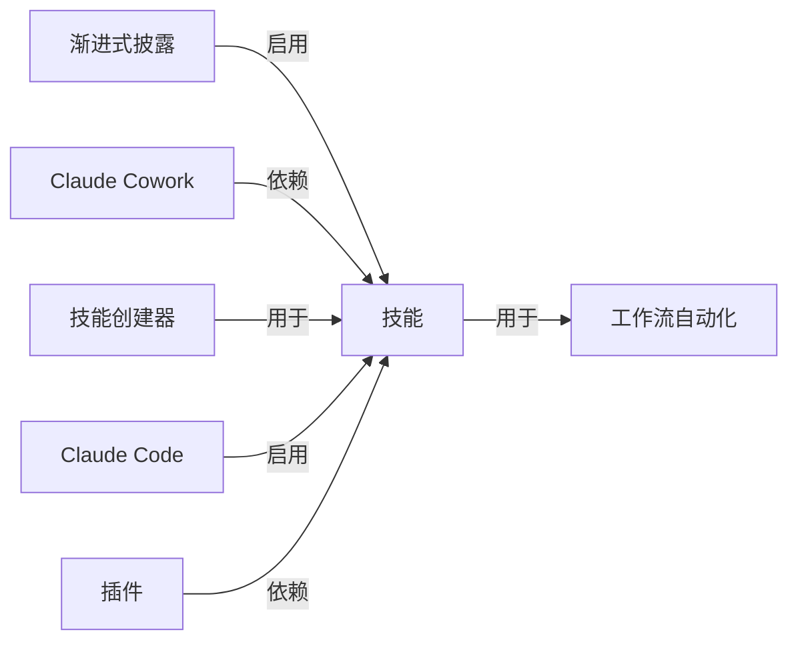

# 技能

> **分类**：工具与扩展 ｜ **英文**：Skills ｜ **出现于 46 篇文章**

## 摘要

技能（Skills）是以文件封装可复用工作流与领域专长的能力包，把工作流、最佳实践与脚本组织成智能体可直接访问和应用的格式。它的价值在于把能力出众的通用智能体转变为特定领域的专家，同时让团队像管理代码一样共同迭代和分发这些专业知识。

## 关键做法

- 把常驻指令写成 Markdown 文件作为 Skills 存放，使多位队友可以共同迭代，并像管理代码一样管理变更。
- 在技能文件中沉淀路由指令、策略以及作为自我改进循环一部分的经验教训日志等关键信息。
- 为技能配套评估（eval）：用评估信号判断技能在特定任务上的表现，并用留出示例捕捉过拟合。
- 迭代时一次只做一处改动，针对评估逐步改进，避免自欺欺人式的“提升”。
- 优先考虑“带 Skills 的单一智能体”而非子智能体拆分：在企业部署对比中，前者在质量上经常更优，单任务成本与延迟通常也更低。
- 当出现上下文膨胀导致的性能下降、需要并行处理任务，或单一智能体难以选对工具时，再考虑拆分结构。

## 在 Claude 里的用法

在 Claude Code 中，Skills 以 Markdown 文件形式承载常驻指令与工作流，可配合 `claude-api` 技能使用 `/claude-api build-eval` 构建评估、用 `/claude-api hillclimb` 针对评估改进应用。Claude Cowork 同样可启用技能来复用专业工作流。技能还可通过插件分发，并借助技能创建器生成，是上下文工程与工作流自动化的重要载体。

## 常见误区

- 认为领域专用智能体必须各自拥有独立工具与脚手架：随着模型智能提升，业界已收敛到用 Skills 为通用智能体注入专长的做法。
- 只写技能不做评估：没有评估信号就无法判断技能在目标任务上的真实表现，也难以发现过拟合。
- 默认拆分子智能体更优：在多项企业部署对比中，带 Skills 的单一智能体在质量、成本与延迟上往往更好。

## 相关概念

- [渐进式披露](渐进式披露.md) —— 技能按需加载所依赖的机制。
- [Claude Cowork](Claude-Cowork.md) —— 可启用技能的产品入口。
- [技能创建器](技能创建器.md) —— 被「技能创建器」使用
- [Claude Code](Claude-Code.md) —— 技能的主要使用场景之一，可用 `claude-api` 技能构建评估与迭代。
- [工作流自动化](工作流自动化.md) —— 用于「工作流自动化」
- [插件](插件.md) —— 技能分发与复用的载体之一。
- [Claude 平台](Claude-平台.md) —— 用于「Claude 平台」

## 知识图谱（Knowledge Graph）

## 来源（Sources）

| # | 文章 | 原文 |
| --- | --- | --- |
| 1 | [Claude Fable 5 实战指南：发现你的未知](../docs/zh/articles/a-field-guide-to-claude-fable-finding-your-unknowns.md) | [原文](https://claude.com/resources/articles/a-field-guide-to-claude-fable-finding-your-unknowns) |
| 2 | [Claude 值班：Claude Tag 如何成为 Anthropic 应对 CI/CD 故障的第一响应者](../docs/zh/articles/ai-ci-cd-on-call.md) | [原文](https://claude.com/resources/articles/ai-ci-cd-on-call) |
| 3 | [在生产环境中运行自动模式](../docs/zh/articles/auto-mode-in-production.md) | [原文](https://claude.com/resources/articles/auto-mode-in-production) |
| 4 | [用 Claude 自动化评估设计与爬山优化](../docs/zh/articles/automating-eval-design-and-hillclimbing.md) | [原文](https://claude.dev/blog/automating-eval-design-and-hillclimbing/) |
| 5 | [用 MCP 构建触达生产系统的智能体](../docs/zh/articles/building-agents-that-reach-production-systems-with-mcp.md) | [原文](https://claude.com/resources/articles/building-agents-that-reach-production-systems-with-mcp) |
| 6 | [构建智能体：何时将子智能体折叠进主智能体循环](../docs/zh/articles/building-agents-when-to-fold-subagents-into-your-main-agent-loop.md) | [原文](https://claude.com/resources/articles/building-agents-when-to-fold-subagents-into-your-main-agent-loop) |
| 7 | [用 Skills 构建智能体：为智能体装备专业化工作能力](../docs/zh/articles/building-agents-with-skills-equipping-agents-for-specialized-work.md) | [原文](https://claude.com/resources/articles/building-agents-with-skills-equipping-agents-for-specialized-work) |
| 8 | [构建 AI 原生收入组织](../docs/zh/articles/building-an-ai-native-revenue-organization.md) | [原文](https://claude.com/resources/articles/building-an-ai-native-revenue-organization) |
| 9 | [在 Claude Code 中用 Skills 构建验证循环](../docs/zh/articles/building-verification-loops-in-claude-code-with-skills.md) | [原文](https://claude.com/resources/articles/building-verification-loops-in-claude-code-with-skills) |
| 10 | [面向初创企业的 Claude Code 指南](../docs/zh/articles/claude-code-guide-for-startups.md) | [原文](https://claude.com/resources/articles/claude-code-guide-for-startups) |

## 反向链接（Backlinks）

- [Claude 平台](Claude-平台.md)
- [MCP 服务器](MCP-服务器.md)
- [上下文窗口](上下文窗口.md)
- [业务拓展代表](业务拓展代表.md)
- [子代理](子代理.md)
- [工作流自动化](工作流自动化.md)
- [技能创建器](技能创建器.md)
- [提示工程](提示工程.md)
- [插件市场](插件市场.md)
- [智能体](智能体.md)
- [智能体工作流](智能体工作流.md)
- [模型上下文协议](模型上下文协议.md)
- [爬山优化](爬山优化.md)
- [评估](评估.md)
- [验证](验证.md)
