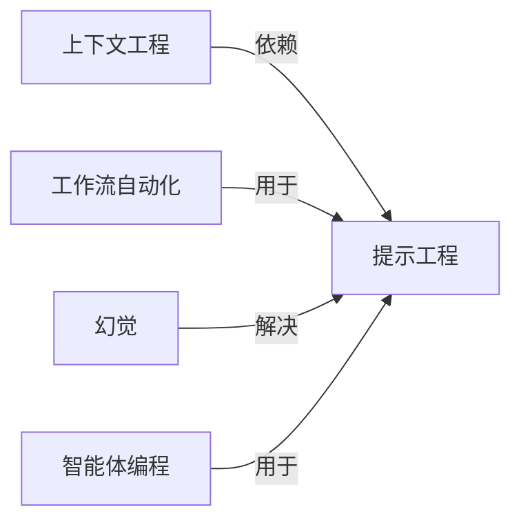

# 提示工程

> **分类**：上下文工程 ｜ **英文**：Prompt Engineering ｜ **出现于 10 篇文章**

## 摘要

提示工程（Prompt Engineering）是通过组织与措辞指令、指定风格、提供上下文来引导模型产出预期结果的手艺，也是上下文工程的基本构建块。一条含糊指令与一条精心设计的提示词之间，往往就是泛泛输出与真正想要结果之间的差距；结构糟糕的提示词需要多轮来回澄清，而工程化良好的提示词能一次到位。随着面向 Claude 5 代模型的实践演进，提示正与上下文工程趋于融合——更少的脚手架，更多的内容策展。

## 关键做法

- 把意图写清楚：明确说明你想要的输出、风格与目标，而不是留下含糊指令让模型猜测。
- 主动提供上下文：在提示词中补齐模型完成任务所需的背景信息，减少因信息缺失导致的来回澄清。
- 一次到位而非多轮试错：把提示词当作需要设计与迭代的产物，先结构化组织指令，再根据输出结果修正。
- 移除提示词中的反模式：在升级到前沿 Claude 模型时，清理旧提示词里为老模型写的冗余技巧与补丁。
- 让提示词前缀保持稳定以提升缓存命中：提示词缓存要求整个跨度逐字节一致，且绑定特定模型、有有限生存时间，因此应把不变内容放在前面。
- 用技能固化最佳实践：把经过验证的提示写法沉淀为可复用的技能，而不是每次重新手写。

## 在 Claude 里的用法

在 Claude Platform 上，提示工程实践被写入 `claude-api` skill，Claude Code 配合该 skill 常能找到在保持或提升性能的同时降低成本的方法。提示词缓存是提示工程在平台侧的直接体现：Claude 先把提示词处理为内部工作状态（prefill），相同前缀的请求可读回 KV 缓存，而缓存读取计费仅为完整输入价格的一小部分。在 Claude Code、Cowork 等产品中，良好的提示与技能、插件结合，可把一次性对话沉淀为可重复的工作流。

## 常见误区

- 认为提示工程只是"把话说得客气一点"：它实际关乎指令组织、风格指定与上下文供给，含糊指令会直接换来泛泛输出。
- 忽视缓存对提示词稳定性的要求：前缀只要不是逐字节一致，缓存就无法命中，成本优势随之消失。
- 把旧模型的提示技巧原样搬到新模型：升级到前沿 Claude 模型时应移除提示词中的反模式，而不是层层叠加脚手架。

## 相关概念

- [上下文工程](上下文工程.md) —— 提示工程是上下文工程的基本构建块，二者正趋于融合。
- [工作流自动化](工作流自动化.md) —— 提示工程被用于把重复性沟通与流程固化为可自动运行的步骤。
- [幻觉](幻觉.md) —— 精心设计的提示词是减少模型编造内容的直接手段之一。
- [智能体编程](智能体编程.md) —— 提示工程被用于指导 Claude Code 等智能体完成编码任务。

## 知识图谱（Knowledge Graph）

## 来源（Sources）

| # | 文章 | 原文 |
| --- | --- | --- |
| 1 | [2026 年提示词工程最佳实践](../docs/zh/articles/best-practices-for-prompt-engineering.md) | [原文](https://claude.com/resources/articles/best-practices-for-prompt-engineering) |
| 2 | [Carta Healthcare 如何让 AI 像临床数据提取员一样推理](../docs/zh/articles/carta-healthcare-clinical-abstractor.md) | [原文](https://claude.com/resources/articles/carta-healthcare-clinical-abstractor) |
| 3 | [Anthropic 的一位现场营销人员如何用 Claude Code 每周向每位销售代表发送个性化更新](../docs/zh/articles/how-an-anthropic-field-marketer-uses-claude-code-to-send-weekly-personalized-updates-to-every-sales-rep.md) | [原文](https://claude.com/resources/articles/how-an-anthropic-field-marketer-uses-claude-code-to-send-weekly-personalized-updates-to-every-sales-rep) |
| 4 | [一位 Anthropic 销售人员如何用 Claude Code 重建团队工作流](../docs/zh/articles/how-anthropic-uses-claude-gtm-engineering.md) | [原文](https://claude.com/resources/articles/how-anthropic-uses-claude-gtm-engineering) |
| 5 | [Anthropic 的销售团队如何用 Claude Managed Agents 重建入站流程](../docs/zh/articles/how-anthropics-sales-team-rebuilt-inbound-with-claude-managed-agents.md) | [原文](https://claude.com/resources/articles/how-anthropics-sales-team-rebuilt-inbound-with-claude-managed-agents) |
| 6 | [打造 Claude Design 的产品设计师，如何在动手构建之前用它探索想法](../docs/zh/articles/how-the-product-designer-who-built-claude-design-uses-it-to-explore-ideas-before-building-them.md) | [原文](https://claude.com/resources/articles/how-the-product-designer-who-built-claude-design-uses-it-to-explore-ideas-before-building-them) |
| 7 | [使用 Claude Platform 降低成本并提升性能](../docs/zh/articles/reducing-cost-and-improving-performance-with-claude-platform.md) | [原文](https://claude.com/resources/articles/reducing-cost-and-improving-performance-with-claude-platform) |
| 8 | [如何在工程组织中推广智能体式编程](../docs/zh/articles/scaling-agentic-coding.md) | [原文](https://claude.com/resources/articles/scaling-agentic-coding) |
| 9 | [使用 CLAUDE.md 文件：为你的代码库定制 Claude Code](../docs/zh/articles/using-claude-md-files.md) | [原文](https://claude.com/resources/articles/using-claude-md-files) |
| 10 | [Opus 5.5 上完成一项任务的成本](../docs/zh/articles/what-a-task-costs-on-opus-5-5.md) | [原文](https://claude.dev/blog/what-a-task-costs-on-opus-5-5/) |
