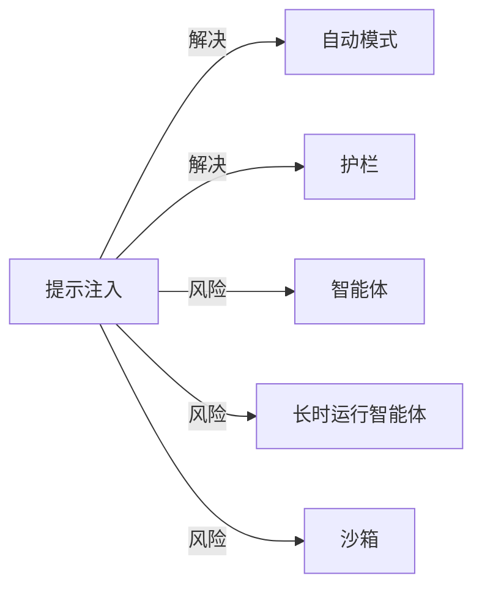

# 提示注入

> **分类**：安全与治理 ｜ **英文**：Prompt Injection ｜ **出现于 7 篇文章**

## 摘要

提示注入（Prompt Injection）是一种攻击方式：攻击者把恶意指令藏进智能体读取的内容里，诱使智能体偏离用户意图去执行这些指令。它之所以重要，是因为智能体一旦获得执行命令、修改文件、访问外部系统的能力，被注入的指令就可能直接变成真实操作，而自动模式、沙箱、护栏等机制正是围绕这一风险设计的。

## 关键做法

- 不要把“跳过权限检查”当作提速手段：完全绕过权限虽然零维护，但提示注入、范围漂移以及偶尔被删除的生产资源正是这样溜进来的。
- 用自动模式替代人工逐条审批：在内部评估中，分类器发现的危险操作比开发者手动点击权限提示时发现的还要多，并且在第三方红队测试下表现稳健。
- 对长时运行、无人值守的智能体保持警惕：这类智能体在后台按计划运行，可能在无人察觉的情况下失去对某个来源的访问权限，或无法遵循既定偏好。
- 把风险变得可理解、有边界，而不是追求零风险：安全负责人的职责是有意识地接受能够管理的风险，避免因一味说“不”而产生没有遥测、没有关闭开关的影子采用。
- 为智能体行为保留监控与审查流程：审查、监控等安全流程需要与加快的节奏同步扩展，否则它本身就会成为瓶颈。

## 在 Claude 里的用法

在 Claude Code 中，默认会在执行命令或修改文件前请求批准，但长期大量点击“批准”会导致审批疲劳，人们不再认真看自己批准了什么；自动模式用分类器判断危险操作，在保持安全的同时减少中断。Claude Code 还提供内置沙箱来隔离工具，以及 `--dangerously-skip-permissions` 标志（禁用所有权限提示，大多数情况下并不安全）。在 Claude Platform 上，Managed Agents 代表用户运行长时程智能体，这类长时间无人值守的运行场景需要把提示注入纳入风险考量。

## 常见误区

- 认为“人工逐条批准”就等于安全：审批疲劳会让用户不再关注自己批准的内容，实际防护效果会下降。
- 认为沙箱可以一劳永逸：沙箱安全但维护成本高，每项新能力都需要配置，任何需要网络或主机访问的操作都会破坏隔离。
- 认为禁用权限提示只是效率选项：它同时移除了对提示注入等风险的防护。

## 相关概念

- [自动模式](自动模式.md) —— 用于在速度与安全之间取得平衡，缓解提示注入等风险带来的权衡。
- [护栏](护栏.md) —— 用于约束智能体行为、降低被注入指令造成实际损害的手段。
- [智能体](智能体.md) —— 提示注入的主要作用对象，因为智能体能够把指令转化为真实操作。
- [长时运行智能体](长时运行智能体.md) —— 长时间无人监督地运行，使注入内容更难被及时发现。
- [沙箱](沙箱.md) —— 通过隔离工具来限制危险操作，是应对注入风险的防护层之一。

## 知识图谱（Knowledge Graph）

## 来源（Sources）

| # | 文章 | 原文 |
| --- | --- | --- |
| 1 | [在生产环境中运行自动模式](../docs/zh/articles/auto-mode-in-production.md) | [原文](https://claude.com/resources/articles/auto-mode-in-production) |
| 2 | [构建高效的智能体自动化](../docs/zh/articles/building-effective-agent-automations.md) | [原文](https://claude.dev/blog/building-effective-agent-automations/) |
| 3 | [零风险不是目标：CISO 的智能体式 AI 指南](../docs/zh/articles/ciso-guide-to-agentic-ai.md) | [原文](https://claude.com/resources/articles/ciso-guide-to-agentic-ai) |
| 4 | [我们如何构建 Claude Code 自动模式：一种更安全的跳过权限方式](../docs/zh/articles/claude-code-auto-mode.md) | [原文](https://www.anthropic.com/engineering/claude-code-auto-mode) |
| 5 | [Anthropic 如何保障其 AI 原生软件开发生命周期的安全](../docs/zh/articles/how-anthropic-secures-its-ai-native-software-development-lifecycle.md) | [原文](https://claude.com/resources/articles/how-anthropic-secures-its-ai-native-software-development-lifecycle) |
| 6 | [Outtake 如何在 Claude 上构建网络调查员](../docs/zh/articles/how-outtake-built-a-cyber-investigator-on-claude.md) | [原文](https://claude.com/resources/articles/how-outtake-built-a-cyber-investigator-on-claude) |
| 7 | [扩展 Managed Agents：将大脑与双手解耦](../docs/zh/articles/managed-agents.md) | [原文](https://www.anthropic.com/engineering/managed-agents) |
