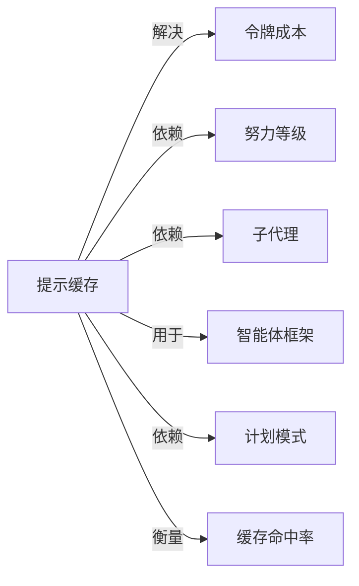

# 提示缓存

> **分类**：成本与性能 ｜ **英文**：prompt caching ｜ **出现于 11 篇文章**

## 摘要

提示缓存（prompt caching）是一种跨请求复用已处理内容的机制：Claude 在生成回复前会先把提示词处理成内部工作状态（prefill），提示缓存保存这份状态（KV 缓存），当后续请求以相同前缀开始时直接读回，而不重新计算。它是长时运行的智能体式产品（如 Claude Code）得以可行的基础，能显著降低延迟与输入成本，并让订阅方案给出更宽松的速率限制。

## 关键做法

- 让尽可能多的请求共享同一个前缀：提示缓存通过前缀匹配工作，API 缓存从请求开头到每个 `cache_control` 断点之间的全部内容，因此内容的排列顺序极其重要。
- 保证前缀逐字节一致：缓存读取要求提示词在整个跨度上完全一致，任何细微改动都会导致缓存失效。
- 在任务之间运行 `/clear`，避免把先前无关的上下文重新发送给模型，减少 token 用量并保护缓存前缀。
- 在会话开始前就设定好模型和努力等级，中途更改其中任何一项都可能破坏提示词缓存、增加 token 成本。
- 注意缓存的生存时间（TTL）：提示缓存约一小时后过期，在对话仍被缓存时进行总结（如离开前运行 `/compact`）要便宜得多。
- 记住缓存固定绑定到特定模型，切换模型即意味着无法复用原有缓存。

## 在 Claude 里的用法

在 Claude Code 中，整个执行框架（harness）都是围绕提示缓存构建的，团队对缓存命中率设置告警，过低即宣布 SEV。在 Claude 平台上，最大化提示缓存命中率被列为降低成本的三大修正之一，相关指导已写入 `claude-api` skill，可配合 Claude Code 使用。此外，最新的 Claude 模型能够响应 effort 调节而不破坏提示缓存，使得在会话中调整努力等级成为可行的成本手段。

## 常见误区

- 认为缓存会自动生效：实际上只有前缀逐字节一致、且在同一模型下才能命中，随意调整提示词顺序或中途换模型都会让缓存失效。
- 把缓存当作永久存储：提示缓存有有限的生存时间，过期后需重新计算。
- 只关注单价而忽略命中率：缓存读取的计费仅为完整输入价格的一小部分，命中率高低才是成本差异的关键。

## 相关概念

- [令牌成本](令牌成本.md) —— 提示缓存通过复用 prefill 计算直接降低输入侧的令牌成本。
- [努力等级](努力等级.md) —— 努力等级可调节而不破坏提示缓存，二者共同决定会话的成本与效果。
- [缓存命中率](缓存命中率.md) —— 衡量提示缓存是否被有效利用的核心指标，Claude Code 对其设置告警。
- [Claude Code](Claude-Code.md) —— 其整个执行框架围绕提示缓存构建，是启用该机制的代表性产品。
- [Claude 平台](Claude-平台.md) —— 将最大化提示缓存命中率列为降本增效的三项修正之一。

## 知识图谱（Knowledge Graph）

## 来源（Sources）

| # | 文章 | 原文 |
| --- | --- | --- |
| 1 | [Claude 成本可见性与控制指南](../docs/zh/articles/a-guide-to-cost-visibility-and-control-in-claude.md) | [原文](https://claude.com/resources/articles/a-guide-to-cost-visibility-and-control-in-claude) |
| 2 | [使用 Claude Sonnet 5.5 构建](../docs/zh/articles/building-with-claude-sonnet-5-5.md) | [原文](https://claude.dev/blog/building-with-claude-sonnet-5-5/) |
| 3 | [编码会话变得更长、使用更多上下文。Claude Opus 5.5 正是为此而生。](../docs/zh/articles/claude-opus-5-5-built-for-coding-sessions-that-use-more-context.md) | [原文](https://claude.com/resources/articles/claude-opus-5-5-built-for-coding-sessions-that-use-more-context) |
| 4 | [智能体执行框架设计：驾驭 Claude 智能的 3 种模式](../docs/zh/articles/harnessing-claudes-intelligence.md) | [原文](https://claude.com/resources/articles/harnessing-claudes-intelligence) |
| 5 | [构建 Claude Code 的经验：提示词缓存就是一切](../docs/zh/articles/lessons-from-building-claude-code-prompt-caching-is-everything.md) | [原文](https://claude.dev/blog/lessons-from-building-claude-code-prompt-caching-is-everything/) |
| 6 | [最大化你的 Claude Code 会话价值](../docs/zh/articles/maximizing-the-value-of-your-claude-code-sessions.md) | [原文](https://claude.com/resources/articles/maximizing-the-value-of-your-claude-code-sessions) |
| 7 | [使用 Claude Platform 降低成本并提升性能](../docs/zh/articles/reducing-cost-and-improving-performance-with-claude-platform.md) | [原文](https://claude.com/resources/articles/reducing-cost-and-improving-performance-with-claude-platform) |
| 8 | [使用 Claude Code：花好你的 effort](../docs/zh/articles/spending-your-effort.md) | [原文](https://claude.dev/blog/spending-your-effort/) |
| 9 | [有效电商智能体的解剖学指南](../docs/zh/articles/the-anatomy-of-effective-commerce-agents.md) | [原文](https://claude.com/resources/articles/the-anatomy-of-effective-commerce-agents) |
| 10 | [该用哪个 Claude 模型来构建？](../docs/zh/articles/which-claude-model-should-you-build-with.md) | [原文](https://claude.dev/blog/which-claude-model-should-you-build-with/) |

## 反向链接（Backlinks）

- [单任务成本](单任务成本.md)
- [智能体框架](智能体框架.md)
- [计划模式](计划模式.md)
