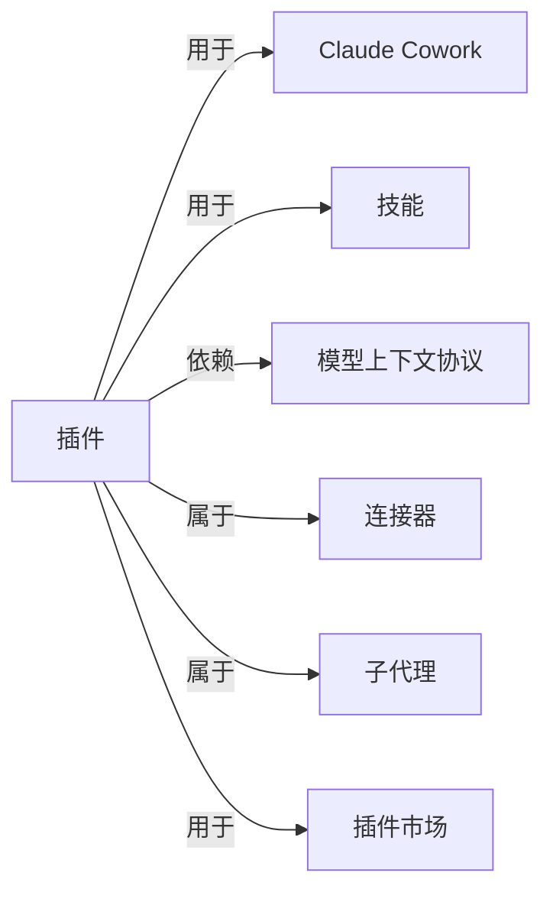

# 插件

> **分类**：工具与扩展 ｜ **英文**：Plugins ｜ **出现于 10 篇文章**

## 摘要

插件（Plugins）是 Claude 中一种可安装的定制单元，把 Skills、连接器、斜杠命令与子代理打包在一起，让 Claude 按你期望的方式完成工作。它的价值在于把“行之有效的方案”从个人小圈子变成团队可复制的标准配置：新成员安装插件后即可获得与他人一致的上下文与能力。

## 关键做法

- 先定义工作方式再打包：在插件中一次性写明希望工作如何完成、从哪些工具和数据源取信息、如何处理关键工作流，以及开放哪些斜杠命令。
- 按职能组织领域知识：每个插件应携带与该职能实际运作方式相关的领域专业知识、预期输出质量和工流模式，而非零散提示词。
- 用插件分发成熟方案：把 Skills、钩子和 MCP 配置打包成一个可安装的包，新工程师第一天安装即可获得与现有使用者相同的上下文和能力。
- 通过托管市场统一分发与更新：组织可在托管市场中管理插件，使插件更新在整个组织范围内同步。
- 渐进式构建：在大型代码库中，插件是建立在 CLAUDE.md、钩子、Skills 之上的扩展层，团队应按层次顺序逐层搭建。
- 先小范围验证再推广：可先在一个业务部门试用插件，确认效果后再广泛推广。

## 在 Claude 里的用法

在 Claude Cowork 中，插件是核心的定制手段：你设定目标，插件告诉 Claude 工作方式、数据来源与可用命令，团队共享后 Claude 会跨职能地复用这些上下文。Claude for Excel 和 PowerPoint 加载项可直接使用已设置的 Skills，入门 Skills 也可通过 Financial Analysis 插件获取并自动安装到两个加载项中。Anthropic 已发布五个面向财务的插件及合作伙伴构建的插件，均可在公共仓库获取；法律行业则有 12 个预构建的执业领域插件。在 Claude Code 中，插件以 `.claude-plugin/plugin.json` 清单形式存在，并可承载随插件分发的钩子（mod）。

## 常见误区

- 把插件当成单纯的提示词集合：插件还包含连接器、命令、子代理与钩子等可执行组件，打包分发才是其关键价值。
- 认为插件只服务个人：插件的主要意义在于团队与组织级的一致性和可复制性，需配合托管市场分发。
- 忽视层次依赖：插件建立在 CLAUDE.md、钩子、Skills 等更基础的扩展点之上，跳过底层直接做插件效果有限。

## 相关概念

- [Claude Cowork](Claude-Cowork.md) —— 插件的主要使用场景，用于定制 Cowork 的工作方式与工作流。
- [技能](技能.md) —— 插件打包的核心内容之一，插件让 Skills 可被安装与共享。
- [模型上下文协议](模型上下文协议.md) —— 插件依赖的配置项之一，MCP 配置可随插件一起分发。
- [连接器](连接器.md) —— 属于插件的组成部分，为插件提供工具与数据源接入。
- [子代理](子代理.md) —— 属于插件的组成部分，与 Skills、命令一同被打包。
- [插件市场](插件市场.md) —— 用于在组织内分发与更新插件的托管渠道。

## 知识图谱（Knowledge Graph）

## 来源（Sources）

| # | 文章 | 原文 |
| --- | --- | --- |
| 1 | [Claude for Excel 与 PowerPoint 能力进阶](../docs/zh/articles/claude-excel-powerpoint-updates.md) | [原文](https://claude.com/resources/articles/claude-excel-powerpoint-updates) |
| 2 | [面向财务的 Cowork 与插件](../docs/zh/articles/cowork-plugins-finance.md) | [原文](https://claude.com/resources/articles/cowork-plugins-finance) |
| 3 | [用插件定制 Cowork](../docs/zh/articles/cowork-plugins.md) | [原文](https://claude.com/resources/articles/cowork-plugins) |
| 4 | [在法律行业部署 Claude](../docs/zh/articles/deploying-claude-across-the-legal-industry.md) | [原文](https://claude.com/resources/articles/deploying-claude-across-the-legal-industry) |
| 5 | [Claude Code mods 入门](../docs/zh/articles/getting-started-with-claude-code-mods.md) | [原文](https://claude.dev/blog/getting-started-with-claude-code-mods/) |
| 6 | [Anthropic 的财务团队如何用 Claude 塑造数字背后的叙事](../docs/zh/articles/how-anthropics-finance-team-uses-claude-to-shape-the-narrative-behind-the-numbers.md) | [原文](https://claude.com/resources/articles/how-anthropics-finance-team-uses-claude-to-shape-the-narrative-behind-the-numbers) |
| 7 | [Claude Code 在大型代码库中如何运作：最佳实践与入门指南](../docs/zh/articles/how-claude-code-works-in-large-codebases-best-practices-and-where-to-start.md) | [原文](https://claude.com/resources/articles/how-claude-code-works-in-large-codebases-best-practices-and-where-to-start) |
| 8 | [使用 Claude Cowork 在整个企业范围内部署智能体式 AI](../docs/zh/articles/new-guide-deploying-claude-across-the-enterprise-with-claude-cowork.md) | [原文](https://claude.com/resources/articles/new-guide-deploying-claude-across-the-enterprise-with-claude-cowork) |
| 9 | [Claude Cowork 产品指南](../docs/zh/articles/the-claude-cowork-product-guide.md) | [原文](https://claude.com/resources/articles/the-claude-cowork-product-guide) |
| 10 | [Claude Cowork 产品指南](../docs/zh/guides/claude-cowork-product-guide.md) | [原文](https://claude.com/resources/guides/claude-cowork-product-guide) |
