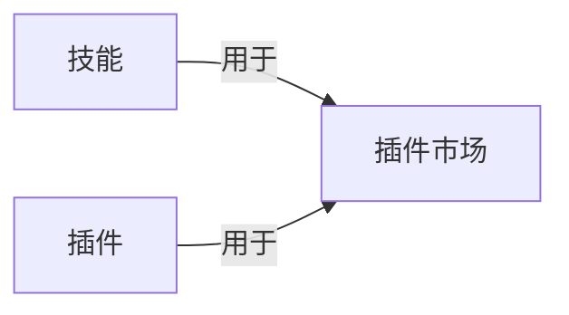

# 插件市场

> **分类**：工具与扩展 ｜ **英文**：Plugin Marketplace ｜ **出现于 3 篇文章**

## 摘要

插件市场（Plugin Marketplace）是集中浏览、安装与分发插件的渠道。它让团队不必把每项配置都塞进仓库，而是按需选择并安装插件，从而在规模扩大时仍能一致地分发 Skills、命令与工作流上下文。

## 关键做法

- 把可复用的能力（Skills、斜杠命令、钩子等）打包成插件，通过插件市场分发，而不是让每个成员各自复制配置。
- 小团队、仓库数量少时，可先把 Skills 检入 `./.claude/skills`；当规模扩大、检入的 Skill 给模型上下文带来负担时，再转向内部插件市场。
- 在市场中提供设置流程，让团队成员自行决定安装哪些插件，而不是强制统一安装。
- 在插件中一次性定义工作方式、数据来源与命令，Claude 会在相关场景自动取用这些上下文。

## 在 Claude 里的用法

在 Cowork 中，插件可把 Claude 连接到 CRM、知识库等工具，并教会它团队的工作流程与斜杠命令；团队构建并共享插件后，Claude 会成为跨职能专家。在 Claude Code 中，可以搭建内部插件市场供用户上传和安装插件，mod 也以随插件分发的钩子形式提供。具体配置可参考 Claude Code 的插件市场文档。

## 常见误区

- 认为所有团队都应一开始就上插件市场：仓库少的小团队直接检入 Skills 往往更简单。
- 把插件市场只当作安装入口：它同时是分发上下文与统一团队工作方式的机制。

## 相关概念

- [技能](技能.md) —— Skills 可通过插件市场分发，让团队自行选择安装哪些。
- [插件](插件.md) —— 插件市场是浏览、安装与分发插件的渠道。

## 知识图谱（Knowledge Graph）

## 来源（Sources）

| # | 文章 | 原文 |
| --- | --- | --- |
| 1 | [用插件定制 Cowork](../docs/zh/articles/cowork-plugins.md) | [原文](https://claude.com/resources/articles/cowork-plugins) |
| 2 | [Claude Code mods 入门](../docs/zh/articles/getting-started-with-claude-code-mods.md) | [原文](https://claude.dev/blog/getting-started-with-claude-code-mods/) |
| 3 | [构建 Claude Code 的经验：我们如何使用 Skills](../docs/zh/articles/lessons-from-building-claude-code-how-we-use-skills.md) | [原文](https://claude.dev/blog/lessons-from-building-claude-code-how-we-use-skills/) |
