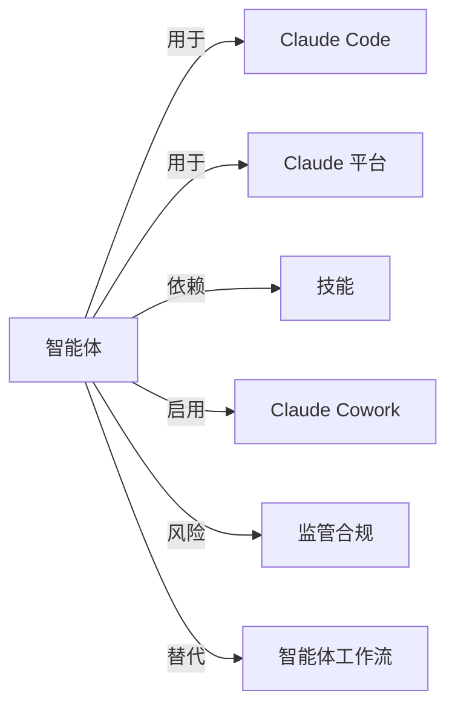

# 智能体

> **分类**：智能体架构 ｜ **英文**：AI Agent ｜ **出现于 18 篇文章**

## 摘要

智能体（AI Agent）是能自主规划、调用工具并执行多步任务的 AI 系统。它把 AI 从"需要持续人工指导的工具"推进为"可自主管理业务流程、由人类在环监督的执行者"，因而成为初创公司、企业与受监管行业提升效率的核心手段。

## 关键做法

- 把智能体嵌入真实工作方式，而不是当作外挂工具：将机构知识编码进能随时间累积的系统，让成效持续叠加，避免部署停滞。
- 按任务结构选择工作流模式：顺序式适合有明确依赖的分阶段任务，并行式适合相互独立的任务，评估器-优化器适合需要迭代改进的输出；单智能体能处理时不要强行拆成顺序步骤。
- 用 MCP 连接第三方工具、用 Skills 教会 Claude 如何用好这些工具，从而构建遵循团队工作流的智能体，而非需要不断纠正的通用流程。
- 保留人在回路的判断与专业能力，在压缩信息密集型流程的同时不牺牲监督与专业判断。
- 让智能体风险"可理解、有边界"：既不一律说不（会催生无遥测、无关闭开关的影子采用），也不无管控地说是，而是有意识地接受可管理的风险。
- 从明确的第一个用例和试点起步，再按分阶段路线图推广到全组织。

## 在 Claude 里的用法

在 Claude Code 中可以用智能体执行多步编码与工具调用任务；Claude Cowork 把同类能力带到桌面端，覆盖本地文件与文件夹、Slack、Google Drive 等已连接应用以及浏览器，并可配合 Claude for Excel 和 Claude for PowerPoint 在单个工作流中跨表格与幻灯片传递上下文。借助插件、Skills 和命令，Claude 能进一步适配团队的工作环境。企业还可参考 Claude Cowork 的采用成熟度模型与六个月部署框架，从内部推动者团队走向全组织部署。

## 常见误区

- 认为智能体只是更快的生成式 AI：真正的转变在于从依赖持续人工输入，转向能推理问题、规划多步骤方案并执行任务的自主系统。
- 为了"更严谨"把任务强行塞进顺序步骤：当任务并不自然契合该结构时，只会增加不必要的复杂度。
- 把安全目标定为零风险：CISO 的职责是让智能体风险可理解、有边界，而非追求零风险。

## 相关概念

- [Claude Code](Claude-Code.md) —— 智能体执行多步编码与工具调用任务的主要产品形态。
- [Claude Cowork](Claude-Cowork.md) —— 把智能体能力带到桌面端与已连接应用，使智能体在组织内大规模启用。
- [技能](技能.md) —— 智能体依赖 Skills 学会按团队工作流使用工具。
- [智能体工作流](智能体工作流.md) —— 顺序式、并行式、评估器-优化器等模式，是智能体落地时的常见替代与组织方式。
- [人在回路](人在回路.md) —— 智能体自主执行所依赖的监督与判断机制。

## 知识图谱（Knowledge Graph）

## 来源（Sources）

| # | 文章 | 原文 |
| --- | --- | --- |
| 1 | [为初创公司构建 AI 智能体](../docs/zh/articles/building-ai-agents-for-startups.md) | [原文](https://claude.com/resources/articles/building-ai-agents-for-startups) |
| 2 | [为企业构建 AI 智能体](../docs/zh/articles/building-ai-agents-for-the-enterprise.md) | [原文](https://claude.com/resources/articles/building-ai-agents-for-the-enterprise) |
| 3 | [为金融服务构建 AI 智能体](../docs/zh/articles/building-ai-agents-in-financial-services.md) | [原文](https://claude.com/resources/articles/building-ai-agents-in-financial-services) |
| 4 | [为医疗健康与生命科学构建 AI 智能体](../docs/zh/articles/building-ai-agents-in-healthcare-and-life-sciences.md) | [原文](https://claude.com/resources/articles/building-ai-agents-in-healthcare-and-life-sciences) |
| 5 | [零风险不是目标：CISO 的智能体式 AI 指南](../docs/zh/articles/ciso-guide-to-agentic-ai.md) | [原文](https://claude.com/resources/articles/ciso-guide-to-agentic-ai) |
| 6 | [AI 智能体的常见工作流模式——以及何时使用它们](../docs/zh/articles/common-workflow-patterns-for-ai-agents-and-when-to-use-them.md) | [原文](https://claude.com/resources/articles/common-workflow-patterns-for-ai-agents-and-when-to-use-them) |
| 7 | [通过 Skills 和 MCP 服务器扩展 Claude 的能力](../docs/zh/articles/extending-claude-capabilities-with-skills-mcp-servers.md) | [原文](https://claude.com/resources/articles/extending-claude-capabilities-with-skills-mcp-servers) |
| 8 | [使用 Claude Cowork 在整个企业范围内部署智能体式 AI](../docs/zh/articles/new-guide-deploying-claude-across-the-enterprise-with-claude-cowork.md) | [原文](https://claude.com/resources/articles/new-guide-deploying-claude-across-the-enterprise-with-claude-cowork) |
| 9 | [像对待新开发者一样上手 Claude Code：来自 17 年开发经验的启示](../docs/zh/articles/onboarding-claude-code-like-a-new-developer-lessons-from-17-years-of-development.md) | [原文](https://claude.com/resources/articles/onboarding-claude-code-like-a-new-developer-lessons-from-17-years-of-development) |
| 10 | [在前沿工作：Cursor 如何判断 Claude Fable 5 已准备好应对最难的 1% 问题](../docs/zh/articles/working-at-the-frontier-cursor.md) | [原文](https://claude.com/resources/articles/working-at-the-frontier-cursor) |

## 反向链接（Backlinks）

- [Claude Tag](Claude-Tag.md)
- [Claude 平台](Claude-平台.md)
- [代码现代化](代码现代化.md)
- [企业AI转型](企业AI转型.md)
- [提示注入](提示注入.md)
- [监管合规](监管合规.md)
- [评估](评估.md)
- [长时运行智能体](长时运行智能体.md)
