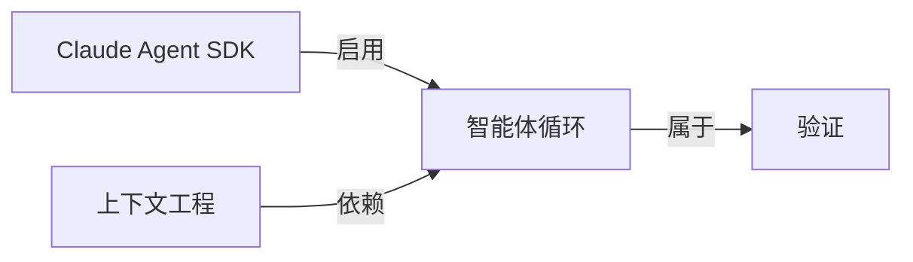

# 智能体循环

> **分类**：智能体架构 ｜ **英文**：Agent Loop ｜ **出现于 6 篇文章**

## 摘要

智能体循环（Agent Loop）是智能体反复“收集上下文 → 采取行动 → 验证结果”直至任务完成的核心推理机制。它决定了智能体下一步做什么，是把模型能力转化为可靠自主工作的关键结构；Anthropic 内部几乎所有主要智能体循环都由 Claude Code 驱动。

## 关键做法

- 把循环拆成四层来设计：智能体循环（核心推理系统）、智能体运行时（代码与文件系统等执行环境）、MCP 服务器（连接外部工具与数据源）、Skills 库（领域与程序性知识）。
- 让循环具备自我评估能力：智能体应检查并改进自身输出，在错误累积之前发现错误，在偏离时自我纠正。
- 为循环设定明确的触发方式与停止条件，例如由用户提示词触发、由 Claude 判断任务完成或需要更多上下文时停止。
- 从最简单的方案开始，并非所有任务都需要复杂循环，只在确有需要时选用更复杂的循环模式。
- 把验证步骤编码为 SKILL.md，让 Claude 能端到端地检查更多自己的工作，从而减少轮次与 token 用量。
- 多次走完循环后回头审视输出，尤其是失败案例，判断智能体是否拥有完成任务的合适工具。

## 在 Claude 里的用法

在 Claude Code 中，智能体循环是最基本的运行方式：Claude 围绕目标推理、探索上下文、通过工具采取行动、通过 Skills 学习流程，并观察结果直到目标达成。Claude Agent SDK 通过评估智能体自己的工作来完成循环，使智能体更可靠。在更复杂的场景中，可以由一个编排器向子智能体发出命令，子智能体并行执行并汇总结果。若想减少循环轮次，可用 Skills 改进验证步骤，并在 Skills、钩子（hooks）和子智能体之间做合适选择。

## 常见误区

- 认为所有任务都需要复杂循环：应当从最简单的方案开始，有选择地使用各种循环模式。
- 只关注循环能否跑通而忽略验证：缺乏自我检查的循环会让错误不断累积，可靠性显著下降。
- 忽视用量管理：循环轮次直接关系到 token 消耗，需要通过具体提示词与 Skills 验证来控制。

## 相关概念

- [Claude Agent SDK](Claude-Agent-SDK.md) —— 通过评估智能体工作来实现智能体循环，是启用循环的主要开发途径。
- [上下文工程](上下文工程.md) —— 循环每一步都依赖对上下文的收集与组织。
- [验证](验证.md) —— 验证是智能体循环的组成部分，决定循环能否收敛到正确结果。

## 知识图谱（Knowledge Graph）

## 来源（Sources）

| # | 文章 | 原文 |
| --- | --- | --- |
| 1 | [用 Skills 构建智能体：为智能体装备专业化工作能力](../docs/zh/articles/building-agents-with-skills-equipping-agents-for-specialized-work.md) | [原文](https://claude.com/resources/articles/building-agents-with-skills-equipping-agents-for-specialized-work) |
| 2 | [使用 Claude Agent SDK 构建智能体](../docs/zh/articles/building-agents-with-the-claude-agent-sdk.md) | [原文](https://claude.com/resources/articles/building-agents-with-the-claude-agent-sdk) |
| 3 | [在 Claude Code 中用 Skills 构建验证循环](../docs/zh/articles/building-verification-loops-in-claude-code-with-skills.md) | [原文](https://claude.com/resources/articles/building-verification-loops-in-claude-code-with-skills) |
| 4 | [循环工程：循环入门](../docs/zh/articles/getting-started-with-loops.md) | [原文](https://claude.com/resources/articles/getting-started-with-loops) |
| 5 | [Anthropic 的网络安全团队如何用 Claude Code 构建威胁检测平台](../docs/zh/articles/how-anthropic-uses-claude-cybersecurity.md) | [原文](https://claude.com/resources/articles/how-anthropic-uses-claude-cybersecurity) |
| 6 | [有效电商智能体的解剖学指南](../docs/zh/articles/the-anatomy-of-effective-commerce-agents.md) | [原文](https://claude.com/resources/articles/the-anatomy-of-effective-commerce-agents) |
