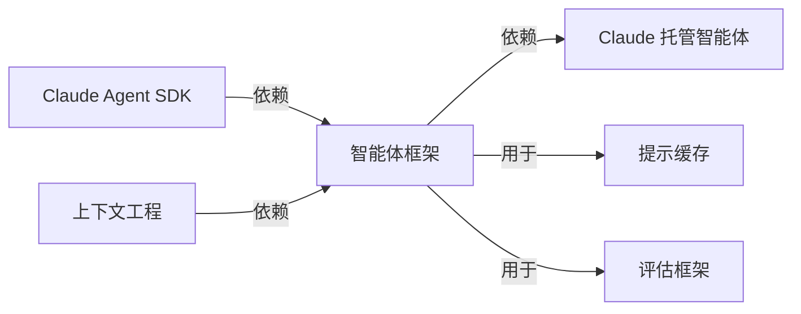

# 智能体框架

> **分类**：智能体架构 ｜ **英文**：agent harness ｜ **出现于 5 篇文章**

## 摘要

智能体框架（agent harness）是围绕模型的一层软件脚手架，包含循环、工具执行、上下文管理与护栏，把模型的原始智能转化为可工作的智能体。它之所以重要，是因为原型与生产级智能体之间的分水岭往往不在提示词，而在执行框架与配套基础设施；同时框架中编码的“Claude 无法独立完成什么”的假设会随模型能力提升而过时，需要持续审视与精简。

## 关键做法

- 把框架视为对模型能力假设的显式编码：明确哪些环节由脚手架补足（如循环控制、工具调用、上下文重置），并定期质疑这些假设是否仍然成立。
- 随模型升级重新验证框架组件：例如为缓解“上下文焦虑”加入的上下文重置，在更强模型上可能已无必要，反而成为累赘，应及时移除。
- 将长时程任务分解为可处理的块，并用结构化产物在会话之间传递上下文，避免单次会话承载过多状态。
- 对主观或难以验证的输出，先制定可评分的标准，再据此构建评估器，把“好不好”转化为具体维度。
- 把安全、状态管理、权限控制与执行框架调优交给可组合的托管能力，减少在基础设施上消耗的开发周期。

## 在 Claude 里的用法

在 Claude Platform 中，Claude Managed Agents 提供为性能调优的智能体执行框架与生产基础设施的配对，通过一小组持久接口代表你运行长时程智能体。开发者也可以基于 Claude Agent SDK 自行搭建框架，并用评估框架在开发阶段验证智能体行为。框架设计中的上下文管理部分可与提示缓存配合，降低重复上下文的成本。

## 常见误区

- 认为好提示词就足以投产：智能体还需要运行代码的环境、访问数据的凭据、可观测的会话与可扩展的基础设施。
- 把某一版框架当作长期方案：框架中的假设会随模型进步而过时，需要持续演进甚至删除组件。
- 只在上线后才发现问题：缺少评估会让团队陷入被动修复循环，问题应在影响用户前可见。

## 相关概念

- [Claude Agent SDK](Claude-Agent-SDK.md) —— 自行构建框架时的开发依托。
- [Claude 托管智能体](Claude-托管智能体.md) —— 托管服务把执行框架与生产基础设施一并提供，是框架的托管化形态。
- [上下文工程](上下文工程.md) —— 框架依赖上下文工程来管理会话中的信息组织与传递。
- [提示缓存](提示缓存.md) —— 用于降低框架中重复上下文带来的开销。
- [评估框架](评估框架.md) —— 用于在开发阶段衡量框架与智能体行为是否达标。

## 知识图谱（Knowledge Graph）

## 来源（Sources）

| # | 文章 | 原文 |
| --- | --- | --- |
| 1 | [智能体界面的演进：使用 Claude Managed Agents 构建](../docs/zh/articles/building-with-claude-managed-agents.md) | [原文](https://claude.com/resources/articles/building-with-claude-managed-agents) |
| 2 | [揭开 AI 智能体评估的面纱](../docs/zh/articles/demystifying-evals-for-ai-agents.md) | [原文](https://www.anthropic.com/engineering/demystifying-evals-for-ai-agents) |
| 3 | [面向长时程应用开发的执行框架设计](../docs/zh/articles/harness-design-long-running-apps.md) | [原文](https://www.anthropic.com/engineering/harness-design-long-running-apps) |
| 4 | [智能体执行框架设计：驾驭 Claude 智能的 3 种模式](../docs/zh/articles/harnessing-claudes-intelligence.md) | [原文](https://claude.com/resources/articles/harnessing-claudes-intelligence) |
| 5 | [扩展 Managed Agents：将大脑与双手解耦](../docs/zh/articles/managed-agents.md) | [原文](https://www.anthropic.com/engineering/managed-agents) |
