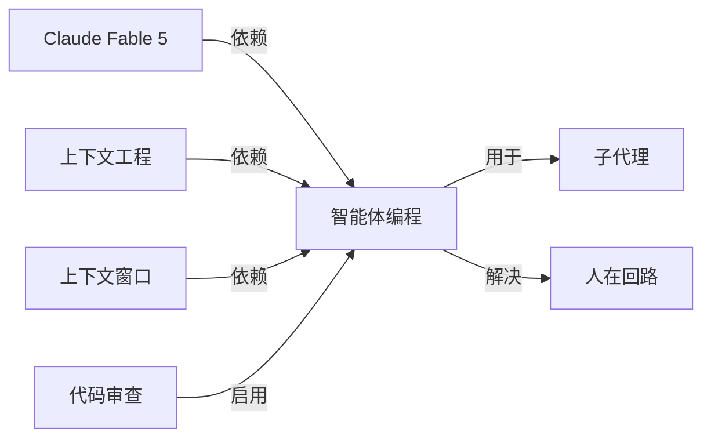

# 智能体编程

> **分类**：Claude Code 与编程 ｜ **英文**：Agentic Coding ｜ **出现于 15 篇文章**

## 摘要

智能体编程（Agentic Coding）是一种由 AI 智能体自主完成编码、审查与测试的开发范式：开发者给出目标，智能体自行规划、修改代码、运行测试并迭代。它之所以重要，是因为它把开发周期从数周压缩到数小时，并让非技术背景的成员也能直接参与构建，但同时显著放大了 CI 负载与上下文消耗。

## 关键做法

- 以 Claude Code 作为主要执行环境，让智能体在终端中直接读写代码库、运行命令并交付改动，而不是只在对话里给建议。
- 根据任务性质选择部署形态：更自主、异步、单用户轮次的智能体适合批量任务；更交互、同步、多轮次的智能体适合需要持续对齐的复杂改动，两者的 token 用量与行为差异明显。
- 为智能体准备项目级上下文（如 CLAUDE.md），让它能自行识别相关文件、理解依赖关系，减少人工指路。
- 把测试纳入智能体的闭环：让智能体自己运行测试、定位失败原因并修复，而不是只依赖错误信息指向的症状。
- 对高敏感操作保留人在回路，例如删除数据库表这类不可逆动作，不应让智能体在无人监督下执行。
- 预期并提前规划规模效应：智能体带来的代码量与测试量增长会迅速传导到 CI，需要相应扩容或优化测试影响分析等基础设施。

## 在 Claude 里的用法

在 Claude Code 中，智能体编程体现为开发者从终端发起任务，Claude 自主读取代码库、编辑文件、运行测试并提交 PR，Opus 4.7 等模型还大幅增强了发现 bug 与代码审查的能力。团队可以结合子代理拆分复杂工作流，用 Skills 与工具服务器扩展智能体能力，并通过自动模式在自主性与监督之间取得平衡。Anthropic 内部团队与多家初创公司的实践表明，这一范式已覆盖调试、代码库浏览、工作流自动化乃至非工程角色的构建需求。

## 常见误区

- 认为智能体编程只是"更快的补全"：实际上它改变了谁能构建、什么该被舍弃，非技术成员也能直接交付产品。
- 忽视基础设施的连带成本：代码量与测试量成倍增长会让 CI 与测试影响分析服务迅速成为瓶颈，临时修补往往只能撑很短时间。
- 默认智能体可以完全无人监督：对敏感或不可逆操作，仍需保留人在回路。

## 相关概念

- [子代理](子代理.md) —— 属于智能体编程的组成部分，用于把复杂工作流拆分为可并行或专门化的智能体。
- [Claude Fable 5](Claude-Fable-5.md) —— 被「Claude Fable 5」依赖
- [上下文工程](上下文工程.md) —— 被「上下文工程」依赖
- [上下文窗口](上下文窗口.md) —— 智能体编程所依赖的资源，长会话与高上下文会直接影响成本与连贯性。
- [人在回路](人在回路.md) —— 用于解决智能体自主执行敏感操作时的风险，保留人工审批环节。
- [代码审查](代码审查.md) —— 由「代码审查」启用
- [代码现代化](代码现代化.md) —— 被「代码现代化」使用

## 知识图谱（Knowledge Graph）

## 来源（Sources）

| # | 文章 | 原文 |
| --- | --- | --- |
| 1 | [智能体式编码正在给 CI 带来压力。我们如何在 Anthropic 扩展测试影响分析](../docs/zh/articles/agentic-coding-is-straining-ci-heres-how-we-scaled-test-impact-analysis-at-anthropic.md) | [原文](https://claude.com/resources/articles/agentic-coding-is-straining-ci-heres-how-we-scaled-test-impact-analysis-at-anthropic) |
| 2 | [在 Claude Code 中使用 Claude Opus 4.7 的最佳实践](../docs/zh/articles/best-practices-for-using-claude-opus-4-7-with-claude-code.md) | [原文](https://claude.com/resources/articles/best-practices-for-using-claude-opus-4-7-with-claude-code) |
| 3 | [三家 YC 初创公司如何用 Claude Code 打造自己的公司](../docs/zh/articles/building-companies-with-claude-code.md) | [原文](https://claude.com/resources/articles/building-companies-with-claude-code) |
| 4 | [面向初创企业的 Claude Code 指南](../docs/zh/articles/claude-code-guide-for-startups.md) | [原文](https://claude.com/resources/articles/claude-code-guide-for-startups) |
| 5 | [编码会话变得更长、使用更多上下文。Claude Opus 5.5 正是为此而生。](../docs/zh/articles/claude-opus-5-5-built-for-coding-sessions-that-use-more-context.md) | [原文](https://claude.com/resources/articles/claude-opus-5-5-built-for-coding-sessions-that-use-more-context) |
| 6 | [用 Claude 更快修复软件缺陷](../docs/zh/articles/fix-software-bugs-faster-with-claude.md) | [原文](https://claude.com/resources/articles/fix-software-bugs-faster-with-claude) |
| 7 | [Anthropic 各团队如何使用 Claude Code](../docs/zh/articles/how-anthropic-teams-use-claude-code.md) | [原文](https://claude.com/resources/articles/how-anthropic-teams-use-claude-code) |
| 8 | [Brex 如何借助 Claude Code 提升代码质量与生产力](../docs/zh/articles/how-brex-improves-code-quality-and-productivity-with-claude-code.md) | [原文](https://claude.com/resources/articles/how-brex-improves-code-quality-and-productivity-with-claude-code) |
| 9 | [守护前沿：JetBrains 如何评估与部署 Claude Fable 5](../docs/zh/articles/how-jetbrains-evaluates-and-deploys-claude-fable-5.md) | [原文](https://claude.com/resources/articles/how-jetbrains-evaluates-and-deploys-claude-fable-5) |
| 10 | [智能体式编程入门](../docs/zh/articles/introduction-to-agentic-coding.md) | [原文](https://claude.com/resources/articles/introduction-to-agentic-coding) |

## 反向链接（Backlinks）

- [Claude Fable 5](Claude-Fable-5.md)
- [代码审查](代码审查.md)
- [代码现代化](代码现代化.md)
- [技术债务](技术债务.md)
- [提示工程](提示工程.md)
- [自动模式](自动模式.md)
- [调试](调试.md)
