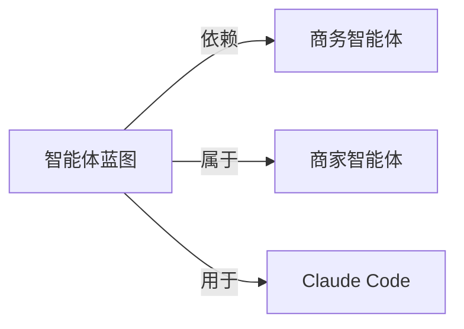

# 智能体蓝图

> **分类**：智能体架构 ｜ **英文**：agent blueprint ｜ **出现于 2 篇文章**

## 摘要

智能体蓝图（agent blueprint）是 Claude 官方提供的一套可复用智能体参考实现，包含执行框架（harness）、模式与护栏，用于帮助工程团队在数天内把商务类智能体跑起来。它的价值在于把“从零搭建智能体”变成“基于经过验证的脚手架与护栏做定制”，并给出零售、旅游、电信、票务等场景的现成参考实现。

## 关键做法

- 以蓝图自带的执行框架（harness）为起点，而不是自行设计智能体循环与工具调用骨架，缩短从原型到可运行的时间。
- 直接复用蓝图中的模式与护栏，把安全边界、交互约束等通用问题交给官方参考实现处理。
- 按行业选择最接近的参考实现（购物智能体或商家智能体），在其基础上改造，而非从通用模板重新推导业务逻辑。
- 借助随蓝图提供的 Claude Code 插件快速上手，减少初始配置与样板代码的工作量。
- 部署时沿用已有的 Claude 构建环境（Claude API、Amazon Bedrock、Microsoft Foundry、Google Cloud Vertex AI），避免为蓝图另建一套基础设施。

## 在 Claude 里的用法

在 Claude 上构建商务智能体时，可直接采用这套蓝图：它提供面向零售、旅游、电信和票务平台的购物智能体与商家智能体参考实现，并附带一个 Claude Code 插件帮助快速起步。代码可部署在 Claude API、Amazon Bedrock、Microsoft Foundry 或 Google Cloud Vertex AI 等你已在使用的环境中。也可与解决方案和生态合作伙伴（如 Accenture、Mastercard、Visa）合作，借助蓝图服务客户与商家社区。

## 常见误区

- 把蓝图当成开箱即用的成品：它提供的是执行框架、模式、护栏与参考实现，仍需工程团队按自身业务做适配。
- 认为蓝图绑定单一部署环境：资料明确其代码可部署在 Claude API、Amazon Bedrock、Microsoft Foundry、Google Cloud Vertex AI 等多种环境。

## 相关概念

- [商务智能体](商务智能体.md) —— 蓝图正是为在 Claude 上构建商务智能体而推出，二者是依赖关系。
- [商家智能体](商家智能体.md) —— 商家智能体是蓝图所提供的参考实现之一，属于蓝图覆盖的范围。
- [Claude Code](Claude-Code.md) —— 蓝图附带一个 Claude Code 插件，用于帮助开发者快速上手。

## 知识图谱（Knowledge Graph）

## 来源（Sources）

| # | 文章 | 原文 |
| --- | --- | --- |
| 1 | [使用 Claude 构建商务智能体](../docs/zh/articles/claude-for-commerce-agents.md) | [原文](https://claude.com/resources/articles/claude-for-commerce-agents) |
| 2 | [构建 Claude 商业智能体](../docs/zh/webinars/building-claude-commerce-agents.md) | [原文](https://claude.com/resources/webinars/building-claude-commerce-agents) |
