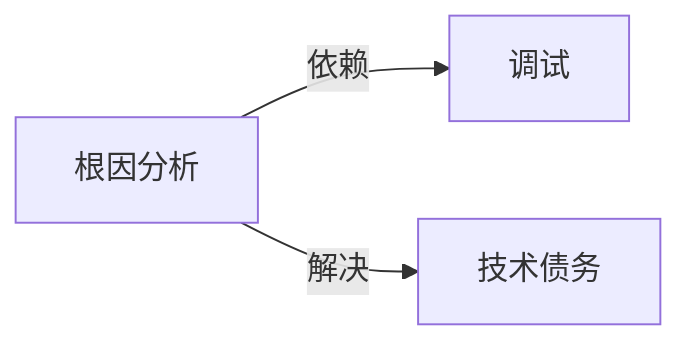

# 根因分析

> **分类**：Claude Code 与编程 ｜ **英文**：root cause analysis ｜ **出现于 2 篇文章**

## 摘要

根因分析（Root Cause Analysis）是一种追溯问题根本原因、而非仅修复表象的调试方法。它之所以重要，是因为错误信息和堆栈跟踪通常只显示代码在*哪里*失败，而不解释*为什么*失败；跳过根因分析直接修补表象，往往把 20 分钟能修好的问题拖成数小时的调查，并留下隐患。

## 关键做法

- 先区分症状与原因：把错误信息、堆栈跟踪视为线索而非结论，追问"为什么这条校验规则被触发""外部服务返回了什么"。
- 在动手修复前先做根因分析：明确要求自己（或智能体）不要进入"猜测加试错"模式，先定位原因再改代码。
- 补齐日志之外的业务上下文：生产日志量大且需要领域知识才能解析，应结合业务语义做关联分析，而不是只翻日志。
- 沿依赖与历史改动追溯：真正的问题可能藏在早已被遗忘的依赖里，或来自几个冲刺之前的代码。
- 把根因分析的流程固化为可复用的技能/清单，并在调查缺陷、失败或异常行为时始终启用。

## 在 Claude 里的用法

在 Claude Code 中，可以把根因分析写成 Skills（技能），例如一个 `debugging` 技能，其描述写明"在调查缺陷、失败或异常行为时始终加载"，从而在 Claude 尝试任何修复之前先推动它做根因分析。Skills 支持手动或自动触发，可为关键技能设置明确的触发条件。这样能把 Claude 从"猜测加试错"模式中拉出来，让调试过程更接近有经验的开发者的调查方式。

## 常见误区

- 把错误信息指向的位置当作根因：堆栈跟踪只说明失败发生在哪里，不说明原因。
- 用"加更多日志 + 本地复现"代替根因分析：这些方法有效但很慢，容易把短问题拖成长调查。
- 直接让智能体开始改代码：未经根因分析的修复只是掩盖表象。

## 相关概念

- [调试](调试.md) —— 根因分析是调试过程中的核心环节，调试依赖根因分析来避免只修表象。
- [技术债务](技术债务.md) —— 跳过根因分析的快速修补会累积隐患，根因分析是减少此类技术债务的手段。

## 知识图谱（Knowledge Graph）

## 来源（Sources）

| # | 文章 | 原文 |
| --- | --- | --- |
| 1 | [用 Claude 更快修复软件缺陷](../docs/zh/articles/fix-software-bugs-faster-with-claude.md) | [原文](https://claude.com/resources/articles/fix-software-bugs-faster-with-claude) |
| 2 | [像对待新开发者一样上手 Claude Code：来自 17 年开发经验的启示](../docs/zh/articles/onboarding-claude-code-like-a-new-developer-lessons-from-17-years-of-development.md) | [原文](https://claude.com/resources/articles/onboarding-claude-code-like-a-new-developer-lessons-from-17-years-of-development) |
