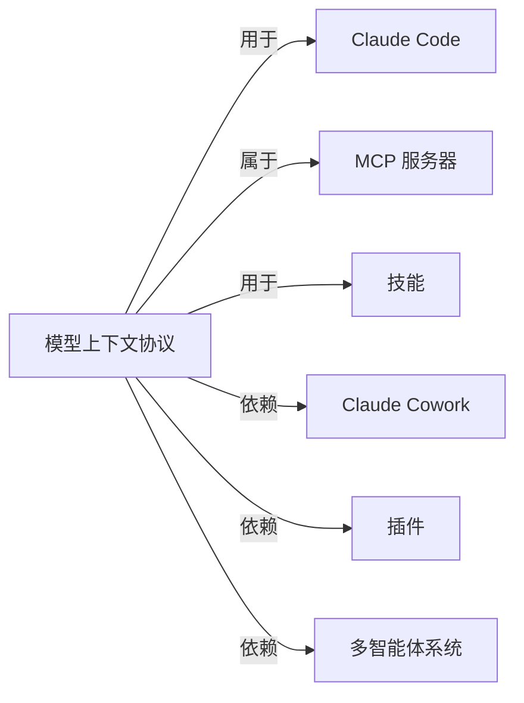

# 模型上下文协议

> **分类**：工具与扩展 ｜ **英文**：MCP ｜ **出现于 31 篇文章**

## 摘要

模型上下文协议（MCP）是一个开放协议，用于标准化地把智能体连接到外部工具与数据源。它之所以重要，是因为智能体的价值取决于它能触达哪些系统，而 MCP 提供了智能体与服务之间的公共层，使集成可以跨智能体平台复用，并已成为智能体连接的事实标准。

## 关键做法

- 在决定连接方式前，先区分三种路径：直接调用 API、CLI 和 MCP。单个智能体对接单个服务、或少量不需复用的集成，直接调用 API 即可。
- 当集成需要跨智能体平台复用、或智能体与服务之间需要一层公共层时，选择 MCP，这也是生产环境智能体常见的收敛方向。
- 把 MCP 视为连接层而非能力层：它解决“能触达什么系统”，专业工作流与最佳实践应另行以 Skills 等形式打包给智能体。
- 构建集成时关注公共层能覆盖多远，这决定了同一套连接能否被多个智能体与多个场景复用。

## 在 Claude 里的用法

在 Claude Code 中，MCP 被用于把编程智能体连接到外部工具与数据源；Claude Cowork、插件与多智能体系统也依赖 MCP 完成对外部系统的连接。配合 Skills，智能体既能通过 MCP 触达系统，又能获得处理真实工作所需的领域专业知识。在 Claude 平台上构建智能体时，可优先评估 MCP 作为与外部服务对接的标准化方式。

## 常见误区

- 认为所有集成都应上 MCP：对于单个智能体对接单个服务、且不需跨平台复用的场景，直接调用 API 往往更简单。
- 把 MCP 当成专业能力的来源：MCP 只负责连接，智能体“知道怎么做”依赖的是 Skills 这类组织化的领域知识。

## 相关概念

- [Claude Code](Claude-Code.md) —— 使用 MCP 连接外部工具与数据源的智能体式编程产品。
- [MCP 服务器](MCP-服务器.md) —— MCP 协议下对外暴露工具与数据源的一端。
- [技能](技能.md) —— 与 MCP 配合使用，为智能体补充领域专业知识与工作流。
- [Claude Cowork](Claude-Cowork.md) —— 依赖 MCP 连接外部系统的协作产品。
- [插件](插件.md) —— 依赖 MCP 扩展能力的载体。

## 知识图谱（Knowledge Graph）

## 来源（Sources）

| # | 文章 | 原文 |
| --- | --- | --- |
| 1 | [Claude 值班：Claude Tag 如何成为 Anthropic 应对 CI/CD 故障的第一响应者](../docs/zh/articles/ai-ci-cd-on-call.md) | [原文](https://claude.com/resources/articles/ai-ci-cd-on-call) |
| 2 | [在生产环境中运行自动模式](../docs/zh/articles/auto-mode-in-production.md) | [原文](https://claude.com/resources/articles/auto-mode-in-production) |
| 3 | [用 MCP 构建触达生产系统的智能体](../docs/zh/articles/building-agents-that-reach-production-systems-with-mcp.md) | [原文](https://claude.com/resources/articles/building-agents-that-reach-production-systems-with-mcp) |
| 4 | [用 Skills 构建智能体：为智能体装备专业化工作能力](../docs/zh/articles/building-agents-with-skills-equipping-agents-for-specialized-work.md) | [原文](https://claude.com/resources/articles/building-agents-with-skills-equipping-agents-for-specialized-work) |
| 5 | [使用 Claude Agent SDK 构建智能体](../docs/zh/articles/building-agents-with-the-claude-agent-sdk.md) | [原文](https://claude.com/resources/articles/building-agents-with-the-claude-agent-sdk) |
| 6 | [为金融服务构建 AI 智能体](../docs/zh/articles/building-ai-agents-in-financial-services.md) | [原文](https://claude.com/resources/articles/building-ai-agents-in-financial-services) |
| 7 | [为医疗健康与生命科学构建 AI 智能体](../docs/zh/articles/building-ai-agents-in-healthcare-and-life-sciences.md) | [原文](https://claude.com/resources/articles/building-ai-agents-in-healthcare-and-life-sciences) |
| 8 | [面向初创企业的 Claude Code 指南](../docs/zh/articles/claude-code-guide-for-startups.md) | [原文](https://claude.com/resources/articles/claude-code-guide-for-startups) |
| 9 | [Claude for Excel 与 PowerPoint 能力进阶](../docs/zh/articles/claude-excel-powerpoint-updates.md) | [原文](https://claude.com/resources/articles/claude-excel-powerpoint-updates) |
| 10 | [面向法律行业的 Claude](../docs/zh/articles/claude-for-the-legal-industry.md) | [原文](https://claude.com/resources/articles/claude-for-the-legal-industry) |

## 反向链接（Backlinks）

- [多智能体系统](多智能体系统.md)
- [工作流自动化](工作流自动化.md)
- [沙箱](沙箱.md)
- [金融服务](金融服务.md)
