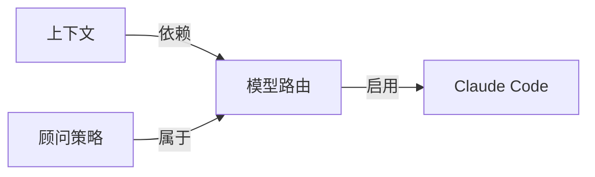

# 模型路由

> **分类**：成本与性能 ｜ **英文**：Model Routing ｜ **出现于 5 篇文章**

## 摘要

模型路由（Model Routing）是按任务复杂度把请求分派给不同能力层级模型的策略，核心是让模型能力与工作难度相匹配。它之所以重要，是因为用错层级两个方向都会浪费：把复杂推理交给便宜模型会因重试和人工纠正而更贵，把前沿模型用于基础处理则是为用不到的能力付费。

## 关键做法

- 先判断任务性质：它是需要判断与推理的困难任务，还是仅仅任务量大、步骤简单的重复工作；后者适合更小的模型。
- 常规任务选择较小的模型，更复杂或更模糊的任务选择较大的模型。
- 把 effort 级别与模型选择分开考虑：模型决定能力范围，effort 决定 Claude 读取多少文件、使用多少工具、执行多少步骤。
- 先从各模型的默认 effort 级别开始，按工作类型调出一个通用偏好，而不是逐个任务调整。
- 用失败模式判断该往哪调：若 Claude 已掌握上下文、明确尝试过仍出错，说明该换更强模型；若出错源于漏读文件、没跑测试或中途放弃，则提高 effort 级别。
- 在生成昂贵产出之前先做结构化规划，因为代码生成越便宜，走错方向的代价就越高。

## 在 Claude 里的用法

在 Claude Code 中，模型设置与 effort 级别是两个看似都能「让答案更好」的旋钮，需要配合使用而非混为一谈。选择 Claude 模型即选择一组固定的权重，能力范围随之确定；effort 则控制 Claude 针对请求整体做多少工作。配合 `/context` 查看 CLAUDE.md 与 MCP 服务器在每一轮中增加的启动上下文，避免为用不到的上下文付费，从而让路由决策真正体现在成本上。

## 常见误区

- 认为更大的模型一定比小模型输出更聪明、更高的 effort 一定更好——两者作用不同，需按任务类型匹配。
- 把复杂推理交给更便宜的模型以省钱，结果在重试 token 和人工纠正上花得更多。
- 把前沿模型用于基础文档处理，为任务根本用不到的能力付费。

## 相关概念

- [Claude Code](Claude-Code.md) —— 提供模型设置与 effort 级别两个旋钮、可实际启用路由的产品环境。
- [上下文](上下文.md) —— 路由依赖的前提，模型是否已掌握相关上下文决定该换模型还是加 effort。
- [顾问策略](顾问策略.md) —— 模型路由的一种具体形态，按需把困难判断交给更高能力层级。

## 知识图谱（Knowledge Graph）

## 来源（Sources）

| # | 文章 | 原文 |
| --- | --- | --- |
| 1 | [Claude 成本可见性与控制指南](../docs/zh/articles/a-guide-to-cost-visibility-and-control-in-claude.md) | [原文](https://claude.com/resources/articles/a-guide-to-cost-visibility-and-control-in-claude) |
| 2 | [在 Claude Code 中选择 Claude 模型与 effort 级别](../docs/zh/articles/claude-model-and-effort-level-in-claude-code.md) | [原文](https://claude.com/resources/articles/claude-model-and-effort-level-in-claude-code) |
| 3 | [CodeRabbit 如何用 Claude 构建智能体编排系统](../docs/zh/articles/how-coderabbit-used-claude-to-build-an-agent-orchestration-system.md) | [原文](https://claude.com/resources/articles/how-coderabbit-used-claude-to-build-an-agent-orchestration-system) |
| 4 | [在前沿工作：Balyasny Asset Management 如何评估与治理 Claude Fable 5](../docs/zh/articles/working-at-the-frontier-how-balyasny-asset-management-evaluates-and-governs-claude-fable-5.md) | [原文](https://claude.com/resources/articles/working-at-the-frontier-how-balyasny-asset-management-evaluates-and-governs-claude-fable-5) |
| 5 | [最大化 Claude Code 的价值](../docs/zh/webinars/claude-code-maximizing-value.md) | [原文](https://claude.com/resources/webinars/claude-code-maximizing-value) |
