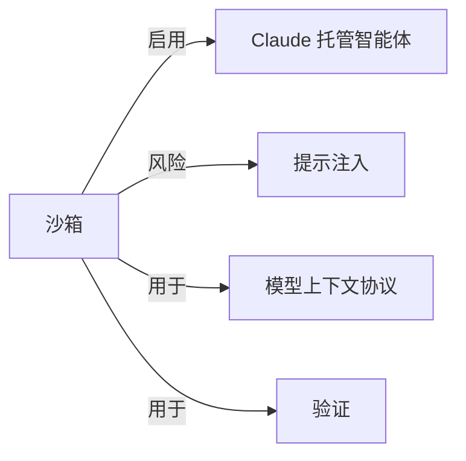

# 沙箱

> **分类**：安全与治理 ｜ **英文**：Sandbox ｜ **出现于 4 篇文章**

## 摘要

沙箱（Sandbox）是隔离运行智能体生成代码与工具调用的执行环境，用来把"执行"与"决策"分开，避免危险操作直接影响主机、凭据或生产系统。随着智能体运行更久、执行更多代码、触及更多系统，沙箱化成为大规模部署智能体时扩展性与安全性的关键前提。

## 关键做法

- 把"大脑"与"双手"解耦：让调用 Claude 的 harness 与执行代码的沙箱分开运行，中间用仅追加的会话日志连接，使各部分可独立失败或被替换。
- 以环境为单位定义沙箱：在 Managed Agents 中，环境包含沙箱容器、网络规则和预装软件包，可托管在云端或自控基础设施上；每次会话获得独立的沙箱实例。
- 按需收紧网络：仅在搭建阶段开放网络以拉取依赖、构建、安装工具并跑通测试，随后对环境做快照并移除网络访问，扫描期间只允许发往模型 API 的流量。
- 用快照保证可复现：每次运行从同一干净快照启动，使结果可比、可追踪。
- 把沙箱作为验证手段：在隔离环境中确认漏洞是否真的可利用，而不是只依赖模型的判断。
- 权衡维护成本：沙箱安全但每项新能力都需配置，任何需要网络或主机访问的操作都会破坏隔离，需与权限提示等机制配合使用。

## 在 Claude 里的用法

在 Claude Managed Agents 中，沙箱是"环境"资源的核心组成，与智能体配置、会话一起构成三种主要资源；会话在服务端持久化沙箱状态与输出，长任务可暂停并干净恢复。Claude Code 提供内置沙箱来隔离工具、防止危险操作，作为权限提示疲劳的一种替代方案。在代码安全扫描流程中，沙箱用于隔离智能体并验证漏洞可利用性。

## 常见误区

- 认为跳过权限提示就等于安全：`--dangerously-skip-permissions` 零维护但没有任何保护，与沙箱是两种不同的权衡。
- 认为沙箱配置一次即可：每项新能力都需要额外配置，需要网络或主机访问的操作会破坏隔离，维护成本真实存在。
- 把沙箱与凭据放在一起：解耦的意义正在于让沙箱与你的凭据保持距离。

## 相关概念

- [Claude 托管智能体](Claude-托管智能体.md) —— 沙箱是其"环境"资源的核心，使智能体可大规模安全部署。
- [提示注入](提示注入.md) —— 沙箱隔离执行环境，是降低此类风险影响面的手段之一。
- [模型上下文协议](模型上下文协议.md) —— 工具调用经由沙箱执行，二者在智能体执行链路中配合。
- [验证](验证.md) —— 沙箱为独立确认发现是否可利用提供隔离环境。

## 知识图谱（Knowledge Graph）

## 来源（Sources）

| # | 文章 | 原文 |
| --- | --- | --- |
| 1 | [智能体界面的演进：使用 Claude Managed Agents 构建](../docs/zh/articles/building-with-claude-managed-agents.md) | [原文](https://claude.com/resources/articles/building-with-claude-managed-agents) |
| 2 | [我们如何构建 Claude Code 自动模式：一种更安全的跳过权限方式](../docs/zh/articles/claude-code-auto-mode.md) | [原文](https://www.anthropic.com/engineering/claude-code-auto-mode) |
| 3 | [扩展 Managed Agents：将大脑与双手解耦](../docs/zh/articles/managed-agents.md) | [原文](https://www.anthropic.com/engineering/managed-agents) |
| 4 | [使用 LLM 保护源代码安全](../docs/zh/articles/using-llms-to-secure-source-code.md) | [原文](https://claude.com/resources/articles/using-llms-to-secure-source-code) |
