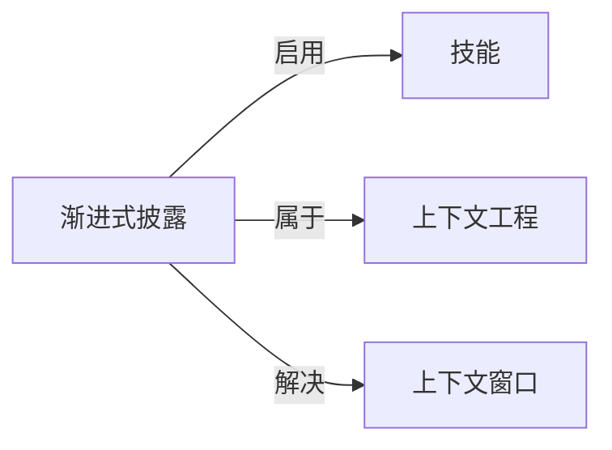

# 渐进式披露

> **分类**：上下文工程 ｜ **英文**：Progressive Disclosure ｜ **出现于 9 篇文章**

## 摘要

渐进式披露（Progressive Disclosure）是一种上下文工程策略：不把全部信息一次性塞进上下文，而是先只暴露简短的元数据或描述，等任务确实需要时再逐层加载完整内容。它之所以重要，是因为它同时解决了两个问题——节省令牌、避免上下文膨胀，并让智能体在保持主上下文窗口干净的同时，仍能按需获得深度信息。

## 关键做法

- **先给元数据，后给正文**：在运行时只把名称与描述（如 YAML frontmatter 中的元数据）展示给模型，完整指令在判定相关后才加载。
- **把大块内容拆成可引用的文件**：将详细的函数签名、用法示例等拆分到 `references/api.md` 之类的独立文件，主文件只负责指向它们，让 Claude 在适当时机自行读取。
- **把整个文件系统当作披露层**：Skill 是一个文件夹而非单个 Markdown 文件，告诉 Claude 里面有哪些文件，本身就是一种渐进式披露。
- **保持 Skill 小巧**：好的 Skill 文件并不大，靠分层引用而非堆砌内容来承载复杂度。
- **对工具同样适用**：不只 Skills，工具也可以通过工具搜索渐进式披露——智能体先看到工具的简短描述，需要时才完整加载。
- **用披露替代拆分**：渐进式披露让单一智能体能够承担多种任务，无需把所有上下文立即写进冗长的系统提示词，从而消除了过去把工作拆给子智能体的主要理由。

## 在 Claude 里的用法

在 Claude Code 与 Agent Skills 中，渐进式披露已被正式化为核心机制：Claude 遇到任务时先扫描可用 Skills 的元数据（约 100 token）判断相关性，匹配后加载完整指令（<5k token），捆绑的文件或脚本仅在需要时加载。构建 Skill 时应把主文件写精简，把细节放进被引用的参考文件。此外，通过工具搜索披露工具描述、以及精简系统提示词（Claude Code 面向更高级模型的系统提示词已缩减 80% 以上），也都是同一思路的应用。

## 常见误区

- **以为披露等于不给信息**：披露只是延后加载，信息仍然可及；问题在于一次性全量加载会造成上下文膨胀。
- **只给链接就够了**：仅提供一个指向文档的链接让 Claude 自行加载并搜索，会导致它把大段文档拉进上下文，只为找一个本可一句话回答的答案。
- **把 Skill 写成一个大文件**：把所有细节堆进主文件违背了披露原则，正确做法是保持主文件精简并引用详细实现文件。

## 相关概念

- [技能](技能.md) —— 渐进式披露最主要的落地载体，Skills 依靠元数据先行、指令后载的机制工作。
- [上下文工程](上下文工程.md) —— 渐进式披露属于上下文工程的一种具体手法，用于管理进入上下文的内容与时机。
- [上下文窗口](上下文窗口.md) —— 渐进式披露正是为解决上下文窗口被过早占满、上下文膨胀的问题而存在。

## 知识图谱（Knowledge Graph）

## 来源（Sources）

| # | 文章 | 原文 |
| --- | --- | --- |
| 1 | [构建智能体：何时将子智能体折叠进主智能体循环](../docs/zh/articles/building-agents-when-to-fold-subagents-into-your-main-agent-loop.md) | [原文](https://claude.com/resources/articles/building-agents-when-to-fold-subagents-into-your-main-agent-loop) |
| 2 | [用 Skills 构建智能体：为智能体装备专业化工作能力](../docs/zh/articles/building-agents-with-skills-equipping-agents-for-specialized-work.md) | [原文](https://claude.com/resources/articles/building-agents-with-skills-equipping-agents-for-specialized-work) |
| 3 | [通过 Skills 和 MCP 服务器扩展 Claude 的能力](../docs/zh/articles/extending-claude-capabilities-with-skills-mcp-servers.md) | [原文](https://claude.com/resources/articles/extending-claude-capabilities-with-skills-mcp-servers) |
| 4 | [如何创建 Skills：关键步骤、限制与示例](../docs/zh/articles/how-to-create-skills-key-steps-limitations-and-examples.md) | [原文](https://claude.com/resources/articles/how-to-create-skills-key-steps-limitations-and-examples) |
| 5 | [Warp 如何在 Claude 上构建自我改进的智能体](../docs/zh/articles/how-warp-builds-self-improving-agents-on-claude.md) | [原文](https://claude.com/resources/articles/how-warp-builds-self-improving-agents-on-claude) |
| 6 | [构建 Claude Code 的经验：我们如何使用 Skills](../docs/zh/articles/lessons-from-building-claude-code-how-we-use-skills.md) | [原文](https://claude.dev/blog/lessons-from-building-claude-code-how-we-use-skills/) |
| 7 | [像智能体一样观察：我们如何在 Claude Code 中设计工具](../docs/zh/articles/seeing-like-an-agent.md) | [原文](https://claude.dev/blog/seeing-like-an-agent/) |
| 8 | [Skills 详解：Skills 与提示词、Projects、MCP 和子智能体的对比](../docs/zh/articles/skills-explained.md) | [原文](https://claude.com/resources/articles/skills-explained) |
| 9 | [Claude 5 代模型的上下文工程新规则](../docs/zh/articles/the-new-rules-of-context-engineering-for-claude-5-generation-models.md) | [原文](https://claude.dev/blog/the-new-rules-of-context-engineering-for-claude-5-generation-models/) |
