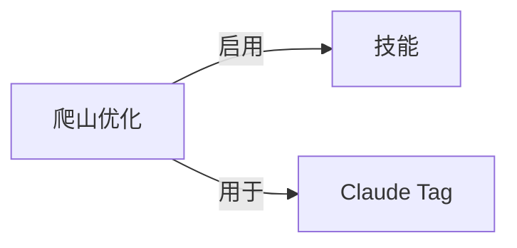

# 爬山优化

> **分类**：成本与性能 ｜ **英文**：Hill Climbing ｜ **出现于 2 篇文章**

## 摘要

爬山优化（Hill Climbing）是一种围绕单一可量化指标持续迭代改进的方法：先建立可靠的评分手段，再小步调整参数、保留有效改动、丢弃无效改动，如此反复。它之所以重要，是因为它把"改进"变成可度量的循环，特别适合在成本与性能之间做权衡，例如调整 effort 或提示词等参数。

## 关键做法

- 先确保评分可靠：让 Claude 对同一输出运行评分器两次并报告判定是否变化，避免把评分噪声当成真实改进。
- 排除基础设施噪声：检查超时、API 错误和答案截断，确保这些因素不会被误判为模型方差。
- 关注基线余量：若基线已接近 95% 或更高，应把爬山优化的目标转向探索成本或延迟，而非继续追求质量。
- 明确优化对象：爬山优化适合调整 effort、提示词等在成本与性能之间权衡的参数。
- 小步迭代、持续验证：每次只做有限改动，依据评分结果决定保留或回退，形成稳定的改进循环。

## 在 Claude 里的用法

在 Claude Code 中配合 `claude-api` skill，可以按上述原则完成评估设计与爬山优化：先建立评分器与噪声检查，再针对参数做迭代调整。在更大规模的工程实践中，Claude Tag（beta）可承担发现瓶颈、构建基准测试、发布改进并监控部署的循环，人则负责设定目标、做出权衡和批准变更。

## 常见误区

- 在评分器本身不稳定时就启动优化，把评分波动误读为模型改进。
- 忽视超时、API 错误与答案截断等基础设施问题，导致噪声被当作信号。
- 基线已接近满分仍一味追求质量分数，而忽略成本与延迟这类更值得优化的维度。

## 相关概念

- [技能](技能.md) —— 爬山优化的原则通过 `claude-api` skill 在 Claude Code 中落地启用。
- [Claude Tag](Claude-Tag.md) —— 用于承载大规模自动化改进循环，发现瓶颈、构建基准并监控每次部署。

## 知识图谱（Knowledge Graph）

## 来源（Sources）

| # | 文章 | 原文 |
| --- | --- | --- |
| 1 | [用 Claude 自动化评估设计与爬山优化](../docs/zh/articles/automating-eval-design-and-hillclimbing.md) | [原文](https://claude.dev/blog/automating-eval-design-and-hillclimbing/) |
| 2 | [我们如何在两周内让 claude.ai 提速 3 倍](../docs/zh/articles/how-we-made-claude-ai-faster.md) | [原文](https://claude.dev/blog/how-we-made-claude-ai-faster/) |
